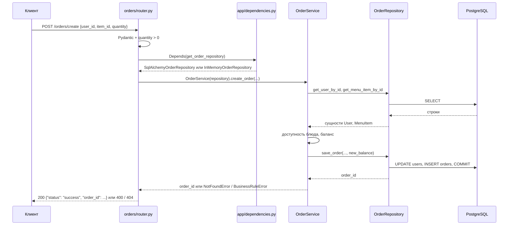

# Сириус.Еда: рефакторинг MVP в Clean Architecture

Лабораторная работа № 2. Все четыре модуля (`orders`, `users`, `menu`, `delivery`)
переведены из MVP-стиля в трёхслойную архитектуру. Внешнее поведение API не изменилось.

## Запуск

```bash
python3 -m venv .venv
source .venv/bin/activate
pip install -r requirements.txt -r requirements-dev.txt

docker-compose up -d db redis
uvicorn app.main:app --reload
```

Swagger: http://127.0.0.1:8000/docs

Запуск без PostgreSQL, на in-memory репозиториях:

```bash
REPOSITORY_BACKEND=memory uvicorn app.main:app --reload
```

Тесты. СУБД не нужна:

```bash
pytest
```

## Что изменилось

До рефакторинга каждый `router.py` содержал HTTP-обработку, бизнес-проверки и SQL-запросы.
Теперь каждый модуль разделён на три файла:

| Файл | Слой | Круг модели Мартина | Что делает |
|---|---|---|---|
| `router.py` | API Layer | 4. Frameworks & Drivers | Pydantic, техническая валидация, сборка слоёв, перевод исключений в HTTP-статусы |
| `service.py` | Business Logic Layer | 1–2. Entities и Use Cases | Бизнес-правила сценария. Нет импортов `fastapi` и `sqlalchemy` |
| `repository.py` | Infrastructure Layer | 3. Interface Adapters | Абстрактный репозиторий (ABC) и две реализации: SQLAlchemy и in-memory |

Общие файлы:

| Файл | Назначение |
|---|---|
| `app/domain/entities.py` | Доменные сущности `User`, `MenuItem`, `Order`, `Delivery` и статусы. Обычные dataclass |
| `app/domain/exceptions.py` | `NotFoundError`, `AccessDeniedError`, `BusinessRuleError`. Наследники `ValueError` |
| `app/http_errors.py` | Отображение исключений в статусы 404, 403, 400 |
| `app/dependencies.py` | Корень композиции. Выбирает реализацию репозиториев по `REPOSITORY_BACKEND` |
| `app/memory_storage.py` | Общее in-memory хранилище для всех модулей |
| `app/models.py` | ORM-модели. Добавлен метод `to_entity()` для перевода строки БД в сущность |

### Разделение проверок

| Проверка | Где | Тип |
|---|---|---|
| Формат email | `schemas.py` (EmailStr) | техническая |
| Длина телефона, `quantity > 0`, `amount > 0`, `price > 0`, длина названия | `router.py` | техническая |
| Уникальность email и названия блюда | `service.py` | бизнес |
| Существование пользователя, блюда, заказа, доставки | `service.py` | бизнес |
| Блюдо доступно, хватает баланса | `OrderService` | бизнес |
| Пользователь не заблокирован, лимит пополнения 50000 | `UserService` | бизнес |
| Заказ оплачен, курьер не занят и не заблокирован | `DeliveryService` | бизнес |
| Статусы при завершении доставки | `DeliveryService` | бизнес |

### Отличия от шаблона из методички

* Сервис бросает не голый `ValueError`, а его наследников. Роутер возвращает те же коды,
  что MVP: 404 для «не найдено», 403 для блокировки, 400 для остального.
  Шаблон отдавал 400 на всё, это меняло бы поведение API.
* Тексты ошибок взяты из MVP, а не из шаблона: «Блюдо не найдено», «Блюдо недоступно».
* Путь эндпоинта остался `/create`. В шаблоне указан `/orders/create`, но роутер
  подключается с префиксом `/orders`, итоговый путь был бы `/orders/orders/create`.
* В шаблоне списание баланса и создание заказа шли двумя коммитами. Здесь это одна
  транзакция в `save_order`, как в MVP. Сбой между ними не спишет деньги без заказа.
* Репозиторий возвращает доменные сущности, а не ORM-объекты. Сервис не зависит от SQLAlchemy
  даже косвенно, через атрибуты моделей.

### Поведение API

Одинаковый сценарий из 26 запросов прогонялся против MVP и против новой версии
на PostgreSQL и на in-memory. Статусы и тела ответов совпали полностью.

Единственное теоретическое расхождение: если в запросе одновременно две ошибки,
техническая и бизнесовая, теперь первой сработает техническая. Пример: занятый email
плюс короткий телефон. MVP вернул бы «email уже зарегистрирован», новая версия вернёт
«Некорректный формат номера телефона». Так и должно быть: техническая валидация
выполняется до обращения к бизнес-логике.

## Путь запроса через слои



Направление зависимостей:

```text
 router.py ──────────────► service.py ──────► domain (entities, exceptions)
     │                         │                     ▲
     │                         ▼                     │
     └──► dependencies.py ──► repository.py ─────────┘
                               ├─ OrderRepository (ABC)      ◄── от него зависит сервис
                               ├─ SqlAlchemyOrderRepository  ──► models.py, SQLAlchemy
                               └─ InMemoryOrderRepository    ──► memory_storage.py
```

Сервис знает только про `OrderRepository`. Какая реализация пришла, решает `dependencies.py`.

## Замена хранилища

Чтобы переключить приложение на другую СУБД, нужно:

1. Написать новый класс, наследник `OrderRepository` (и других ABC).
2. Добавить его в `app/dependencies.py`.

`service.py` и `router.py` не меняются. Это видно на `REPOSITORY_BACKEND=memory`:
приложение работает без PostgreSQL на тех же сервисах и роутерах.
`tests/test_repository_contract.py` гоняет один сценарий на обеих реализациях.

## Тесты

| Файл | Что проверяет |
|---|---|
| `tests/test_order_service.py` | Бизнес-правила заказа. Плюс сервис с фейковым репозиторием без наследования |
| `tests/test_user_service.py` | Регистрация, пополнение, блокировка, лимит |
| `tests/test_menu_service.py` | Уникальность названия, частичное обновление |
| `tests/test_delivery_service.py` | Назначение курьера, завершение доставки |
| `tests/test_repository_contract.py` | Подстановка Лисков: in-memory и SQLAlchemy на SQLite |
| `tests/test_api.py` | HTTP-статусы и структура ответов как в MVP |
| `tests/test_architecture.py` | В `service.py` нет импортов `fastapi`, `sqlalchemy`, `starlette` |

## Ответы на контрольные вопросы

**1. Какому кругу соответствует `repository.py`?**
Третьему, Interface Adapters. Он переводит данные из формата СУБД в формат сущностей
и обратно. Сам по себе он не СУБД и не драйвер, это адаптер между ними и use case.

**2. Почему в `service.py` нельзя импортировать `fastapi` и `sqlalchemy`?**
Правило зависимостей: внутренние круги не знают о внешних. Бизнес-правила не должны
меняться при смене фреймворка или СУБД. Без этих импортов сервис тестируется без
сервера и базы, и его можно вызвать из CLI или Celery.

**3. Где проверять формат email, а где уникальность?**
Формат проверяется в транспортном слое, Pydantic `EmailStr`. Для этого не нужны данные
системы, это корректность входа. Уникальность проверяется в сервисе: это правило
предметной области, ему нужно состояние системы, получаемое через репозиторий.

**4. Что такое DIP и как он реализован?**
Модули верхнего уровня не зависят от нижнего, оба зависят от абстракции.
Здесь `OrderService` получает в конструктор `OrderRepository` (ABC). Конкретный
`SqlAlchemyOrderRepository` или `InMemoryOrderRepository` создаёт `dependencies.py`.

**5. Что изменится при переходе на MongoDB?**
Новый класс-репозиторий для каждого модуля, строки в `app/dependencies.py`,
подключение вместо `database.py` и `models.py`, `requirements.txt`, `docker-compose.yml`.
Не меняются `service.py`, `router.py`, `app/domain`, `schemas.py`.

**6. Можно ли использовать `OrderService` в CLI или Celery?**
Да. Сервис зависит только от репозитория и сущностей. В CLI или задаче Celery
создаём репозиторий, передаём в `OrderService` и вызываем `create_order`.
Исключения `NotFoundError` и `BusinessRuleError` обрабатываются там по-своему, без HTTP.

**7. Техническая и бизнес-валидация.**
Техническая проверяет форму данных без знания о системе: тип, формат, диапазон.
Примеры: `quantity > 0`, email по формату, длина телефона.
Бизнес-валидация проверяет правила предметной области, часто с учётом состояния.
Примеры: хватает ли баланса, доступно ли блюдо, не занят ли курьер.

**8. «`service.py` импортирует `HTTPException` для ошибки 400».**
Нарушает правило зависимостей. Внутренний слой начинает зависеть от внешнего,
веб-фреймворка. Сервис уже нельзя вызвать из CLI или Celery без HTTP-семантики,
а смена фреймворка затронет бизнес-логику. Правильно бросить доменное исключение
и перевести его в статус в роутере.
