# Сириус.Еда

Учебный сервис столовой: студенты заказывают еду, повара готовят, курьеры доставляют.

* Лабораторная работа № 2: модули переведены в Clean Architecture ([раздел ниже](#лабораторная-работа--2-clean-architecture)).
* Лабораторная работа № 3: аутентификация, авторизация, защита от IDOR, вход через Google.
* Лабораторная работа № 4: кеширование меню на Redis, замеры нагрузки.
* Лабораторная работа № 5: PDF, email и SMS в фоне на Celery, ретраи, DLQ, Flower, Celery Beat.
* Лабораторная работа № 6: доставка вынесена в gRPC-микросервис, стрим статусов и чат с курьером.

## Запуск

```bash
python3 -m venv .venv
source .venv/bin/activate
pip install -r requirements.txt -r requirements-dev.txt

cp .env.example .env              # затем задать SECRET_KEY
docker compose up -d db redis     # если порты заняты: DB_PORT=5433 REDIS_PORT=6380 docker compose up -d db redis
alembic upgrade head
python -m app.cli create-user --email admin@sirius.ru --role admin
python -m app.cli seed-menu       # 12 разделов по 25 блюд для нагрузочных замеров
python -m delivery_service          # сервис доставки на gRPC, в отдельном терминале
uvicorn app.main:app --reload
celery -A app.core.celery_app worker --loglevel=info   # фоновые задачи заказов, в отдельном терминале
celery -A app.core.celery_app beat --loglevel=info     # периодические задачи
```

Swagger доступен только при `DEBUG=true`: http://127.0.0.1:8000/docs.
Кнопка Authorize принимает email в поле username и пароль.

База, созданная во время лабораторной № 2 через `create_all`, подключается к Alembic так:

```bash
alembic stamp 0001
alembic upgrade head
```

Существующие пользователи получают роль `student` и не имеют пароля.

Тесты не требуют ни PostgreSQL, ни Redis:

```bash
pytest
```

## Лабораторная работа № 6: доставка в gRPC-микросервис

Выполнено на 10 баллов: модуль `delivery` вынесен в отдельный процесс на gRPC, монолит вызывает его через клиент,
обработаны `UNAVAILABLE` и таймауты, есть Server Streaming `TrackDelivery` и Bidirectional Streaming `ChatWithCourier`.

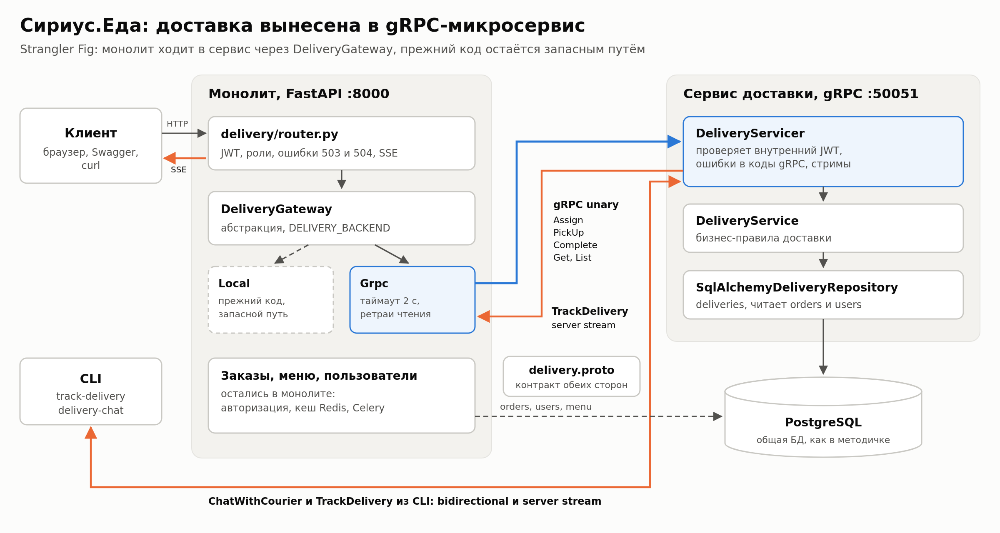

Сводка для защиты: [`docs/lab6/DEFENSE.md`](docs/lab6/DEFENSE.md). Итоги с выводами: [`docs/lab6/result.md`](docs/lab6/result.md).

### Результаты

`GET /delivery/{id}`, 500 последовательных запросов после 20 прогревочных, `scripts/delivery_probe.py`:

| Путь | Медиана | 95-й перцентиль |
|---|---|---|
| HTTP, доставка внутри монолита, `DELIVERY_BACKEND=local` | 9,0 мс | 15,1 мс |
| HTTP, монолит вызывает gRPC-сервис | 12,8 мс | 23,0 мс |
| gRPC напрямую, без монолита | 6,8 мс | 9,4 мс |

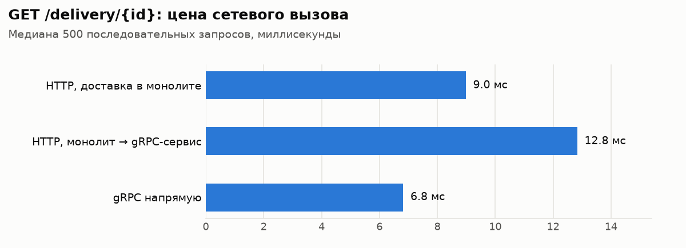

Сетевой вызов добавил около 4 мс. В них входят HTTP/2 до сервиса, выпуск и проверка внутреннего токена
и повторное чтение пользователя из БД. Это цена отдельного процесса: каждая граница сервиса стоит миллисекунды.

Сервис доставки остановлен, монолит работает:

| Запрос | Ответ |
|---|---|
| `POST /delivery/assign` | 503 за 8 мс, `Retry-After: 5` |
| `GET /delivery/4` | 503 за 0,33 с: чтение повторяется 3 раза |
| `GET /delivery/my` | 503 за 0,29 с |
| Тот же `GET` после запуска сервиса | 200 за 63 мс, монолит не перезапускали |

### Как устроено

```text
Клиент ──HTTP──► delivery/router.py ──► DeliveryGateway (ABC)
                                            ├─ GrpcDeliveryGateway ──gRPC :50051──► delivery_service
                                            └─ LocalDeliveryGateway   прежний код в процессе монолита

delivery_service: DeliveryServicer ──► DeliveryService ──► SqlAlchemyDeliveryRepository ──► PostgreSQL
```

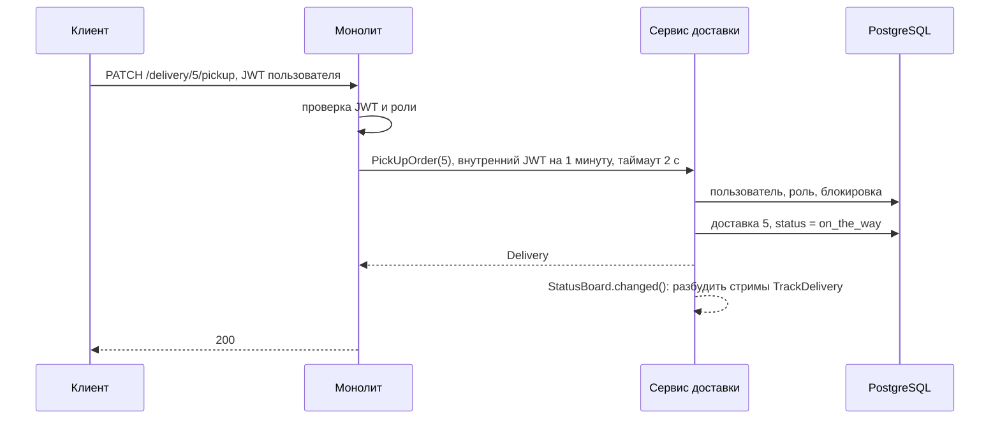

Роутер не знает про gRPC. Он зовёт `DeliveryGateway`, а реализацию выбирает `app/dependencies.py` по `DELIVERY_BACKEND`.
Бизнес-правила остались в `DeliveryService`, его же использует микросервис. `DeliveryServicer` только переводит
сообщения protobuf в вызовы сервиса и доменные ошибки в коды gRPC.

### Что сделано

| Требование | Где |
|---|---|
| Контракт | `proto/delivery.proto`: 5 unary-методов, `TrackDelivery`, `ChatWithCourier` |
| Сгенерированный код | `delivery_pb2.py`, `delivery_pb2_grpc.py`, `delivery_pb2.pyi`, генерация `scripts/gen_proto.sh` |
| gRPC-сервер | пакет `delivery_service`, запуск `python -m delivery_service` |
| Клиент в монолите | `app/modules/delivery/grpc_client.py`, `GrpcDeliveryGateway` |
| Переключатель Strangler Fig | `DELIVERY_BACKEND=grpc\|local`, `app/modules/delivery/gateway.py` |
| `UNAVAILABLE` и таймауты | `to_domain_error` в `grpc_client.py`, `call` в `router.py` |
| Server Streaming | `TrackDelivery`, SSE `GET /delivery/{id}/track`, `python -m app.cli track-delivery` |
| Bidirectional Streaming | `ChatWithCourier`, `python -m app.cli delivery-chat` |
| Новый статус «курьер забрал заказ» | `on_the_way`, `PATCH /delivery/{id}/pickup` |
| Тесты | `tests/test_delivery_grpc.py`, 22 теста на настоящем gRPC-сервере |

### Ошибки

| В сервисе | Код gRPC | В монолите | HTTP |
|---|---|---|---|
| `NotFoundError` | `NOT_FOUND` | `NotFoundError` | 404 |
| `AccessDeniedError` | `PERMISSION_DENIED` | `AccessDeniedError` | 403 |
| другие правила, например заказ не оплачен | `FAILED_PRECONDITION` | `BusinessRuleError` | 400 |
| нет или просрочен внутренний токен | `UNAUTHENTICATED` | `AuthenticationError` | 401 |
| непредвиденное исключение | `INTERNAL`, текст без деталей | `DeliveryUnavailableError` | 503 |
| сервис не запущен | `UNAVAILABLE` | `DeliveryUnavailableError` | 503, `Retry-After: 5` |
| не ответил за 2 с | `DEADLINE_EXCEEDED` | `DeliveryTimeoutError` | 504 |

**Таймаут** у каждого вызова, `DELIVERY_GRPC_TIMEOUT=2`. Без него зависший сервис держал бы поток монолита до разрыва TCP.

**Повторы только для чтения.** `GetDelivery`, `ListMyDeliveries` и `TrackDelivery` повторяются при `UNAVAILABLE`
до 3 раз с растущей паузой от 0,1 с. Повторы заданы в service config канала, а не циклом в коде.
`AssignCourier` и `CompleteDelivery` не повторяются: если ответ потерялся после записи, повтор выполнил бы действие дважды.

**Один канал на процесс.** Канал gRPC держит соединение HTTP/2 и сам переподключается после падения сервиса.
Открывать его на каждый запрос, как в методичке, значит платить за TCP-рукопожатие каждый раз. Канал закрывается при остановке монолита.

**Сервис не верит монолиту на слово.** Монолит передаёт в метаданных `authorization` внутренний JWT
с типом `internal` и сроком 1 минута. Сервис проверяет подпись и читает роль и блокировку пользователя из БД.
Пользовательский токен не подойдёт: у него другой тип. Порт по умолчанию слушает только `127.0.0.1`.

### Стримы

**`TrackDelivery`.** Сервис сразу отдаёт текущий статус, затем каждое изменение, и закрывает стрим на `completed`.
Изменение из этого же процесса будит стрим мгновенно через `StatusBoard`. Раз в 2 секунды стрим перечитывает БД,
чтобы увидеть изменения из других процессов, например из монолита в режиме `local`.

```bash
python -m app.cli track-delivery --delivery-id 5 --user-id 9
curl -N -H "Authorization: Bearer $TOKEN" http://127.0.0.1:8000/delivery/5/track   # тот же стрим как SSE
```

```text
10:51:30  доставка 5: in_progress
10:51:32  доставка 5: on_the_way
10:51:34  доставка 5: completed
```

**`ChatWithCourier`.** Писать могут те, кто видит доставку: заказчик, курьер, администратор.
Первое сообщение подключает к комнате доставки. Каждый участник получает чужие и свои сообщения,
а новый участник ещё и последние 20. Автора и время ставит сервер, подделать их клиент не может.
Чтение входящих идёт в отдельном потоке, ответы отдаёт поток вызова.

```bash
python -m app.cli delivery-chat --delivery-id 5 --user-id 9    # заказчик
python -m app.cli delivery-chat --delivery-id 5 --user-id 60   # курьер, второй терминал
```

```text
[10:51:43] вы: Где мой заказ?
[10:51:45] courier 60: Буду через 5 минут, позвоню в домофон
```

Посторонний получает `Нет доступа к чужой доставке`.

### Как запустить

```bash
docker compose up -d db redis
python -m delivery_service                  # терминал 1, gRPC :50051
uvicorn app.main:app                        # терминал 2, HTTP :8000
DELIVERY_BACKEND=local uvicorn app.main:app # откат на прежний код без сервиса
```

Пересобрать код после правки контракта:

```bash
scripts/gen_proto.sh
```

Повторить замеры:

```bash
PYTHONPATH=. python scripts/delivery_probe.py http http://127.0.0.1:8000 5 9 grpc_http
PYTHONPATH=. python scripts/delivery_probe.py grpc localhost:50051       5 9 grpc_direct
DELIVERY_BACKEND=local uvicorn app.main:app   # затем probe http с меткой local_http
python scripts/plot_delivery.py
```

### Отличия от методички

* **Роутер зовёт абстракцию `DeliveryGateway`**, а не gRPC-клиент. Переключатель `DELIVERY_BACKEND` делает
  Strangler Fig обратимым: при проблемах доставка возвращается в монолит без деплоя кода.
* **Пакет `delivery_service`** вместо одного файла `delivery_server.py`: сервер, servicer и стримы раздельно.
* **Бизнес-правила не скопированы в сервер.** Servicer зовёт тот же `DeliveryService`, что был в монолите.
* **`GetDelivery` принимает `delivery_id`**, как и прежний HTTP-эндпоинт. Добавлены `PickUpOrder` и `ListMyDeliveries`.
* **Код генерируется скриптом**, тест сверяет закоммиченные файлы со свежей генерацией.
* **Один канал на процесс**, повторы только для чтения, внутренний JWT. Причины выше.
* **Статус `on_the_way`.** Без него стриму нечего показывать между назначением и доставкой.
* **SSE-мост** `GET /delivery/{id}/track`: браузер не умеет gRPC, а стрим нужен клиенту.

### Ответы на контрольные вопросы

**1. Зачем выносить delivery в отдельный сервис?**
У доставки свой ритм: курьеры, геолокация, чаты и долгие соединения. Отдельный процесс масштабируется
и деплоится независимо. Падение или нагрузка в доставке не кладёт меню и заказы.
Команда доставки меняет свой сервис, не трогая монолит. Цена: сеть, новые виды отказов, второй процесс в эксплуатации.

**2. Почему gRPC, а не REST?**
Строгий контракт в `.proto`: клиент и сервер генерируются из одного файла, несовместимое изменение видно сразу.
Бинарный protobuf компактнее JSON. HTTP/2 держит одно соединение на много вызовов и даёт стримы в обе стороны,
которые в REST пришлось бы собирать из SSE и WebSocket. Минус: браузер напрямую gRPC не вызовет, нужен мост.

**3. Что будет, если сервис недоступен?**
Вызов падает с `UNAVAILABLE`, при зависании с `DEADLINE_EXCEEDED` через 2 с. Клиент переводит их в
`DeliveryUnavailableError` и `DeliveryTimeoutError`, роутер отвечает 503 с `Retry-After` и 504.
Остальной монолит работает. Чтения повторяются 3 раза, записи нет. Сервис поднялся, канал переподключился сам.

**4. Почему у delivery должна быть своя БД?**
Общая БД связывает сервисы через схему: переименование колонки в `orders` ломает доставку, а деплой
по отдельности перестаёт быть независимым. Здесь сервис читает `orders` и `users` и пишет `orders.status = delivered`,
то есть меняет чужие данные. Транзакции, блокировки и нагрузка тоже общие. В правильной схеме сервис хранит
только `deliveries`, данные о заказе получает в запросе или из событий, а статус заказа меняет монолит по событию.

**5. Чем Server Streaming отличается от Unary?**
Unary: один запрос и один ответ, как `GetDelivery`. Server Streaming: один запрос и поток ответов
по одному соединению, пока сервер его не закроет. `TrackDelivery` отдаёт статус при каждом изменении.
Опрос через unary раз в секунду давал бы задержку и лишние запросы, когда ничего не меняется.

**6. Что такое Strangler Fig?**
Постепенная замена монолита: вырезается один модуль, вызовы перенаправляются в новый сервис,
монолит худеет. Здесь `DeliveryGateway` и есть точка перенаправления. Старая реализация осталась
за `DELIVERY_BACKEND=local`, её удаляют, когда сервис проверен в работе.

**7. Роль gRPC-клиента в монолите.**
Это адаптер к внешней системе, такой же, как репозиторий к БД. Он знает про каналы, stub, коды gRPC и метаданные
и переводит их в доменные сущности и исключения. Поэтому он в инфраструктуре, а роутер и домен про gRPC не знают.
`tests/test_architecture.py` запрещает импорт `grpc` во внутренних слоях. Замена gRPC на что-то другое меняет один файл.

## Лабораторная работа № 5: фоновые задачи на Celery

Выполнено на 10 баллов: PDF, email и SMS вынесены в Celery, ретраи с экспоненциальной задержкой,
Dead Letter Queue, идемпотентность, замеры с графиками, мониторинг во Flower, периодические задачи Celery Beat.

### Результаты

Время одного запроса, 30 заказов подряд, `scripts/order_probe.py`:

| Режим | Медиана | 95-й перцентиль |
|---|---|---|
| Baseline, PDF, email и SMS в запросе | 4053 мс | 4082 мс |
| Тот же код, `ORDER_TASKS_MODE=sync` | 4043 мс | 4063 мс |
| `ORDER_TASKS_MODE=celery` | **23 мс** | 54 мс |

Ответ стал быстрее в 179 раз.

Нагрузка Locust: 40 студентов, пауза между заказами 2–4 с, 2 минуты, `scripts/loadtest_orders.sh`:

| Метрика | Синхронно | Celery |
|---|---|---|
| Заказов в секунду после разгона | 5,7 | 13,2 |
| Медиана ответа | 4,1 с | 0,06 с |
| 95-й перцентиль | 4,1 с | 0,14 с |
| Ошибки | 0 | 0 |
| Максимум задач в очереди | | 933 |
| От заказа до последнего уведомления, медиана | 4,1 с, внутри запроса | 16 с |

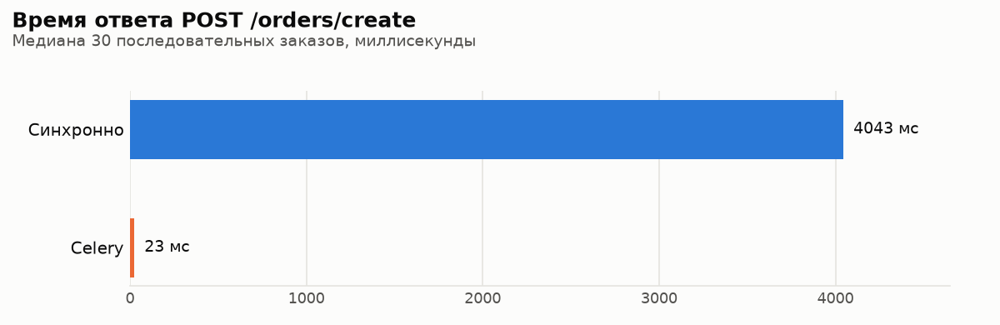

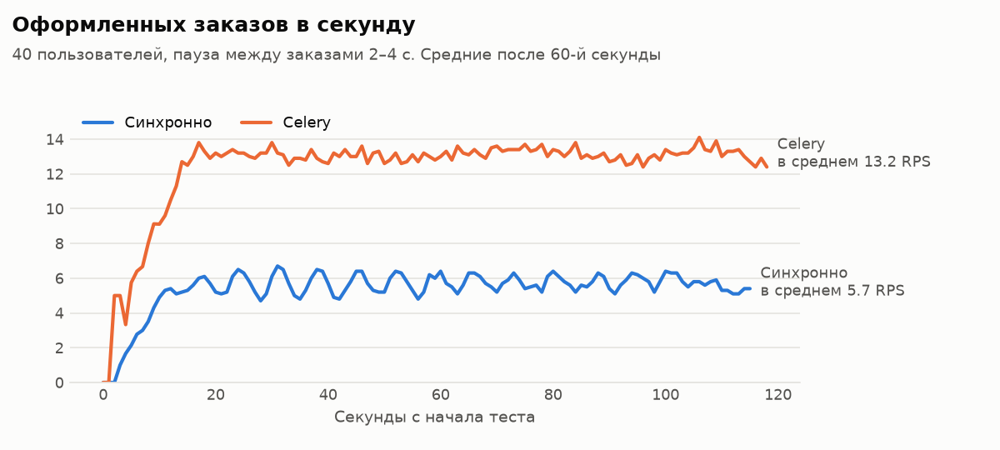

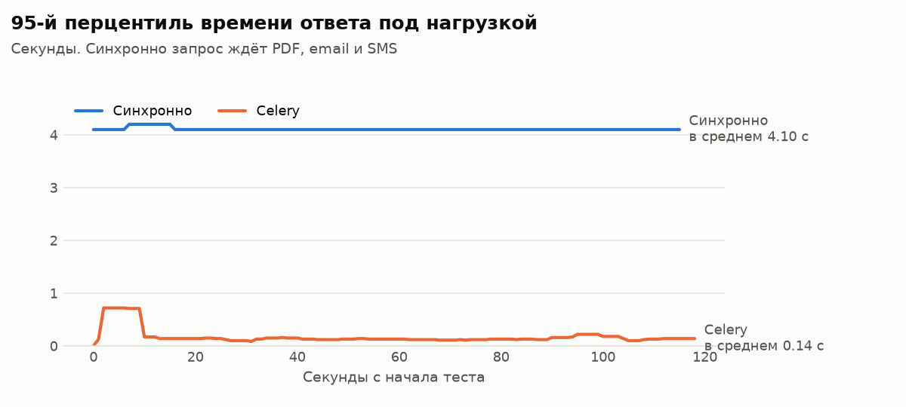


Сводка для защиты: [`docs/lab5/DEFENSE.md`](docs/lab5/DEFENSE.md). Отчёты Locust и CSV лежат в `docs/lab5/results`.

**Как читать цифры.** Синхронно каждый заказ держит поток сервера 4 секунды, пока спят заглушки PDF, email и SMS.
Студент успевает сделать только один заказ за 6–8 секунд. С Celery запрос только пишет заказ в БД и кладёт три сообщения в Redis.
Пропускная способность выросла в 2,3 раза: в замкнутом сценарии Locust её ограничивает пауза пользователя, а не сервер.

Фоновая работа никуда не исчезла. 13 заказов в секунду дают 40 задач в секунду, а воркер с 64 потоками успевал около 31.
Очередь росла всю нагрузку и рассосалась за 30 секунд после неё. Клиент получил ответ за 60 мс, а чек в среднем через 16 секунд.
Это нормальная цена асинхронности: очередь сглаживает пик, а скорость обработки задаётся числом воркеров.

### Как проходил замер

1. **Baseline.** В коммите «Замер baseline» PDF, email и SMS выполнялись в запросе: 4053 мс.
2. **Celery.** Оба финальных прогона на одном коде, отличается только `ORDER_TASKS_MODE`. Сбои заглушек выключены,
   чтобы ретраи не искажали время. Воркер: `--pool threads --concurrency 64`, задачи ждут сеть, а не CPU.
3. **Найдено при проверке отказов.** С остановленным Redis заказ висел 19 секунд и отвечал 500.
   `.delay()` подписывался на результат задачи в Redis и переподключался к нему. Результаты задач никто не читает,
   поэтому включён `task_ignore_result`. Теперь заказ отвечает 200 за 0,3 с, а в лог пишется ошибка.

### Как устроено

```text
router.py ──► OrderService ──► OrderRepository   (PostgreSQL: заказ и списание)
                   │
                   └──► OrderNotifier (ABC)
                            ├─ CeleryOrderNotifier ──► Redis, очередь default ──► воркер
                            └─ InlineOrderNotifier      всё в запросе, режим sync для замера «до»

воркер: generate_order_pdf, send_order_email, send_order_sms
          ├─ TaskJournal ──► task_logs   идемпотентность
          ├─ stubs                       внешние сервисы
          └─ после 3 ретраев ──► очередь dlq
```

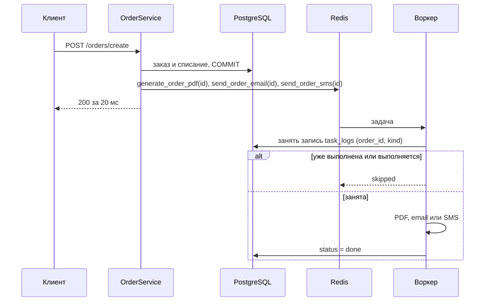

Сервис зовёт абстракцию `OrderNotifier`, а не задачи Celery напрямую. `service.py` не импортирует ни Celery, ни kombu,
это проверяет `tests/test_architecture.py`. Какая реализация придёт, решает `app/dependencies.py` по `ORDER_TASKS_MODE`.

### Что сделано

| Требование | Где |
|---|---|
| Замер baseline | коммит «Замер baseline», `InlineOrderNotifier`, `docs/lab5/results/before*` |
| Приложение Celery, брокер Redis, JSON | `app/core/celery_app.py` |
| Задачи PDF, email, SMS | `app/tasks/orders.py`, заглушки в `app/tasks/stubs.py` |
| Вызов задач из Service | `OrderService.create_order` → `OrderNotifier.order_created` |
| Ответ API мгновенный | `CeleryOrderNotifier`, замеры выше |
| Ретраи 1, 2, 4 с, jitter, не больше 3 | `RETRY_POLICY` в `app/tasks/orders.py` |
| Dead Letter Queue | `OrderTask.on_failure`, `app/tasks/dead_letters.py`, `python -m app.cli dlq-list` и `dlq-replay` |
| Идемпотентность | `app/tasks/journal.py`, таблица `task_logs`, миграция `0006` |
| Flower | `celery -A app.core.celery_app flower`, скриншоты ниже |
| Celery Beat | `beat_schedule` в `app/core/celery_app.py`, задачи в `app/tasks/maintenance.py` |
| Тесты | `tests/test_order_tasks.py`, 16 тестов |

**Ретраи.** `autoretry_for`, `retry_backoff`, `retry_jitter`, `max_retries=3`. Задержка 1, 2, 4 секунды,
jitter делает её случайной в этих пределах. Иначе после сбоя провайдера все задачи вернутся к нему в одну секунду.
Почтовая заглушка падает для каждого 5-го заказа всегда: задача делает 4 попытки и уходит в DLQ.
SMS-заглушка не отвечает на первую попытку для каждого 3-го заказа: ретрай проходит.

**Идемпотентность.** Перед работой задача занимает строку `task_logs` с уникальной парой `(order_id, kind)`.
Занять можно только новую строку, упавшую попытку или зависшую дольше 2 минут.
Условие стоит в самом `UPDATE`, поэтому из двух одновременных запусков работу сделает один.
Повторный запуск выполненной задачи пишет в лог `already done or in progress, skipped`.
Флаг в Redis, как в методичке, хуже: проверка и запись разделены, и два воркера пройдут проверку одновременно.
К тому же Redis здесь и брокер, и кеш, и его потеря стёрла бы все флаги.

**Dead Letter Queue.** После последней попытки `on_failure` публикует задачу в очередь `dlq`, а в журнале ставит `dead`.
Очереди `dlq` нет в `task_queues`, поэтому воркер её не слушает. В методичке `dlq` объявлена рядом с `default`,
и тогда воркер сразу запускал бы упавшую задачу снова. Разбор:

```bash
python -m app.cli dlq-list      # задачи с ошибкой и временем, очередь не меняется
python -m app.cli dlq-replay    # вернуть в рабочую очередь, когда провайдер починен
```

**Воркер упал посреди задачи.** `task_acks_late` подтверждает задачу только после выполнения,
`task_reject_on_worker_lost` возвращает её в очередь. Redis выдаст её снова через `visibility_timeout`, 5 минут.
Журнал увидит зависшую строку `started` и разрешит взять задачу заново.

**Брокер недоступен.** Заказ и деньги уже в БД, поэтому ошибка постановки задачи не превращается в 500.
Задачу досылает Beat: `requeue_lost_order_tasks` раз в минуту ищет заказы старше 2 минут без записей в журнале.
Повтор безопасен благодаря идемпотентности.

**Персональные данные.** В задачу передаётся только id заказа. Email и телефон воркер читает из БД.
Во Flower и в Redis видно `(3010,)`, а не адрес студента.

### Flower

Нагрузка Celery, 64 задачи выполняются одновременно, 1858 уже выполнено:

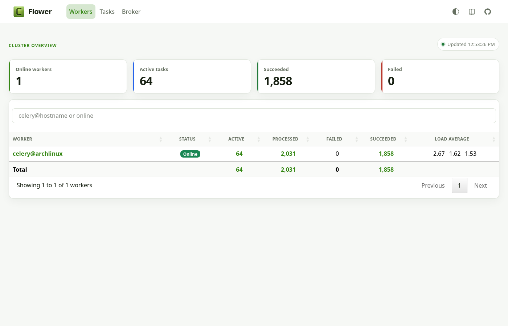

Задачи в реальном времени: одни приняты воркером, другие уже выполняются:

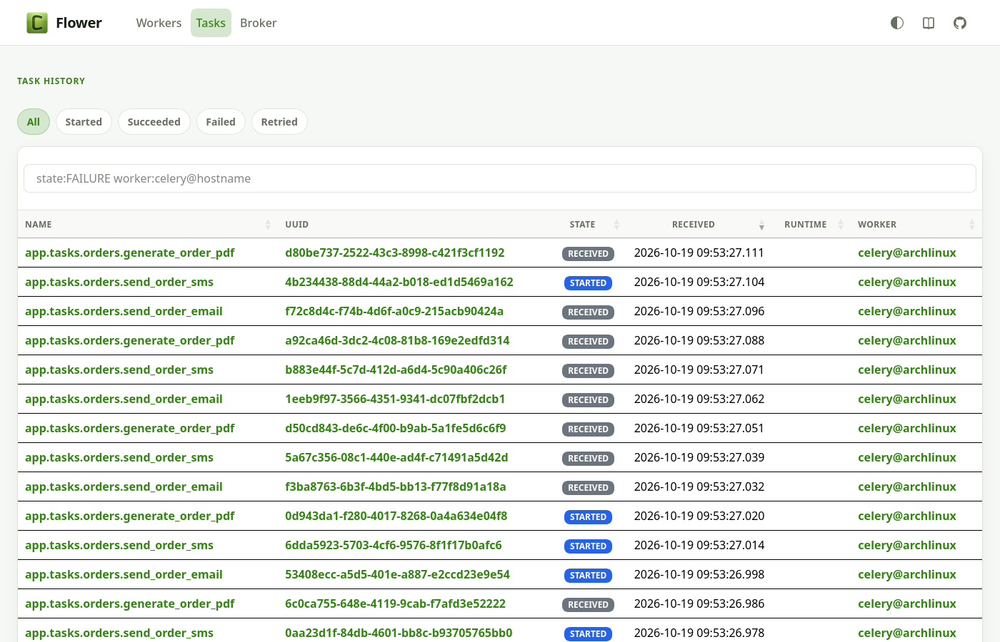

Письма каждого 5-го заказа не ушли, остальные выполнены:

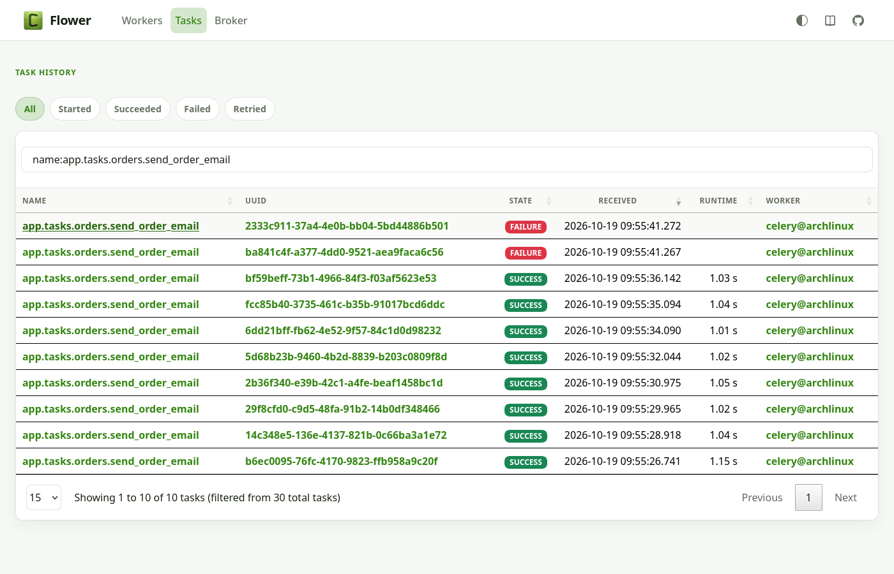

Упавшая задача: 3 ретрая, ошибка провайдера, в аргументах только id заказа:

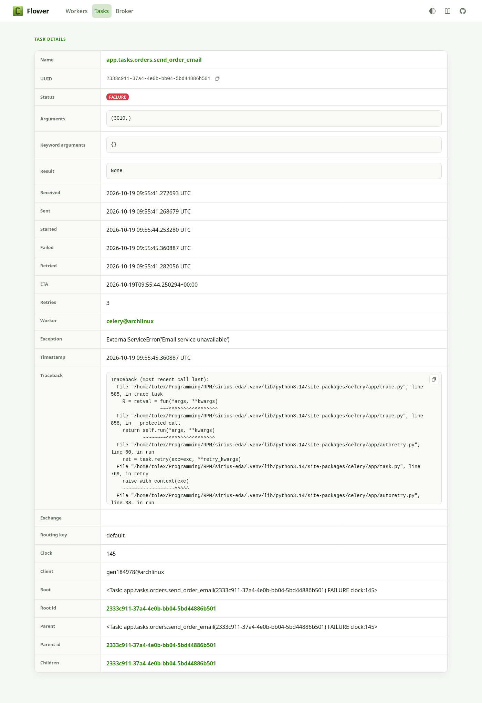

Очередь в Redis во время нагрузки:

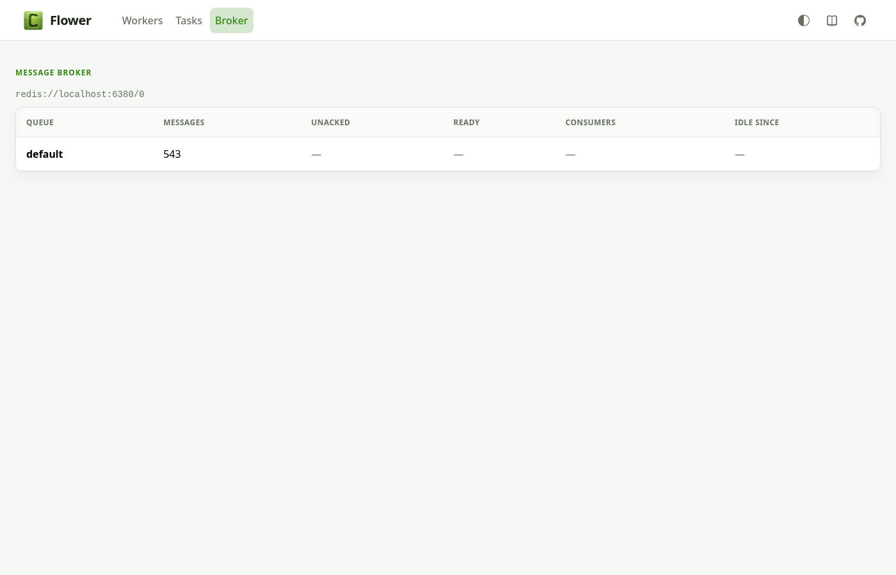

Flower слушает только `127.0.0.1`: он показывает аргументы задач и умеет их отменять.
В продакшене нужен `--basic-auth` или OAuth.

### Celery Beat

| Задача | Расписание | Что делает |
|---|---|---|
| `refresh_order_stats` | раз в минуту | Пересчитывает число заказов и выручку за сегодня и вчера в таблице `order_stats` |
| `requeue_lost_order_tasks` | раз в минуту | Досылает задачи, которые не попали в очередь |
| `cleanup_task_logs` | в 03:00 UTC | Удаляет записи `task_logs` старше 30 дней |

Сводку видит администратор: `GET /orders/stats?days=7`. Вчерашний день пересчитывается, потому что заказ,
отменённый после полуночи, меняет вчерашнюю выручку.

### Как запустить

```bash
alembic upgrade head
uvicorn app.main:app                                                  # терминал 1
celery -A app.core.celery_app worker --loglevel=info                  # терминал 2
celery -A app.core.celery_app beat --loglevel=info                    # терминал 3
celery -A app.core.celery_app flower --address=127.0.0.1 --port=5555  # терминал 4, http://127.0.0.1:5555
```

Повторить замеры:

```bash
python -m app.cli seed-menu
ACCESS_TOKEN_TTL_MINUTES=120 python -m app.cli load-users --count 50 > tokens.txt
export FAKE_EMAIL_FAIL_EVERY=0 FAKE_SMS_FLAKY_EVERY=0
ORDER_TASKS_MODE=sync   scripts/loadtest_orders.sh sync tokens.txt
ORDER_TASKS_MODE=celery scripts/loadtest_orders.sh celery tokens.txt
python scripts/plot_orders.py sync celery
```

Токены выдаёт CLI, потому что rate limiting пускает только 5 входов в минуту с одного IP.

### Отличия от методички

* **Сервис зовёт абстракцию `OrderNotifier`, а не `.delay()` напрямую.** Сервис по-прежнему решает,
  что после заказа нужны чек и уведомления. Но не знает, Celery это или что-то другое. Тесты сервиса работают без брокера.
* **В задачу передаётся только id заказа**, а не email и телефон.
* **Идемпотентность через таблицу `task_logs`**, а не через флаг в Redis. Причины выше.
* **DLQ действительно получает задачи.** В методичке очередь объявлена, но в неё ничего не отправляется.
* **`task_acks_late` и `task_ignore_result`.** Первое защищает от потери задачи при падении воркера,
  второе убирает зависание заказа при падении Redis.
* **Режим `ORDER_TASKS_MODE=sync`** вместо `time.sleep` в сервисе: замер «до» снимается на том же коде.
* **Beat делает три задачи,** включая досылку потерянных задач.

### Ответы на контрольные вопросы

**1. Почему задачи вызываются из Service, а не из Router?**
«После заказа выдать чек и уведомить клиента» это правило предметной области, а не детали HTTP.
Если вызвать задачи из роутера, то CLI, другой роутер или будущий gRPC создадут заказ без чека.
Здесь сервис зовёт абстракцию `OrderNotifier`, а Celery подключается в корне композиции.
Так зависимости направлены внутрь, как требует Clean Architecture.

**2. Что будет, если воркер отключится во время задачи?**
Без настроек задача потеряна: Celery по умолчанию подтверждает её при получении.
Здесь включены `task_acks_late` и `task_reject_on_worker_lost`. Подтверждения нет, и Redis вернёт задачу в очередь
через `visibility_timeout`. Задача выполнится повторно, поэтому она обязана быть идемпотентной.
Журнал считает запись `started` старше 2 минут брошенной и разрешает взять её заново.

**3. Что такое идемпотентность и почему она важна?**
Повторное выполнение даёт тот же результат, что и одно. Celery гарантирует доставку «хотя бы один раз»:
ретраи, повторная доставка после падения воркера и досылка из Beat запускают задачу снова.
Без идемпотентности студент получит два письма или два чека.

**4. Зачем экспоненциальная задержка?**
Сбой провайдера обычно длится секунды или минуты. Мгновенный повтор упадёт так же и добавит нагрузки
на сервис, который и так не справляется. Растущая задержка даёт ему время восстановиться.
Jitter разносит повторы тысяч задач во времени, иначе они придут к провайдеру одновременно.

**5. Что такое Dead Letter Queue?**
Очередь для задач, исчерпавших ретраи. Задача не теряется и не крутится бесконечно.
Её можно посмотреть, понять причину, починить провайдер и вернуть в работу: `dlq-list` и `dlq-replay`.
Рост DLQ должен вызывать алерт.

**6. Почему Celery, а не threading или asyncio?**
Поток или задача asyncio живут в процессе веб-сервера. Перезапуск или падение сервера теряет их,
ретраев, DLQ и мониторинга нет, а тяжёлая работа отнимает ресурсы у запросов.
Celery хранит задачи в брокере, переживает рестарты, масштабируется отдельными воркерами на других машинах,
даёт ретраи, расписание и Flower. Это стандарт с большой экосистемой.

**7. Чем Celery Beat отличается от обычной задачи?**
Обычную задачу ставит приложение в ответ на событие. Beat это отдельный процесс-планировщик:
он сам ставит задачи по расписанию, а выполняют их обычные воркеры.
Beat должен быть запущен в одном экземпляре, иначе каждая задача выполнится несколько раз.

## Лабораторная работа № 4: кеширование

Выполнено на 10 баллов: Cache-Aside в Repository, событийная инвалидация и TTL,
замеры Locust с графиками, защита от cache stampede, кеш разделов меню с другим TTL
и прогрев кеша при старте.

### Результаты

Сценарий методички: 500 пользователей, подключаются по 10 в секунду, пауза между запросами 0,1–0,5 с.
Четыре запроса из пяти идут в `GET /menu/items`, один в `GET /menu/categories/{id}`. Каждый прогон длится 3 минуты.
Приложение работает в одном процессе uvicorn, как в методичке. Locust, PostgreSQL и Redis запущены на той же машине с 4 ядрами.

Оба прогона сделаны на одном коде, отличается только `MENU_CACHE_ENABLED`.

| Метрика | Без кеша | С кешем | Изменение |
|---|---|---|---|
| RPS, весь прогон | 87 | 165 | ×1,9 |
| RPS после разгона, с 60-й секунды | 91 | 188 | ×2,1 |
| Медиана времени ответа | 5,1 с | 2,2 с | −57% |
| 95-й перцентиль | 5,8 с | 4,0 с | −31% |
| 95-й перцентиль после разгона | 5,7 с | 2,8 с | −51% |
| Ошибки | 0 | 0 | |
| Транзакций в PostgreSQL за прогон | 21 983 | 99 | ÷222 |
| Строк прочитано PostgreSQL | 5,9 млн | 16 тыс. | ÷362 |
| CPU PostgreSQL после разгона | 50% ядра | 0% | |
| Попаданий в кеш Redis | | 29 991 | промахов 0 |
| Load average 1 мин, среднее | 3,7 | 4,3 | |

Время одного запроса без очереди, 500 последовательных запросов, `scripts/latency_probe.py`:

| Эндпоинт | Без кеша, медиана / p95 | С кешем, медиана / p95 |
|---|---|---|
| `GET /menu/items`, 300 блюд | 10,8 / 14,5 мс | 4,6 / 6,0 мс |
| `GET /menu/categories/3`, 25 блюд | 6,4 / 8,4 мс | 3,0 / 4,1 мс |

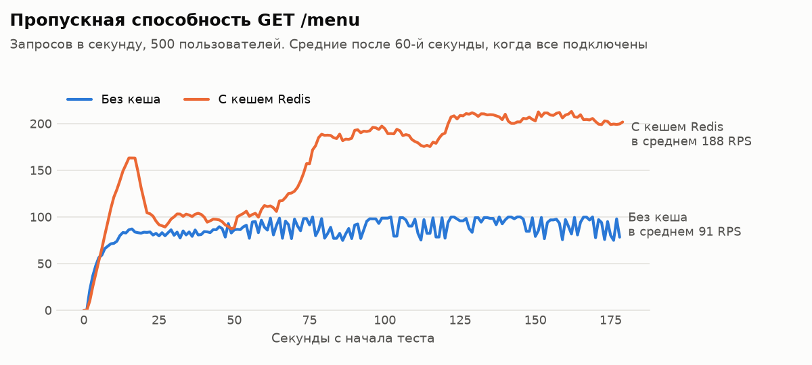

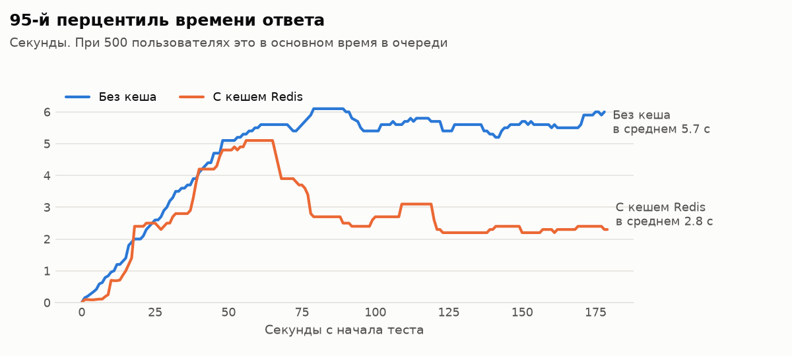

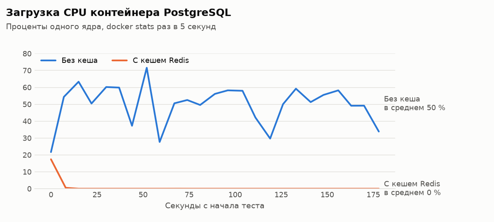

Отчёты Locust с графиками лежат в `docs/lab4/results/*.html`. Там же CSV и метрики системы.

**Как читать цифры.** Кеш снял нагрузку с PostgreSQL почти полностью: транзакций в 222 раза меньше, CPU базы с 50% до нуля.
Пропускная способность выросла вдвое, а не в десятки раз, как ожидает методичка. Причина в том, что база здесь не главное узкое место.
Меню из 300 строк PostgreSQL отдаёт быстро. Остальное время уходит на Python: превратить строки в объекты и сериализовать 26 КБ JSON.
Всё это делает один процесс uvicorn. 500 пользователей с паузой 0,3 с создают около 1600 запросов в секунду, это больше,
чем один процесс обработает даже с кешем. Поэтому при такой нагрузке время ответа измеряется секундами: это ожидание в очереди.
Без очереди запрос с кешем занимает 4,6 мс, без кеша 10,8 мс.
Load average с кешем выше потому, что приложение и Locust обрабатывают вдвое больше запросов.

### Как проходил замер

История есть в коммитах, сырые результаты всех прогонов в `docs/lab4/results`.

1. **Baseline, `before`.** Код после лабораторной № 3: 72 RPS, медиана 6,4 с, 13 тыс. транзакций.
2. **Первый замер с кешем, `cache_v1`.** Транзакций стало 62, CPU базы ноль, но RPS вырос только до 98.
   Профилирование показало, что из 8 мс на запрос 6,6 мс уходит на `jsonable_encoder`:
   без `response_model` FastAPI обходит 300 объектов на чистом Python.
   Добавлен `response_model`, сериализацию делает pydantic-core за 0,3 мс.
3. **Повторный замер без кеша упал.** 13% ответов 500, `QueuePool limit of size 5 overflow 10 reached`.
   Сессия SQLAlchemy держала соединение до конца запроса, пока FastAPI сериализует ответ в пуле потоков.
   Все 40 потоков ждали соединение, а все 15 соединений ждали поток. Через 30 секунд таймаут.
   Ошибка была в коде и раньше, ускорение сериализации её только проявило.
   Исправлено: SQL-репозитории возвращают соединение в пул после каждой операции (`short_transactions` в `app/database.py`).
4. **Финальные замеры, `nocache` и `cache`.** Таблица выше.

### Где живёт кеш

Кеш относится к инфраструктуре, поэтому он целиком в слое Repository.
`MenuService` и роутер про Redis не знают. `tests/test_architecture.py` проверяет, что ни один `service.py` не импортирует `redis`.

```text
router.py ──► MenuService ──► MenuRepository (ABC)
                                   ▲
              CachedMenuRepository ┘  декоратор: Cache-Aside, инвалидация
                   │
                   ├──► SqlAlchemyMenuRepository ──► PostgreSQL
                   └──► CacheAside (app/core/cache.py) ──► Redis
```

`CachedMenuRepository` оборачивает любой `MenuRepository`. Включается в корне композиции
`app/dependencies.py`, флаг `MENU_CACHE_ENABLED`. Сервис получает его как обычный репозиторий.
Методичка предлагает вызывать `invalidate_cache()` из сервиса. Здесь сброс делает сам репозиторий
после записи: так сервис вообще не знает, что кеш существует.

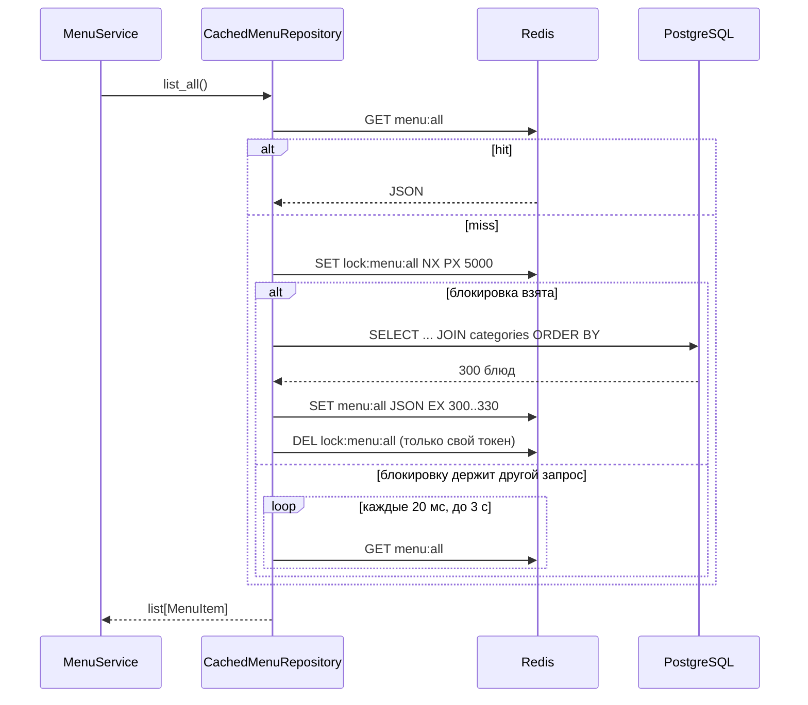

| Ключ | Что внутри | TTL | Когда сбрасывается |
|---|---|---|---|
| `menu:all` | всё меню, 300 блюд | 300 с + до 10% | создание или изменение любого блюда |
| `menu:category:{id}` | раздел с блюдами | 600 с + до 10% | изменение блюда этого раздела, перенос блюда из раздела или в раздел, создание раздела с этим id |
| `lock:menu:all`, `lock:menu:category:{id}` | токен владельца | 5 с | владелец снимает после загрузки |

### Что сделано

| Требование | Где |
|---|---|
| Клиент Redis, `check_redis_connection` | `app/core/redis.py` |
| Cache-Aside: hit, miss, запись с TTL | `app/core/cache.py`, `CacheAside.get_or_load` |
| Кеш в Repository, сервис не изменён | `app/modules/menu/repository.py`, `CachedMenuRepository` |
| TTL 5 минут для `menu:all` | `MENU_ALL_TTL = 300` |
| Событийная инвалидация | `CachedMenuRepository.create`, `save`, `create_category` |
| Категории `menu:category:{id}`, TTL 10 минут | `GET /menu/categories/{id}`, `CATEGORY_TTL = 600`, миграция `0005` |
| Защита от cache stampede | блокировка Redis в `CacheAside._load_once` |
| Прогрев кеша при старте | `lifespan` в `app/main.py`, `CachedMenuRepository.warm_up` |
| Locust | `locustfile.py`, `scripts/loadtest.sh` |
| Графики «до / после» | `docs/lab4/*.png`, `scripts/plot_loadtest.py` |
| Тесты | `tests/test_menu_cache.py`, 13 тестов |

**Защита от stampede.** При промахе запрос пытается взять `lock:<ключ>` через `SET NX` с TTL 5 секунд.
Взял: повторно проверяет кеш, идёт в БД, кладёт результат, снимает блокировку.
Снимается только своя блокировка: redis-py сверяет токен Lua-скриптом.
Не взял: каждые 20 мс читает ключ и получает данные, как только их положит владелец.
Если владелец упал, через 3 секунды запрос идёт в БД сам: лучше один лишний SELECT, чем вечное ожидание.
Тест `test_stampede_sends_one_query_to_database`: 20 потоков одновременно на холодном кеше, в БД ровно один запрос.

**Разброс TTL.** К TTL добавляется случайные 0..10%. Ключи, записанные одновременно при прогреве,
истекают в разное время и не устраивают stampede по всем ключам сразу.

**Отказ Redis.** Любая ошибка Redis даёт чтение из PostgreSQL и предупреждение в лог.
Повторы redis-py по умолчанию отключены: с ними каждый запрос при упавшем Redis ждал бы секунды.
Проверено вживую: остановленный Redis, `GET /menu/items` отвечает 200 за 20 мс.

**Что не кешируется.** Цены и доступность для оформления заказа `OrderRepository` читает из БД напрямую,
мимо кеша: деньги списываются по актуальной цене. Баланс, заказы, токены, роли не кешируются.

### Как воспроизвести

```bash
python -m app.cli seed-menu
MENU_CACHE_ENABLED=false scripts/loadtest.sh nocache   # 3 минуты
scripts/loadtest.sh cache
python scripts/plot_loadtest.py nocache cache
```

Скрипт сам запускает uvicorn, Locust в режиме без интерфейса и сбор метрик:
load average, CPU контейнеров, счётчики `pg_stat_database` до и после прогона.
Параметры меняются через `USERS`, `SPAWN_RATE`, `DURATION`.
Интерфейс Locust как в методичке: `locust -f locustfile.py --host=http://127.0.0.1:8000`, затем http://localhost:8089.

Посмотреть кеш вживую:

```bash
docker compose exec redis redis-cli KEYS 'menu:*'
docker compose exec redis redis-cli TTL menu:all
docker compose exec redis redis-cli INFO stats | grep keyspace
```

### Отличия от методички

* **Инвалидацию делает репозиторий, а не сервис.** В методичке `MenuService` вызывает `invalidate_cache()`.
  Тогда сервис знает, что кеш существует. Здесь `MenuService` не изменился вообще.
* **Кеш вынесен в декоратор `CachedMenuRepository`,** а не встроен в SQL-репозиторий.
  SQL-код остался прежним, кеш включается и выключается в одном месте.
* **В кеше хранятся все поля блюда.** В примере методички сохраняются только `id`, `name`, `price`,
  и после восстановления из кеша теряется `is_available`.
* **Пустое значение тоже кешируется.** Запрос несуществующего раздела не ходит в БД каждый раз.
  При создании раздела этот ключ сбрасывается.
* **Разброс TTL** и **отключённые повторы Redis**, см. выше.
* Найдены и исправлены две проблемы производительности: медленная сериализация и взаимоблокировка пула соединений.

### Ответы на контрольные вопросы

**1. Почему кеш в Repository, а не в Service?**
Кеш отвечает на вопрос «откуда взять данные», а это забота инфраструктуры.
Сервис отвечает на вопрос «что можно делать с данными». Если кеш попадёт в сервис,
бизнес-логика начнёт зависеть от Redis: её нельзя протестировать без Redis, а замена хранилища затронет правила предметной области.
Здесь кеш подключается декоратором в корне композиции, сервис его не видит.

**2. Что такое Cache-Aside и какие у него недостатки?**
Приложение само читает кеш, при промахе идёт в БД и кладёт результат в кеш.
Недостатки: первый запрос после промаха медленный; данные в кеше могут устареть до TTL или до инвалидации;
при массовом истечении ключей возникает stampede; код должен помнить о сбросе кеша при каждой записи;
есть гонка, когда чтение старых данных из БД записывает их в кеш сразу после инвалидации.

**3. Что будет, если Redis перезагрузится в пик?**
Кеш опустеет, и все запросы одновременно пойдут в БД. Это cache stampede, или thundering herd.
Здесь при промахе в БД идёт только запрос с блокировкой, остальные ждут его результат.
Пока Redis недоступен совсем, запросы идут в PostgreSQL напрямую, без ожидания повторов.
Прогрев при старте приложения закрывает холодный старт после деплоя.

**4. Почему TTL 5 минут, а не час?**
TTL ограничивает, сколько живут устаревшие данные, если событийный сброс не сработал:
запись прошла в обход приложения, Redis был недоступен при сбросе, случилась гонка.
Меню меняется в течение дня, например блюдо закончилось. Пять минут устаревших данных допустимы, час нет.
При этом 5 минут под нагрузкой это тысячи попаданий на одно обращение к БД.

**5. Как событийная инвалидация дополняет TTL?**
Событийная сбрасывает ключ сразу после изменения, поэтому повар видит новое блюдо мгновенно.
TTL страхует случаи, которые событие не покрыло. Вместе они дают свежие данные в обычном случае
и ограниченное устаревание в худшем.

**6. Что нельзя кешировать?**
Баланс студента и всё, что связано с деньгами: списание по устаревшему балансу даст минус или двойную оплату.
Цену в момент оформления заказа: `OrderRepository` читает её из БД, мимо кеша.
Статусы заказов и доставок, refresh-токены и их отзыв, роли и блокировку пользователя:
заблокированный пользователь не должен работать ещё 5 минут.
Пароли, хеши паролей, персональные данные вообще не стоит класть в общий кеш.

**7. Как решить stampede для 10 000 ключей?**
Блокировка на каждый ключ, как здесь: ключи независимы, ждут только запросы к одному и тому же ключу.
Разброс TTL, чтобы ключи, записанные вместе, не истекали вместе.
Вероятностное раннее обновление (XFetch): запрос с вероятностью, растущей к концу TTL, обновляет ключ заранее,
и истечения под нагрузкой не происходит. Для самых горячих ключей фоновое обновление по расписанию.
Прогрев при старте с ограничением параллельности, чтобы не уронить БД.

## Лабораторная работа № 3: безопасность

Выполнено на 10 баллов: основа, rate limiting, Secure by Default и вход через Google.
Ротация refresh-токенов и защита всех модулей сделаны сверх этого.

### Схема безопасности

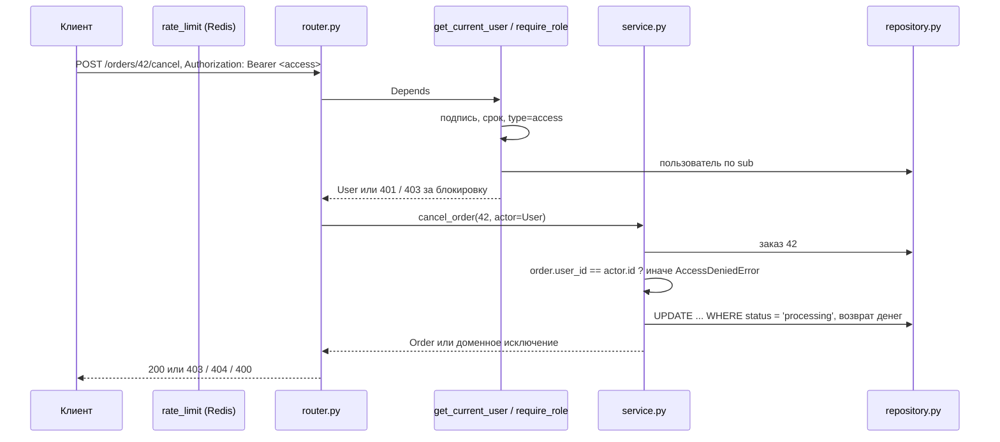

Каждый уровень защиты отвечает на свой вопрос:

| Уровень | Где | Вопрос | Ошибка |
|---|---|---|---|
| Rate limiting | `app/core/rate_limit.py`, API | Не слишком ли часто? | 429 |
| Аутентификация | `get_current_user`, API | Кто ты? | 401 |
| Роль (RBAC) | `require_role`, API | Можно ли твоей роли этот эндпоинт? | 403 |
| Объект (IDOR) | `service.py` | Можно ли тебе этот конкретный заказ? | 403 |

Роль проверяется в API-слое, потому что это свойство эндпоинта: решение принимается до чтения данных.
Права на объект проверяются в сервисе, потому что для них нужен сам объект и правило предметной области.
Такую проверку можно протестировать без HTTP и переиспользовать в CLI.

### Матрица доступа

| Эндпоинт | Кто может |
|---|---|
| `POST /auth/login`, `/auth/token` | все, общий лимит 5 попыток в минуту с IP |
| `POST /auth/refresh` | владелец refresh-токена, лимит 10 в минуту |
| `POST /auth/logout` | владелец refresh-токена |
| `GET /auth/google/login`, `/auth/google/callback` | все, лимит 10 в минуту |
| `POST /users/register` | все, лимит 5 в минуту. Всегда роль `student` |
| `GET /users/me` | любой вошедший |
| `GET /users/{id}`, `POST /users/{id}/topup` | владелец аккаунта или `admin` |
| `PATCH /users/{id}/role` | `admin` |
| `GET /menu/items` | все |
| `POST /menu/items`, `PATCH /menu/items/{id}` | `cook`, `admin` |
| `POST /orders/create` | `student`. Заказчик берётся из токена |
| `GET /orders/my` | любой вошедший, только свои заказы |
| `POST /orders/{id}/cancel` | владелец заказа или `admin` |
| `GET /kitchen/orders` | `cook`, `admin` |
| `POST /delivery/assign` | `courier` только на себя, `admin` на любого курьера |
| `GET /delivery/my` | курьер видит свои доставки, студент доставки своих заказов |
| `GET /delivery/{id}` | курьер доставки, заказчик, `admin` |
| `PATCH /delivery/{id}/complete` | курьер этой доставки, `admin` |

### Что сделано

**Миграции.** Alembic, ревизии в `alembic/versions`:

| Ревизия | Что делает |
|---|---|
| `0001` | Схема из лабораторной № 2. Для старой базы: `alembic stamp 0001` |
| `0002` | `roles`, `users.password_hash`, `users.role_id`, `refresh_tokens`. Роли заполняются, старым пользователям назначается `student` |
| `0003` | `orders.total_cost`: сумма заказа нужна для возврата при отмене |
| `0004` | `external_accounts` для входа через Google |

**Пароли.** bcrypt, 12 раундов (`BCRYPT_ROUNDS`). Если email не найден, всё равно выполняется
сравнение с фиктивным хешем, чтобы время ответа не выдавало, зарегистрирован ли адрес.
Ответ на неверный email и на неверный пароль одинаковый.

**JWT.** Access-токен живёт 15 минут, refresh-токен 7 дней. В payload только `sub`, `type`, `exp`, `iat`, `jti`.
Тип проверяется: refresh-токен не пройдёт как access и наоборот.
Роль в токен не пишется: `get_current_user` берёт пользователя из БД,
поэтому блокировка и смена роли действуют сразу, а не через 15 минут.

**Refresh-токены.** В БД лежит SHA-256 токена, а не сам токен. При каждом `/auth/refresh`
старый токен отзывается и выдаётся новая пара. Если отозванный токен предъявлен повторно,
значит, его украли: отзываются все refresh-токены пользователя. Отзыв сделан условным UPDATE,
поэтому два одновременных refresh с одним токеном не пройдут оба.

**IDOR.** `user_id` убран из `OrderCreate`. Проверки владельца в сервисах:
`OrderService.cancel_order`, `UserService.top_up_balance` и `get_profile`,
`DeliveryService.assign_courier`, `get_delivery`, `complete_delivery`.
Отмена заказа атомарна: повторная отмена не вернёт деньги дважды.

**Rate limiting.** Фиксированное окно в Redis: `INCR` и `EXPIRE NX` одним pipeline.
`/auth/login` и `/auth/token` делят один счётчик. При превышении 429 и заголовок `Retry-After`.
Если Redis недоступен, запрос пропускается, а в лог пишется предупреждение:
падение Redis не должно отключать вход.

**Secure by Default.**
* `SECRET_KEY` и `DATABASE_URL` обязательны, ключ не короче 32 символов. Без них приложение не стартует.
* Секреты только в `.env`, файл в `.gitignore`. В репозитории лежит `.env.example`.
* Swagger, ReDoc и `openapi.json` выключены, пока `DEBUG` не равен `true`.
* CORS разрешён только для `ALLOWED_ORIGINS`, по умолчанию список пуст.
* Регистрация всегда даёт роль `student`. Первый администратор создаётся только через CLI.
* Ошибка 401 содержит `WWW-Authenticate: Bearer`.

### Вход через Google

Настройка: создать OAuth client типа Web application в Google Cloud Console,
добавить Authorized redirect URI `http://localhost:8000/auth/google/callback`,
заполнить `GOOGLE_CLIENT_ID` и `GOOGLE_CLIENT_SECRET` в `.env`.
Пока они пустые, `/auth/google/*` отвечает 503.

Вход: открыть в браузере http://localhost:8000/auth/google/login.
Swagger для этого не подходит, ему нужен переход на страницу Google.
После входа браузер получит JSON с парой токенов, access-токен вставляется в Authorize.

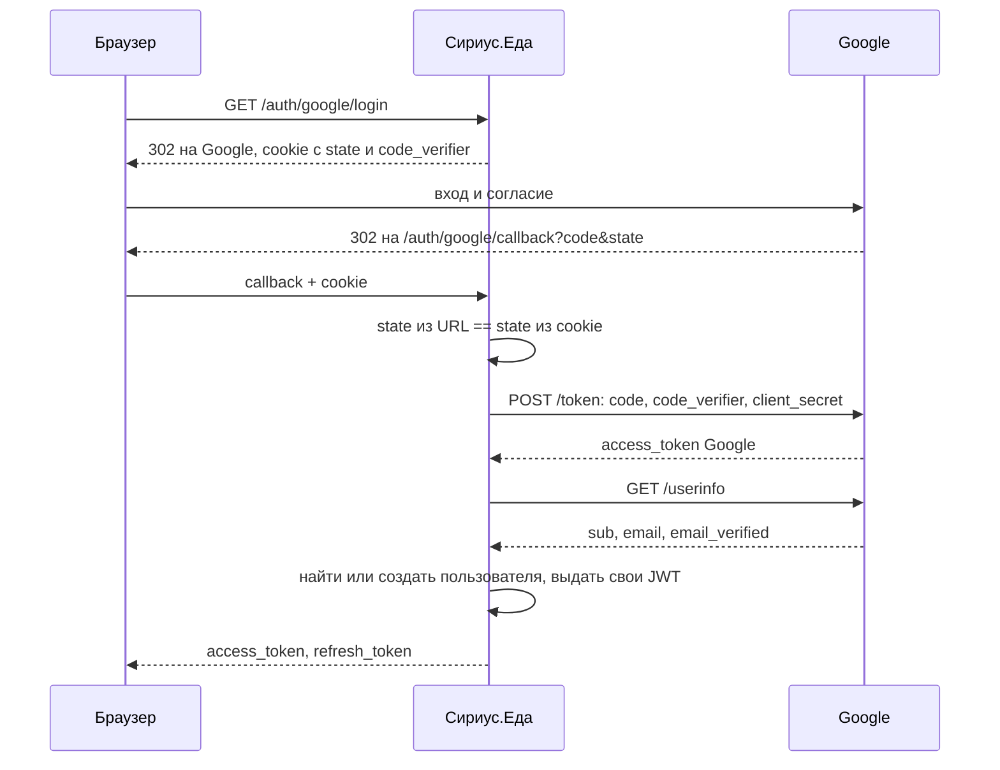

Защиты:
* **state** в подписанной HttpOnly-cookie. Без совпадения state чужой `code` нельзя подсунуть по ссылке.
* **PKCE S256.** Перехваченный `code` бесполезен без `code_verifier`, который не покидает сервер и cookie.
* Cookie живёт 10 минут, `SameSite=Lax`, в продакшене `Secure`. Путь ограничен `/auth/google`.
* **Привязка по `sub`**, а не по email: email у Google может смениться, `sub` нет.
* **Связь с существующим аккаунтом только по подтверждённому email.**
  Иначе можно указать у провайдера чужой адрес и войти в чужой аккаунт.
* Пользователь из Google создаётся без пароля. Войти по паролю он не может, пустой пароль не подходит.
* Клиент Google спрятан за абстракцией `OAuthProvider`. `AuthService` от Google не зависит,
  в тестах провайдер подменяется.

### Тесты

147 тестов, сеть и сервисы не нужны. CI в `.github/workflows/tests.yml`:
pytest плюс прогон миграций вверх, вниз и снова вверх на PostgreSQL и `alembic check`.

| Файл | Что проверяет |
|---|---|
| `tests/test_security.py` | 401 без токена на всех 14 защищённых эндпоинтах, 403 за чужую роль и чужой объект, 429, CORS, Swagger в продакшене, обязательный `SECRET_KEY` |
| `tests/test_auth_service.py` | Вход, поддельный, просроченный и неподписанный токен, ротация и кража refresh-токена |
| `tests/test_oauth.py` | Поток Google: state, PKCE, привязка аккаунта, неподтверждённый email, ошибки провайдера |
| `tests/test_api.py` | Полный сценарий заказа, ответы для авторизованных не изменились |
| `tests/test_*_service.py` | Бизнес-правила и проверки владельца в сервисах |

### Сценарии проверки из методички

Проверены на запущенном сервере с PostgreSQL и Redis:

| Сценарий | Результат |
|---|---|
| 1. `POST /orders/create` без токена | 401 |
| 2. Студент входит и создаёт заказ | 200 |
| 3. Второй студент отменяет заказ первого | 403 |
| 4. Студент открывает `GET /kitchen/orders` | 403 |
| 5. Шестой неверный вход подряд | 429 |

### Отличия от методички

* **PyJWT вместо python-jose.** У python-jose есть неисправленные уязвимости CVE-2024-33663 и CVE-2024-33664.
* **bcrypt напрямую вместо passlib.** passlib не обновлялся с 2020 года и ломается на bcrypt 4.1+.
* **`password_hash` остаётся nullable.** В методичке миграция делает его NOT NULL и падает:
  у существующих пользователей пароля нет. Пользователям из Google пароль тоже не нужен.
* **`jti` в токенах.** Без него два refresh-токена, выданные в одну секунду, совпадут
  и нарушат уникальность `token_hash`.
* **Кухня на `/kitchen/orders`.** В методичке эндпоинт описан в роутере orders с префиксом `/orders`,
  получилось бы `/orders/kitchen/orders`. Вынесен в отдельный роутер.
* **Сервисы получают доменную сущность `User`,** а не ORM-модель, как было принято в лабораторной № 2.
* **Сообщения об ошибках на русском,** как в остальном API.
* **Отмена заказа возвращает деньги.** Для этого добавлены статус `cancelled` и `orders.total_cost`.
* Порты PostgreSQL и Redis в `docker-compose.yml` настраиваются через `DB_PORT` и `REDIS_PORT`.

Известное ограничение: назначить курьера можно только на заказ в статусе `paid`,
но ни один эндпоинт этот статус не выставляет. Правило досталось из MVP. В тестах статус выставляется напрямую.

### Ответы на контрольные вопросы

**1. Чем аутентификация отличается от авторизации?**
Аутентификация устанавливает, кто делает запрос. Авторизация решает, что ему можно.
Ошибка аутентификации: сервер принимает токен без проверки подписи, и злоумышленник выдаёт себя за другого.
Ошибка авторизации: студент с настоящим токеном отменяет чужой заказ, подставив его id.

**2. Почему `user_id` убирают из payload и берут из JWT?**
Тело запроса целиком под контролем клиента, в нём можно написать любой `user_id`.
JWT подписан ключом сервера. Изменить `sub`, не сломав подпись, нельзя.

**3. Что такое IDOR и на каком слое от него защищаются?**
Сервер берёт id объекта от клиента и не проверяет, принадлежит ли объект пользователю.
Защита в Service-слое: правило «отменять можно только свой заказ» относится к предметной области.
Ему нужен сам объект, и оно должно работать и из HTTP, и из CLI.

**4. Почему payload JWT не защищён?**
Он закодирован Base64URL, а не зашифрован. Прочитать его может любой, у кого есть токен.
Подпись гарантирует только, что payload не изменили. Поэтому в токене лишь id пользователя и служебные поля.

**5. Почему роль проверяется в API, а права на объект в Service?**
Роль относится к эндпоинту целиком и известна до чтения данных: повару кухня доступна, студенту нет.
Права на объект зависят от конкретной записи, её владельца и статуса. Это бизнес-правило, и живёт оно рядом с данными сценария.

**6. Зачем rate limiting в Redis, а не в памяти?**
У каждой реплики и каждого воркера uvicorn свой счётчик в памяти. При четырёх воркерах лимит 5 превращается в 20.
Счётчик в памяти ещё и сбрасывается при перезапуске. Redis даёт один счётчик на все процессы.

**7. Что такое Secure by Default? Три примера.**
Безопасная конфигурация по умолчанию: чтобы ослабить защиту, нужно сделать это явно.
Без `SECRET_KEY` приложение не стартует. Swagger выключен, пока не задан `DEBUG=true`.
Список CORS пуст, пока домен не указан явно. Новый пользователь получает минимальную роль `student`.

**8. `service.py` импортирует `HTTPException` для ошибки 403.**
Нарушает правило зависимостей: внутренний слой начинает зависеть от веб-фреймворка.
Сервис перестаёт работать в CLI и Celery. Правильно бросать `AccessDeniedError` и переводить его в 403 в роутере.

## Лабораторная работа № 2: Clean Architecture

### Что изменилось

До рефакторинга каждый `router.py` содержал HTTP-обработку, бизнес-проверки и SQL-запросы.
Теперь каждый модуль разделён на три файла:

| Файл | Слой | Круг модели Мартина | Что делает |
|---|---|---|---|
| `router.py` | API Layer | 4. Frameworks & Drivers | Pydantic, техническая валидация, сборка слоёв, перевод исключений в HTTP-статусы |
| `service.py` | Business Logic Layer | 1–2. Entities и Use Cases | Бизнес-правила сценария. Нет импортов `fastapi` и `sqlalchemy` |
| `repository.py` | Infrastructure Layer | 3. Interface Adapters | Абстрактный репозиторий (ABC) и две реализации: SQLAlchemy и in-memory |

Общие файлы:

| Файл | Назначение |
|---|---|
| `app/domain/entities.py` | Доменные сущности `User`, `MenuItem`, `Order`, `Delivery` и статусы. Обычные dataclass |
| `app/domain/exceptions.py` | `NotFoundError`, `AccessDeniedError`, `BusinessRuleError`. Наследники `ValueError` |
| `app/http_errors.py` | Отображение исключений в статусы 404, 403, 400 |
| `app/dependencies.py` | Корень композиции. Выбирает реализацию репозиториев по `REPOSITORY_BACKEND` |
| `app/memory_storage.py` | Общее in-memory хранилище для всех модулей |
| `app/models.py` | ORM-модели. Добавлен метод `to_entity()` для перевода строки БД в сущность |

#### Разделение проверок

| Проверка | Где | Тип |
|---|---|---|
| Формат email | `schemas.py` (EmailStr) | техническая |
| Длина телефона, `quantity > 0`, `amount > 0`, `price > 0`, длина названия | `router.py` | техническая |
| Уникальность email и названия блюда | `service.py` | бизнес |
| Существование пользователя, блюда, заказа, доставки | `service.py` | бизнес |
| Блюдо доступно, хватает баланса | `OrderService` | бизнес |
| Пользователь не заблокирован, лимит пополнения 50000 | `UserService` | бизнес |
| Заказ оплачен, курьер не занят и не заблокирован | `DeliveryService` | бизнес |
| Статусы при завершении доставки | `DeliveryService` | бизнес |

#### Отличия от шаблона из методички

* Сервис бросает не голый `ValueError`, а его наследников. Роутер возвращает те же коды,
  что MVP: 404 для «не найдено», 403 для блокировки, 400 для остального.
  Шаблон отдавал 400 на всё, это меняло бы поведение API.
* Тексты ошибок взяты из MVP, а не из шаблона: «Блюдо не найдено», «Блюдо недоступно».
* Путь эндпоинта остался `/create`. В шаблоне указан `/orders/create`, но роутер
  подключается с префиксом `/orders`, итоговый путь был бы `/orders/orders/create`.
* В шаблоне списание баланса и создание заказа шли двумя коммитами. Здесь это одна
  транзакция в `save_order`, как в MVP. Сбой между ними не спишет деньги без заказа.
* Репозиторий возвращает доменные сущности, а не ORM-объекты. Сервис не зависит от SQLAlchemy
  даже косвенно, через атрибуты моделей.

#### Поведение API

Одинаковый сценарий из 26 запросов прогонялся против MVP и против новой версии
на PostgreSQL и на in-memory. Статусы и тела ответов совпали полностью.

Единственное теоретическое расхождение: если в запросе одновременно две ошибки,
техническая и бизнесовая, теперь первой сработает техническая. Пример: занятый email
плюс короткий телефон. MVP вернул бы «email уже зарегистрирован», новая версия вернёт
«Некорректный формат номера телефона». Так и должно быть: техническая валидация
выполняется до обращения к бизнес-логике.

### Путь запроса через слои

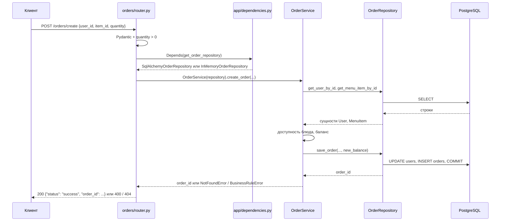

Направление зависимостей:

```text
 router.py ──────────────► service.py ──────► domain (entities, exceptions)
     │                         │                     ▲
     │                         ▼                     │
     └──► dependencies.py ──► repository.py ─────────┘
                               ├─ OrderRepository (ABC)      ◄── от него зависит сервис
                               ├─ SqlAlchemyOrderRepository  ──► models.py, SQLAlchemy
                               └─ InMemoryOrderRepository    ──► memory_storage.py
```

Сервис знает только про `OrderRepository`. Какая реализация пришла, решает `dependencies.py`.

### Замена хранилища

Чтобы переключить приложение на другую СУБД, нужно:

1. Написать новый класс, наследник `OrderRepository` (и других ABC).
2. Добавить его в `app/dependencies.py`.

`service.py` и `router.py` не меняются. Это видно на `REPOSITORY_BACKEND=memory`:
приложение работает без PostgreSQL на тех же сервисах и роутерах.
`tests/test_repository_contract.py` гоняет один сценарий на обеих реализациях.

### Тесты

| Файл | Что проверяет |
|---|---|
| `tests/test_order_service.py` | Бизнес-правила заказа. Плюс сервис с фейковым репозиторием без наследования |
| `tests/test_user_service.py` | Регистрация, пополнение, блокировка, лимит |
| `tests/test_menu_service.py` | Уникальность названия, частичное обновление |
| `tests/test_delivery_service.py` | Назначение курьера, завершение доставки |
| `tests/test_repository_contract.py` | Подстановка Лисков: in-memory и SQLAlchemy на SQLite |
| `tests/test_api.py` | HTTP-статусы и структура ответов как в MVP |
| `tests/test_architecture.py` | В `service.py` нет импортов `fastapi`, `sqlalchemy`, `starlette` |

### Ответы на контрольные вопросы

**1. Какому кругу соответствует `repository.py`?**
Третьему, Interface Adapters. Он переводит данные из формата СУБД в формат сущностей
и обратно. Сам по себе он не СУБД и не драйвер, это адаптер между ними и use case.

**2. Почему в `service.py` нельзя импортировать `fastapi` и `sqlalchemy`?**
Правило зависимостей: внутренние круги не знают о внешних. Бизнес-правила не должны
меняться при смене фреймворка или СУБД. Без этих импортов сервис тестируется без
сервера и базы, и его можно вызвать из CLI или Celery.

**3. Где проверять формат email, а где уникальность?**
Формат проверяется в транспортном слое, Pydantic `EmailStr`. Для этого не нужны данные
системы, это корректность входа. Уникальность проверяется в сервисе: это правило
предметной области, ему нужно состояние системы, получаемое через репозиторий.

**4. Что такое DIP и как он реализован?**
Модули верхнего уровня не зависят от нижнего, оба зависят от абстракции.
Здесь `OrderService` получает в конструктор `OrderRepository` (ABC). Конкретный
`SqlAlchemyOrderRepository` или `InMemoryOrderRepository` создаёт `dependencies.py`.

**5. Что изменится при переходе на MongoDB?**
Новый класс-репозиторий для каждого модуля, строки в `app/dependencies.py`,
подключение вместо `database.py` и `models.py`, `requirements.txt`, `docker-compose.yml`.
Не меняются `service.py`, `router.py`, `app/domain`, `schemas.py`.

**6. Можно ли использовать `OrderService` в CLI или Celery?**
Да. Сервис зависит только от репозитория и сущностей. В CLI или задаче Celery
создаём репозиторий, передаём в `OrderService` и вызываем `create_order`.
Исключения `NotFoundError` и `BusinessRuleError` обрабатываются там по-своему, без HTTP.

**7. Техническая и бизнес-валидация.**
Техническая проверяет форму данных без знания о системе: тип, формат, диапазон.
Примеры: `quantity > 0`, email по формату, длина телефона.
Бизнес-валидация проверяет правила предметной области, часто с учётом состояния.
Примеры: хватает ли баланса, доступно ли блюдо, не занят ли курьер.

**8. «`service.py` импортирует `HTTPException` для ошибки 400».**
Нарушает правило зависимостей. Внутренний слой начинает зависеть от внешнего,
веб-фреймворка. Сервис уже нельзя вызвать из CLI или Celery без HTTP-семантики,
а смена фреймворка затронет бизнес-логику. Правильно бросить доменное исключение
и перевести его в статус в роутере.
