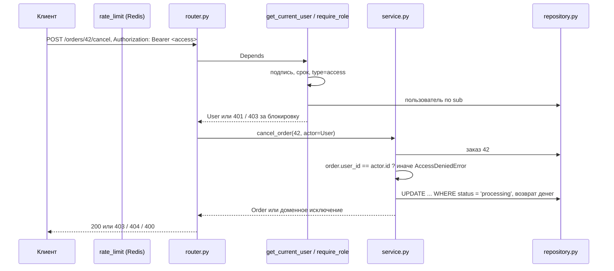
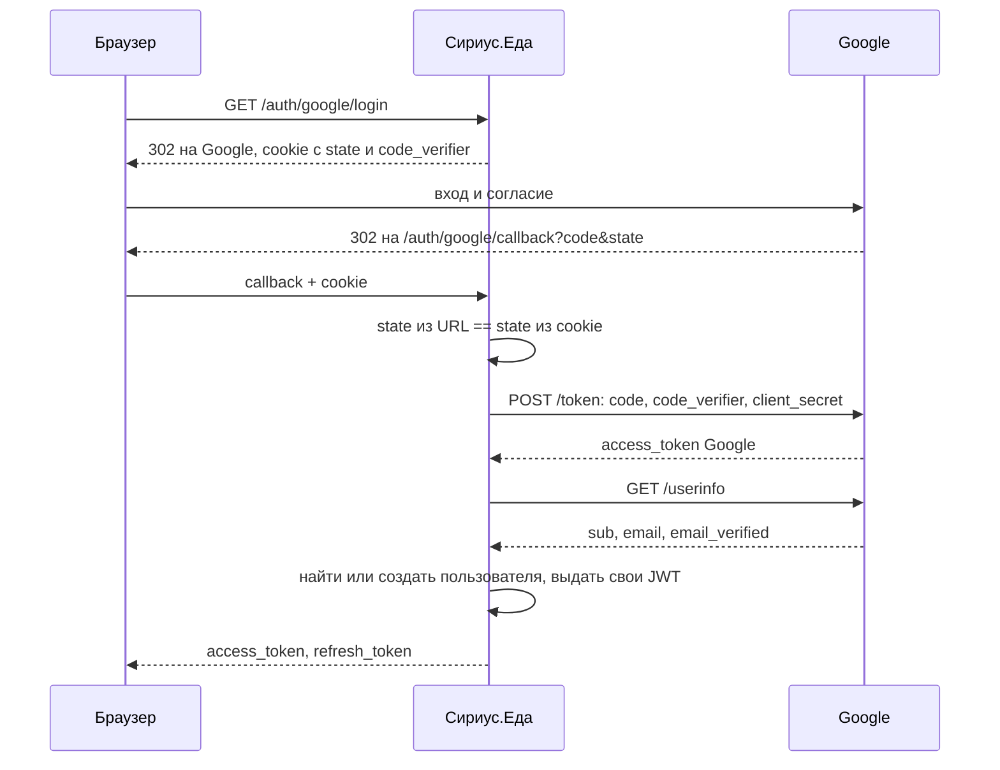
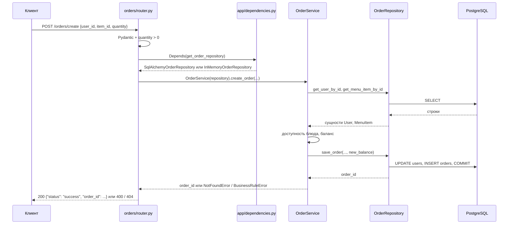

# Сириус.Еда

Учебный сервис столовой: студенты заказывают еду, повара готовят, курьеры доставляют.

* Лабораторная работа № 2: модули переведены в Clean Architecture ([раздел ниже](#лабораторная-работа--2-clean-architecture)).
* Лабораторная работа № 3: аутентификация, авторизация, защита от IDOR, вход через Google.

## Запуск

```bash
python3 -m venv .venv
source .venv/bin/activate
pip install -r requirements.txt -r requirements-dev.txt

cp .env.example .env              # затем задать SECRET_KEY
docker compose up -d db redis     # если порты заняты: DB_PORT=5433 REDIS_PORT=6380 docker compose up -d db redis
alembic upgrade head
python -m app.cli create-user --email admin@sirius.ru --role admin
uvicorn app.main:app --reload
```

Swagger доступен только при `DEBUG=true`: http://127.0.0.1:8000/docs.
Кнопка Authorize принимает email в поле username и пароль.

База, созданная во время лабораторной № 2 через `create_all`, подключается к Alembic так:

```bash
alembic stamp 0001
alembic upgrade head
```

Существующие пользователи получают роль `student` и не имеют пароля.

Тесты не требуют ни PostgreSQL, ни Redis:

```bash
pytest
```

## Лабораторная работа № 3: безопасность

Выполнено на 10 баллов: основа, rate limiting, Secure by Default и вход через Google.
Ротация refresh-токенов и защита всех модулей сделаны сверх этого.

### Схема безопасности



Каждый уровень защиты отвечает на свой вопрос:

| Уровень | Где | Вопрос | Ошибка |
|---|---|---|---|
| Rate limiting | `app/core/rate_limit.py`, API | Не слишком ли часто? | 429 |
| Аутентификация | `get_current_user`, API | Кто ты? | 401 |
| Роль (RBAC) | `require_role`, API | Можно ли твоей роли этот эндпоинт? | 403 |
| Объект (IDOR) | `service.py` | Можно ли тебе этот конкретный заказ? | 403 |

Роль проверяется в API-слое, потому что это свойство эндпоинта: решение принимается до чтения данных.
Права на объект проверяются в сервисе, потому что для них нужен сам объект и правило предметной области.
Такую проверку можно протестировать без HTTP и переиспользовать в CLI.

### Матрица доступа

| Эндпоинт | Кто может |
|---|---|
| `POST /auth/login`, `/auth/token` | все, общий лимит 5 попыток в минуту с IP |
| `POST /auth/refresh` | владелец refresh-токена, лимит 10 в минуту |
| `POST /auth/logout` | владелец refresh-токена |
| `GET /auth/google/login`, `/auth/google/callback` | все, лимит 10 в минуту |
| `POST /users/register` | все, лимит 5 в минуту. Всегда роль `student` |
| `GET /users/me` | любой вошедший |
| `GET /users/{id}`, `POST /users/{id}/topup` | владелец аккаунта или `admin` |
| `PATCH /users/{id}/role` | `admin` |
| `GET /menu/items` | все |
| `POST /menu/items`, `PATCH /menu/items/{id}` | `cook`, `admin` |
| `POST /orders/create` | `student`. Заказчик берётся из токена |
| `GET /orders/my` | любой вошедший, только свои заказы |
| `POST /orders/{id}/cancel` | владелец заказа или `admin` |
| `GET /kitchen/orders` | `cook`, `admin` |
| `POST /delivery/assign` | `courier` только на себя, `admin` на любого курьера |
| `GET /delivery/my` | курьер видит свои доставки, студент доставки своих заказов |
| `GET /delivery/{id}` | курьер доставки, заказчик, `admin` |
| `PATCH /delivery/{id}/complete` | курьер этой доставки, `admin` |

### Что сделано

**Миграции.** Alembic, ревизии в `alembic/versions`:

| Ревизия | Что делает |
|---|---|
| `0001` | Схема из лабораторной № 2. Для старой базы: `alembic stamp 0001` |
| `0002` | `roles`, `users.password_hash`, `users.role_id`, `refresh_tokens`. Роли заполняются, старым пользователям назначается `student` |
| `0003` | `orders.total_cost`: сумма заказа нужна для возврата при отмене |
| `0004` | `external_accounts` для входа через Google |

**Пароли.** bcrypt, 12 раундов (`BCRYPT_ROUNDS`). Если email не найден, всё равно выполняется
сравнение с фиктивным хешем, чтобы время ответа не выдавало, зарегистрирован ли адрес.
Ответ на неверный email и на неверный пароль одинаковый.

**JWT.** Access-токен живёт 15 минут, refresh-токен 7 дней. В payload только `sub`, `type`, `exp`, `iat`, `jti`.
Тип проверяется: refresh-токен не пройдёт как access и наоборот.
Роль в токен не пишется: `get_current_user` берёт пользователя из БД,
поэтому блокировка и смена роли действуют сразу, а не через 15 минут.

**Refresh-токены.** В БД лежит SHA-256 токена, а не сам токен. При каждом `/auth/refresh`
старый токен отзывается и выдаётся новая пара. Если отозванный токен предъявлен повторно,
значит, его украли: отзываются все refresh-токены пользователя. Отзыв сделан условным UPDATE,
поэтому два одновременных refresh с одним токеном не пройдут оба.

**IDOR.** `user_id` убран из `OrderCreate`. Проверки владельца в сервисах:
`OrderService.cancel_order`, `UserService.top_up_balance` и `get_profile`,
`DeliveryService.assign_courier`, `get_delivery`, `complete_delivery`.
Отмена заказа атомарна: повторная отмена не вернёт деньги дважды.

**Rate limiting.** Фиксированное окно в Redis: `INCR` и `EXPIRE NX` одним pipeline.
`/auth/login` и `/auth/token` делят один счётчик. При превышении 429 и заголовок `Retry-After`.
Если Redis недоступен, запрос пропускается, а в лог пишется предупреждение:
падение Redis не должно отключать вход.

**Secure by Default.**
* `SECRET_KEY` и `DATABASE_URL` обязательны, ключ не короче 32 символов. Без них приложение не стартует.
* Секреты только в `.env`, файл в `.gitignore`. В репозитории лежит `.env.example`.
* Swagger, ReDoc и `openapi.json` выключены, пока `DEBUG` не равен `true`.
* CORS разрешён только для `ALLOWED_ORIGINS`, по умолчанию список пуст.
* Регистрация всегда даёт роль `student`. Первый администратор создаётся только через CLI.
* Ошибка 401 содержит `WWW-Authenticate: Bearer`.

### Вход через Google

Настройка: создать OAuth client типа Web application в Google Cloud Console,
добавить Authorized redirect URI `http://localhost:8000/auth/google/callback`,
заполнить `GOOGLE_CLIENT_ID` и `GOOGLE_CLIENT_SECRET` в `.env`.
Пока они пустые, `/auth/google/*` отвечает 503.

Вход: открыть в браузере http://localhost:8000/auth/google/login.
Swagger для этого не подходит, ему нужен переход на страницу Google.
После входа браузер получит JSON с парой токенов, access-токен вставляется в Authorize.



Защиты:
* **state** в подписанной HttpOnly-cookie. Без совпадения state чужой `code` нельзя подсунуть по ссылке.
* **PKCE S256.** Перехваченный `code` бесполезен без `code_verifier`, который не покидает сервер и cookie.
* Cookie живёт 10 минут, `SameSite=Lax`, в продакшене `Secure`. Путь ограничен `/auth/google`.
* **Привязка по `sub`**, а не по email: email у Google может смениться, `sub` нет.
* **Связь с существующим аккаунтом только по подтверждённому email.**
  Иначе можно указать у провайдера чужой адрес и войти в чужой аккаунт.
* Пользователь из Google создаётся без пароля. Войти по паролю он не может, пустой пароль не подходит.
* Клиент Google спрятан за абстракцией `OAuthProvider`. `AuthService` от Google не зависит,
  в тестах провайдер подменяется.

### Тесты

147 тестов, сеть и сервисы не нужны. CI в `.github/workflows/tests.yml`:
pytest плюс прогон миграций вверх, вниз и снова вверх на PostgreSQL и `alembic check`.

| Файл | Что проверяет |
|---|---|
| `tests/test_security.py` | 401 без токена на всех 14 защищённых эндпоинтах, 403 за чужую роль и чужой объект, 429, CORS, Swagger в продакшене, обязательный `SECRET_KEY` |
| `tests/test_auth_service.py` | Вход, поддельный, просроченный и неподписанный токен, ротация и кража refresh-токена |
| `tests/test_oauth.py` | Поток Google: state, PKCE, привязка аккаунта, неподтверждённый email, ошибки провайдера |
| `tests/test_api.py` | Полный сценарий заказа, ответы для авторизованных не изменились |
| `tests/test_*_service.py` | Бизнес-правила и проверки владельца в сервисах |

### Сценарии проверки из методички

Проверены на запущенном сервере с PostgreSQL и Redis:

| Сценарий | Результат |
|---|---|
| 1. `POST /orders/create` без токена | 401 |
| 2. Студент входит и создаёт заказ | 200 |
| 3. Второй студент отменяет заказ первого | 403 |
| 4. Студент открывает `GET /kitchen/orders` | 403 |
| 5. Шестой неверный вход подряд | 429 |

### Отличия от методички

* **PyJWT вместо python-jose.** У python-jose есть неисправленные уязвимости CVE-2024-33663 и CVE-2024-33664.
* **bcrypt напрямую вместо passlib.** passlib не обновлялся с 2020 года и ломается на bcrypt 4.1+.
* **`password_hash` остаётся nullable.** В методичке миграция делает его NOT NULL и падает:
  у существующих пользователей пароля нет. Пользователям из Google пароль тоже не нужен.
* **`jti` в токенах.** Без него два refresh-токена, выданные в одну секунду, совпадут
  и нарушат уникальность `token_hash`.
* **Кухня на `/kitchen/orders`.** В методичке эндпоинт описан в роутере orders с префиксом `/orders`,
  получилось бы `/orders/kitchen/orders`. Вынесен в отдельный роутер.
* **Сервисы получают доменную сущность `User`,** а не ORM-модель, как было принято в лабораторной № 2.
* **Сообщения об ошибках на русском,** как в остальном API.
* **Отмена заказа возвращает деньги.** Для этого добавлены статус `cancelled` и `orders.total_cost`.
* Порты PostgreSQL и Redis в `docker-compose.yml` настраиваются через `DB_PORT` и `REDIS_PORT`.

Известное ограничение: назначить курьера можно только на заказ в статусе `paid`,
но ни один эндпоинт этот статус не выставляет. Правило досталось из MVP. В тестах статус выставляется напрямую.

### Ответы на контрольные вопросы

**1. Чем аутентификация отличается от авторизации?**
Аутентификация устанавливает, кто делает запрос. Авторизация решает, что ему можно.
Ошибка аутентификации: сервер принимает токен без проверки подписи, и злоумышленник выдаёт себя за другого.
Ошибка авторизации: студент с настоящим токеном отменяет чужой заказ, подставив его id.

**2. Почему `user_id` убирают из payload и берут из JWT?**
Тело запроса целиком под контролем клиента, в нём можно написать любой `user_id`.
JWT подписан ключом сервера. Изменить `sub`, не сломав подпись, нельзя.

**3. Что такое IDOR и на каком слое от него защищаются?**
Сервер берёт id объекта от клиента и не проверяет, принадлежит ли объект пользователю.
Защита в Service-слое: правило «отменять можно только свой заказ» относится к предметной области.
Ему нужен сам объект, и оно должно работать и из HTTP, и из CLI.

**4. Почему payload JWT не защищён?**
Он закодирован Base64URL, а не зашифрован. Прочитать его может любой, у кого есть токен.
Подпись гарантирует только, что payload не изменили. Поэтому в токене лишь id пользователя и служебные поля.

**5. Почему роль проверяется в API, а права на объект в Service?**
Роль относится к эндпоинту целиком и известна до чтения данных: повару кухня доступна, студенту нет.
Права на объект зависят от конкретной записи, её владельца и статуса. Это бизнес-правило, и живёт оно рядом с данными сценария.

**6. Зачем rate limiting в Redis, а не в памяти?**
У каждой реплики и каждого воркера uvicorn свой счётчик в памяти. При четырёх воркерах лимит 5 превращается в 20.
Счётчик в памяти ещё и сбрасывается при перезапуске. Redis даёт один счётчик на все процессы.

**7. Что такое Secure by Default? Три примера.**
Безопасная конфигурация по умолчанию: чтобы ослабить защиту, нужно сделать это явно.
Без `SECRET_KEY` приложение не стартует. Swagger выключен, пока не задан `DEBUG=true`.
Список CORS пуст, пока домен не указан явно. Новый пользователь получает минимальную роль `student`.

**8. `service.py` импортирует `HTTPException` для ошибки 403.**
Нарушает правило зависимостей: внутренний слой начинает зависеть от веб-фреймворка.
Сервис перестаёт работать в CLI и Celery. Правильно бросать `AccessDeniedError` и переводить его в 403 в роутере.

## Лабораторная работа № 2: Clean Architecture

### Что изменилось

До рефакторинга каждый `router.py` содержал HTTP-обработку, бизнес-проверки и SQL-запросы.
Теперь каждый модуль разделён на три файла:

| Файл | Слой | Круг модели Мартина | Что делает |
|---|---|---|---|
| `router.py` | API Layer | 4. Frameworks & Drivers | Pydantic, техническая валидация, сборка слоёв, перевод исключений в HTTP-статусы |
| `service.py` | Business Logic Layer | 1–2. Entities и Use Cases | Бизнес-правила сценария. Нет импортов `fastapi` и `sqlalchemy` |
| `repository.py` | Infrastructure Layer | 3. Interface Adapters | Абстрактный репозиторий (ABC) и две реализации: SQLAlchemy и in-memory |

Общие файлы:

| Файл | Назначение |
|---|---|
| `app/domain/entities.py` | Доменные сущности `User`, `MenuItem`, `Order`, `Delivery` и статусы. Обычные dataclass |
| `app/domain/exceptions.py` | `NotFoundError`, `AccessDeniedError`, `BusinessRuleError`. Наследники `ValueError` |
| `app/http_errors.py` | Отображение исключений в статусы 404, 403, 400 |
| `app/dependencies.py` | Корень композиции. Выбирает реализацию репозиториев по `REPOSITORY_BACKEND` |
| `app/memory_storage.py` | Общее in-memory хранилище для всех модулей |
| `app/models.py` | ORM-модели. Добавлен метод `to_entity()` для перевода строки БД в сущность |

#### Разделение проверок

| Проверка | Где | Тип |
|---|---|---|
| Формат email | `schemas.py` (EmailStr) | техническая |
| Длина телефона, `quantity > 0`, `amount > 0`, `price > 0`, длина названия | `router.py` | техническая |
| Уникальность email и названия блюда | `service.py` | бизнес |
| Существование пользователя, блюда, заказа, доставки | `service.py` | бизнес |
| Блюдо доступно, хватает баланса | `OrderService` | бизнес |
| Пользователь не заблокирован, лимит пополнения 50000 | `UserService` | бизнес |
| Заказ оплачен, курьер не занят и не заблокирован | `DeliveryService` | бизнес |
| Статусы при завершении доставки | `DeliveryService` | бизнес |

#### Отличия от шаблона из методички

* Сервис бросает не голый `ValueError`, а его наследников. Роутер возвращает те же коды,
  что MVP: 404 для «не найдено», 403 для блокировки, 400 для остального.
  Шаблон отдавал 400 на всё, это меняло бы поведение API.
* Тексты ошибок взяты из MVP, а не из шаблона: «Блюдо не найдено», «Блюдо недоступно».
* Путь эндпоинта остался `/create`. В шаблоне указан `/orders/create`, но роутер
  подключается с префиксом `/orders`, итоговый путь был бы `/orders/orders/create`.
* В шаблоне списание баланса и создание заказа шли двумя коммитами. Здесь это одна
  транзакция в `save_order`, как в MVP. Сбой между ними не спишет деньги без заказа.
* Репозиторий возвращает доменные сущности, а не ORM-объекты. Сервис не зависит от SQLAlchemy
  даже косвенно, через атрибуты моделей.

#### Поведение API

Одинаковый сценарий из 26 запросов прогонялся против MVP и против новой версии
на PostgreSQL и на in-memory. Статусы и тела ответов совпали полностью.

Единственное теоретическое расхождение: если в запросе одновременно две ошибки,
техническая и бизнесовая, теперь первой сработает техническая. Пример: занятый email
плюс короткий телефон. MVP вернул бы «email уже зарегистрирован», новая версия вернёт
«Некорректный формат номера телефона». Так и должно быть: техническая валидация
выполняется до обращения к бизнес-логике.

### Путь запроса через слои



Направление зависимостей:

```text
 router.py ──────────────► service.py ──────► domain (entities, exceptions)
     │                         │                     ▲
     │                         ▼                     │
     └──► dependencies.py ──► repository.py ─────────┘
                               ├─ OrderRepository (ABC)      ◄── от него зависит сервис
                               ├─ SqlAlchemyOrderRepository  ──► models.py, SQLAlchemy
                               └─ InMemoryOrderRepository    ──► memory_storage.py
```

Сервис знает только про `OrderRepository`. Какая реализация пришла, решает `dependencies.py`.

### Замена хранилища

Чтобы переключить приложение на другую СУБД, нужно:

1. Написать новый класс, наследник `OrderRepository` (и других ABC).
2. Добавить его в `app/dependencies.py`.

`service.py` и `router.py` не меняются. Это видно на `REPOSITORY_BACKEND=memory`:
приложение работает без PostgreSQL на тех же сервисах и роутерах.
`tests/test_repository_contract.py` гоняет один сценарий на обеих реализациях.

### Тесты

| Файл | Что проверяет |
|---|---|
| `tests/test_order_service.py` | Бизнес-правила заказа. Плюс сервис с фейковым репозиторием без наследования |
| `tests/test_user_service.py` | Регистрация, пополнение, блокировка, лимит |
| `tests/test_menu_service.py` | Уникальность названия, частичное обновление |
| `tests/test_delivery_service.py` | Назначение курьера, завершение доставки |
| `tests/test_repository_contract.py` | Подстановка Лисков: in-memory и SQLAlchemy на SQLite |
| `tests/test_api.py` | HTTP-статусы и структура ответов как в MVP |
| `tests/test_architecture.py` | В `service.py` нет импортов `fastapi`, `sqlalchemy`, `starlette` |

### Ответы на контрольные вопросы

**1. Какому кругу соответствует `repository.py`?**
Третьему, Interface Adapters. Он переводит данные из формата СУБД в формат сущностей
и обратно. Сам по себе он не СУБД и не драйвер, это адаптер между ними и use case.

**2. Почему в `service.py` нельзя импортировать `fastapi` и `sqlalchemy`?**
Правило зависимостей: внутренние круги не знают о внешних. Бизнес-правила не должны
меняться при смене фреймворка или СУБД. Без этих импортов сервис тестируется без
сервера и базы, и его можно вызвать из CLI или Celery.

**3. Где проверять формат email, а где уникальность?**
Формат проверяется в транспортном слое, Pydantic `EmailStr`. Для этого не нужны данные
системы, это корректность входа. Уникальность проверяется в сервисе: это правило
предметной области, ему нужно состояние системы, получаемое через репозиторий.

**4. Что такое DIP и как он реализован?**
Модули верхнего уровня не зависят от нижнего, оба зависят от абстракции.
Здесь `OrderService` получает в конструктор `OrderRepository` (ABC). Конкретный
`SqlAlchemyOrderRepository` или `InMemoryOrderRepository` создаёт `dependencies.py`.

**5. Что изменится при переходе на MongoDB?**
Новый класс-репозиторий для каждого модуля, строки в `app/dependencies.py`,
подключение вместо `database.py` и `models.py`, `requirements.txt`, `docker-compose.yml`.
Не меняются `service.py`, `router.py`, `app/domain`, `schemas.py`.

**6. Можно ли использовать `OrderService` в CLI или Celery?**
Да. Сервис зависит только от репозитория и сущностей. В CLI или задаче Celery
создаём репозиторий, передаём в `OrderService` и вызываем `create_order`.
Исключения `NotFoundError` и `BusinessRuleError` обрабатываются там по-своему, без HTTP.

**7. Техническая и бизнес-валидация.**
Техническая проверяет форму данных без знания о системе: тип, формат, диапазон.
Примеры: `quantity > 0`, email по формату, длина телефона.
Бизнес-валидация проверяет правила предметной области, часто с учётом состояния.
Примеры: хватает ли баланса, доступно ли блюдо, не занят ли курьер.

**8. «`service.py` импортирует `HTTPException` для ошибки 400».**
Нарушает правило зависимостей. Внутренний слой начинает зависеть от внешнего,
веб-фреймворка. Сервис уже нельзя вызвать из CLI или Celery без HTTP-семантики,
а смена фреймворка затронет бизнес-логику. Правильно бросить доменное исключение
и перевести его в статус в роутере.
