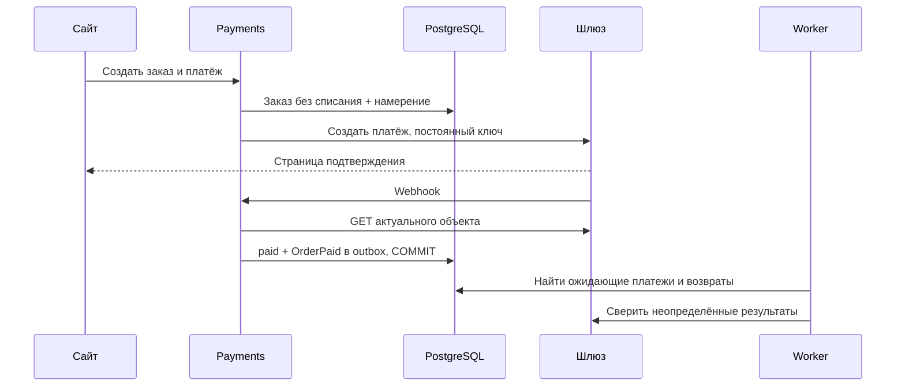

# ADR 001: внешняя тестовая оплата и компенсации

Статус: принято для учебного стенда. Тестовый магазин подключён; авторизация и test=true проверены через GET /me. Сквозную оплату и возврат ещё предстоит проверить.

## Контекст

Лабораторные списывают внутренний баланс при создании заказа. Такой заказ нельзя повторно
оплачивать через шлюз. Внешний запрос также может выполниться, даже если ответ потерян.

## Решение

Новые веб-заказы создаются через `/payments/checkout` с `payment_source=gateway` без списания баланса.
Старые заказы мигрируют с `internal_balance`; их сценарий и публичные числовые ответы сохраняются.
В PostgreSQL денежные столбцы используют `Numeric(14,2)`, внешняя оплата рассчитывается через Decimal.
Старые доменные DTO по-прежнему используют float для совместимости с лабораторными.

`POST /payments` принимает order_id, amount и Idempotency-Key. Заявленная amount обязана совпадать с серверной суммой заказа. Намерение резервируется под блокировкой заказа до обращения к провайдеру.
На заказ разрешено одно намерение, `(user_id, idempotency_key)` уникален.
После окончательной отмены платежа пользователь оформляет новый заказ.
При повторе с другими параметрами/ключом возвращается конфликт, без нового списания.

Провайдер получает UUID намерения как постоянный ключ операции, возврат — `refund-UUID`.
Транзакция БД не удерживается во время HTTP-запроса. Ответ проверяется по сумме, валюте и order_id.
Подтверждение оплаты, перевод заказа в paid и запись OrderPaid атомарны.
Прежний `/orders/{id}/pay` не подтверждает внешний заказ.

| Платёж | Что означает |
|---|---|
| creating | Намерение записано, результата провайдера пока нет |
| pending / waiting_for_capture | Результат ещё не окончательный |
| succeeded | Провайдер подтвердил оплату |
| canceled | Провайдер окончательно отменил платёж |

Возврат имеет своё состояние pending/succeeded/canceled. Отмена заказа не означает,
что возврат уже дошёл до клиента. Подтверждённый внешний платёж не возвращается на внутренний баланс.
Если отмена обогнала успешную оплату, поздний результат запускает возврат, без OrderPaid.
Отмена и операции доставки согласованы блокировкой заказа; переданный в путь заказ клиент не отменяет.

## ЮKassa и отличие от методички

Адаптер работает только с `test=true`. События: `payment.succeeded`, `payment.canceled`, `refund.succeeded`.
Уведомление не подтверждает оплату само по себе: перечитывается объект провайдера через авторизованный API.
ЮKassa описывает проверку через статус/IP, а не общую для всех шлюзов HMAC-подпись.
Refund-webhook вызывает проверку актуального состояния возврата по сохранённому refund_id; его повторы не создают новый refund. Периодическая сверка страхует потерянные уведомления.
Если уведомление пришло раньше сохранения gateway_id, сверка восстанавливает результат по постоянному ключу.

OrderCancelled получает отдельный payments_consumer из payments_queue. Consumer атомарно сохраняет Inbox receipt и refund_status=pending, затем ставит задачу возврата в Celery. Повтор события не создаёт второй компенсации; поздняя оплата отменённого заказа публикует новое OrderCancelled. Периодическая задача также ставит ожидающие операции в Celery. Повторы: 1/2/4/8 секунд + jitter.
После исчерпания — DLQ и review_required, автоматическая постановка приостанавливается. Окончательные HTTP 4xx (кроме 429) не повторяются; отказ платежа, например insufficient_funds, сохраняется как canceled с причиной.
Ручной replay или успешная ручная проверка снимают флаг. HTTP-запросы не спят между повторами.
Окно идемпотентности ЮKassa — 24 часа; без известного внешнего ID мы останавливаем создание/возврат
после 23 часов от сохранённого начала. Нужна ручная сверка, а не новый ключ.

## Компромиссы

- В первом варианте один заказ — одно блюдо, один платёж, полный возврат.
- Начальный HTTP-вызов может завершиться неопределённо; UI сообщает об этом, worker продолжает проверку.
- Демо-адаптер хранит состояние в БД, но не доказывает работу интеграции с внешним магазином.
- При смене выбранного провайдера сверка использует исходного провайдера конкретного платежа.
- Реальный магазин, HTTPS-вебхук и проверка тестовых отказов требуют настроек владельца.

Источники: [уведомления](https://yookassa.ru/developers/using-api/webhooks),
[идемпотентность и ошибки](https://yookassa.ru/developers/using-api/interaction-format).
