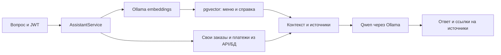

# ADR 002: локальный ассистент с публичным RAG и личным контекстом

Статус: принято; выполнен реальный прогон 19.11.2026, результаты и ограничения — в ../study/DEFENSE_AI.md.

## Решение

Генератор — Ollama с `qwen2.5:3b-instruct-q5_K_M`, эмбеддинги — отдельная `bge-m3:latest`, 1024 измерения. Контекст — 8192, максимум ответа — 350 токенов. Генерация идёт на GPU, эмбеддинги на CPU, чтобы модели помещались на видеокарте. Маленькая модель экономит ресурсы, но допускает фактические ошибки: критичные ответы формирует сервер.

RAG использует pgvector в уже имеющемся PostgreSQL. Это позволяет не добавлять отдельную векторную СУБД.
Пока данных немного, выполняется точный cosine search без приближённого HNSW-индекса.
Индексируются только текущее меню и `docs/knowledge/service.md`.
Сданные отчёты, секреты, пользователи и заказы в публичный индекс не попадают.
Версия embedding-модели и checksum записи позволяют переиндексировать изменения.
Устаревшие/удалённые записи убираются; возвращаемые блюда перечитываются из актуальной БД.

На явно личных вопросах сервер отдельно получает последние пять заказов пользователя с оплатой,
возвратом и доставкой. Пользователь определяется по JWT. Модель не выбирает user_id и не выполняет SQL.
История разговоров проверяется по владельцу, в генерацию передаются последние восемь сообщений.
Модель получает публичные источники и разрешённый личный контекст, а затем формирует ответ.

Пользовательские тексты и документы не изменяют права доступа. Даже при неудачном ответе LLM
в её распоряжении нет операций оплаты, отмены, возврата или чтения чужого аккаунта.
Заявленный состав хранится в каталоге; отсутствие следов аллергенов не гарантируется. Ответы об аллергии ограничены серверной проверкой.
Если модели нет, возвращается явный fallback; сайт, заказы и оплата продолжают работать.
Логи содержат длительность, ID пользователя и источников, без полного текста диалогов и токенов.
Диалоги хранятся в пользовательской истории в БД.

## Границы первой версии

Персональный контекст ограничен пятью последними заказами; ассистент не обещает поиск по всей истории.
Меню находится через RAG; обзор меню и точечные цены могут возвращаться сервером без генерации.
Нет потоковой генерации, автономных действий, персонального ранжирования и гарантий медицинской пригодности еды.
Размерность индекса фиксирована; смена embedding-модели требует совместимости и переиндексации.
Результаты оценки должны отделять корректность механики RAG от качества ответов настоящей модели.

Источники: [Qwen в Ollama](https://ollama.com/library/qwen2.5/tags),
[API эмбеддингов](https://github.com/ollama/ollama/blob/main/docs/capabilities/embeddings.mdx).
