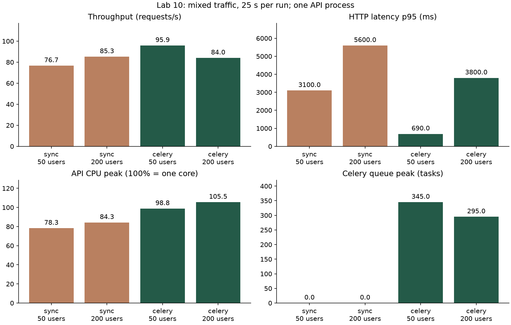
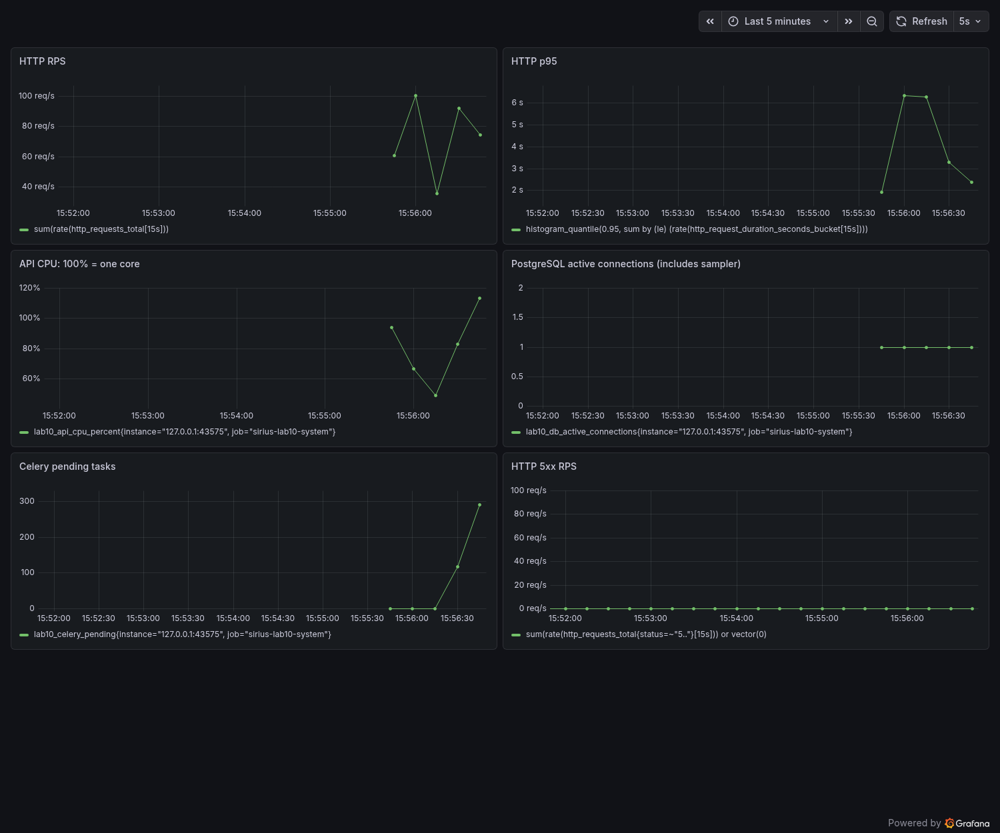
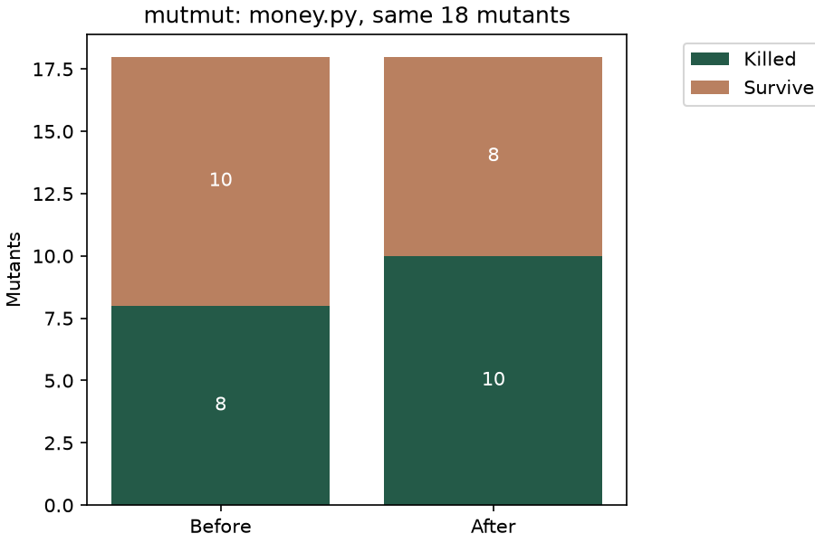

# Лабораторная № 10 — результаты

Дата: 19.11.2026. Измерения выполнены на локальном учебном компьютере. Исходные данные сохранены рядом с отчётом.

## Тесты

**367 passed, 8 skipped**, покрытие `app/` — **82%** строк, 4070 строк кода, 732 не покрыты. Полный запуск занял 30,49 с. Это line coverage, не branch coverage и не оценка качества каждого теста.

Команда:

```bash
PACT_DO_NOT_TRACK=true .venv/bin/pytest -q --cov=app --cov-report=term --cov-report=xml:docs/lab10/results/coverage.xml --junitxml=docs/lab10/results/pytest.xml
```

[Полный вывод](results/pytest.txt), [JUnit XML](results/pytest.xml), [coverage XML](results/coverage.xml).

Семь новых интеграционных проверок работают с настоящей PostgreSQL 16 + pgvector через Testcontainers и миграции Alembic. Ни одна не пропущена. Два Pact-теста проходят, включая ожидаемый отказ на несовместимом сообщении. Остальной набор содержит как unit-, так и компонентные проверки с SQLite/in-memory/fakeredis.

Восемь пропусков относятся к прежним опциональным проверкам: отдельный URL pgvector не задан, RabbitMQ не запущен. Полный брокерный E2E этим прогоном не подтверждён. Браузерные E2E в этом запуске не повторялись; они находятся в отдельной CI job.

## Нагрузочный эксперимент 50–200 пользователей

Сценарий: 70/20/10 по весам задач — список меню, карточка, создание заказа. Пауза 0,1–0,5 с; разгон по 50 пользователей в секунду; 25 с на прогон плюс завершение запросов. Setup-запросы входят в общий счётчик. Один Uvicorn-процесс, настоящая временная PostgreSQL/Redis, для async — Celery worker с 16 потоками. Тестовые уведомления имитируют PDF (2 с) и email (1 с), искусственные сбои выключены.

| Уведомления | Пользователи | Запросы | RPS | p95, с | Ошибки | Пик CPU API | Пик очереди Celery |
|---|---:|---:|---:|---:|---:|---:|---:|
| sync | 50 | 2074 | 76.70 | 3.10 | 0 | 78.3% | 0 |
| sync | 200 | 2309 | 85.26 | 5.60 | 0 | 84.3% | 0 |
| celery | 50 | 2316 | 95.87 | 0.69 | 0 | 98.8% | 345 |
| celery | 200 | 2265 | 84.03 | 3.80 | 0 | 105.5% | 295 |



Исходные [JSON](results/load-summary.json), CSV `*_stats.csv` и `*_stats_history.csv`, HTML-отчёты Locust `sync-50.html`, `sync-200.html`, `celery-50.html`, `celery-200.html` лежат в `results/`. RPS — значение из итогового агрегата Locust; фактическое окно включает завершение запросов и отличается от ровных 25 секунд.

**Что ограничивает систему:**

1. В sync p95 уже при 50 пользователях больше секунды. Около трёх секунд уходит на PDF/email внутри HTTP-запроса. При 200 пользователях заняты рабочие потоки и задержка растёт.
2. В celery/50 p95 ниже секунды, но worker не успевает за поступлением уведомлений: очередь растёт. Уменьшение HTTP latency не означает, что все письма уже отправлены.
3. В celery/200 API загружен примерно на одно ядро, очередь задач продолжает расти. Активных запросов к PostgreSQL немного (максимум четыре, включая измеритель); данных о насыщении БД в этом эксперименте нет. Ограничение CPU API — обоснованная гипотеза по наблюдениям, а не доказательство оптимального числа процессов.
4. Ошибок HTTP/Locust не наблюдалось. Порог появления 5xx не найден; мы не утверждаем, что система выдерживает любую нагрузку.

Это короткие диагностические замеры на общем компьютере, где работают и другие процессы. Они показывают симптомы и изменение поведения, но не заменяют длительный тест стабильности или независимый нагрузочный генератор. Нагрузка покрывает создание заказа с внутренним тестовым балансом; внешняя оплата, AI, SSR и обработка RabbitMQ в этот сценарий не входят. Поток задач в конце намеренно не дожидается полного опустошения: временный стенд затем удаляется.

## Подтверждение через Prometheus и Grafana

Дополнительные два прогона по 25 секунд при 200 пользователях с отдельным временным мониторингом:

| Уведомления | Запросы | RPS | p95, с | Ошибки | Пик CPU API | Пик очереди |
|---|---:|---:|---:|---:|---:|---:|
| sync | 2657 | 91.23 | 5.30 | 0 | 99.8% | 0 |
| celery | 2610 | 103.77 | 3.30 | 0 | 113.2% | 291 |



Слева в истории — sync, справа — Celery. Растущая очередь и CPU около одного ядра видны непосредственно на дашборде. PostgreSQL active connections включает сам запрос измерителя. CPU снимается через psutil: 100% соответствует одному логическому ядру, а не всему компьютеру.

[Снимок ответов Prometheus](results/monitored/prometheus-evidence.json), [данные повторного эксперимента](results/monitored/load-summary.json), [JSON дашборда](results/monitored/grafana-dashboard.json). Prometheus собирал реальные `/metrics`; системные gauges передавались небольшим локальным exporter из измерителя.

**Найден и исправлен дефект наблюдаемости:** стандартный `http_request_duration_seconds` имел последний конечный интервал 1 с, поэтому histogram_quantile при перегрузке показывал максимум около 1 с. В `app/main.py` конечные интервалы расширены до 180 с; добавлен регрессионный тест `tests/test_lab10_metrics.py`. Скриншот сделан после исправления. Prometheus p95 оценивается по интервалам и скользящему окну, поэтому не обязан совпадать с итоговым p95 Locust.

## Контракт Pact

Consumer — кухня, provider — заказы. Контракт описан независимо от `OrderPaid.to_payload`. Пример проходит реальные `parse_event` и `KitchenService.accept`; проверка provider получает сообщение из outbox после настоящего `OrderService.pay_order`.

Два сценария: рабочий producer проходит; переименование `amount` в `total` вызывает ошибку Pact Verifier. Отрицательный сценарий ожидает ошибку, поэтому итоговый pytest зелёный. [Сгенерированный контракт](pacts/sirius-kitchen-sirius-orders.json).

В проекте `amount/customer_id`, а не иллюстративные `total/currency` из методички. Проверяется действующий протокол, без изменения рабочего события. Pact не доказывает доставку сообщения через брокер.

## Мутационное тестирование

Один и тот же `app/domain/money.py`, 18 мутаций. До — проверка целых рублей, после — плюс проверки дробной копейки, отрицательного округления и недопустимых значений.

| Набор | Убито | Выжило | Доля убитых |
|---|---:|---:|---:|
| До | 8 | 10 | 44,4% |
| После | 10 | 8 | 55,6% |



Новые тесты ловят две мутации: удаление `rounding=ROUND_HALF_UP` и замену его на None. На целых рублях разницы нет, на 1.005 и -1.005 она появляется. Восемь оставшихся мутаций меняют текст ValueError — текущие проверки требуют тип ошибки, но не точный текст. Это честно оставлено в отчёте. Нельзя переносить mutation score одной функции на весь проект.

Исходные файлы: [до](results/mutation-before.json), [после](results/mutation-after.json), [выжившие после](results/mutation-after-survivors.diff). Скрипт работает в копиях во временных каталогах и никогда не применяет мутант к рабочему коду.

## CI

Workflow `.github/workflows/tests.yml` подготовлен для push/PR: быстрые тесты, миграции, frontend, browser, Testcontainers/Pact, mutmut до/после. Локальный [сломанный тест](results/local-red-gate.txt) вернул ожидаемый exit 1. Этот локальный результат не подменяет реальный запуск Actions.

GitHub: https://github.com/Tolex1510/sirius-eda. Пользователь указал новый пустой приватный репозиторий; подготовка публикации и проверка Actions выполняются отдельно. Окончательное состояние GitHub будет записано в `GITHUB.md`. Блокировка Merge требует настройки обязательных status checks; YAML workflow сам по себе её не включает.

Подробные команды, карта кода и ответы на вопросы — в [DEFENSE.md](DEFENSE.md).
