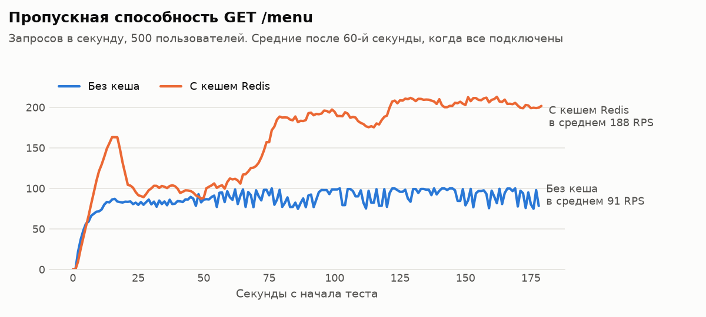
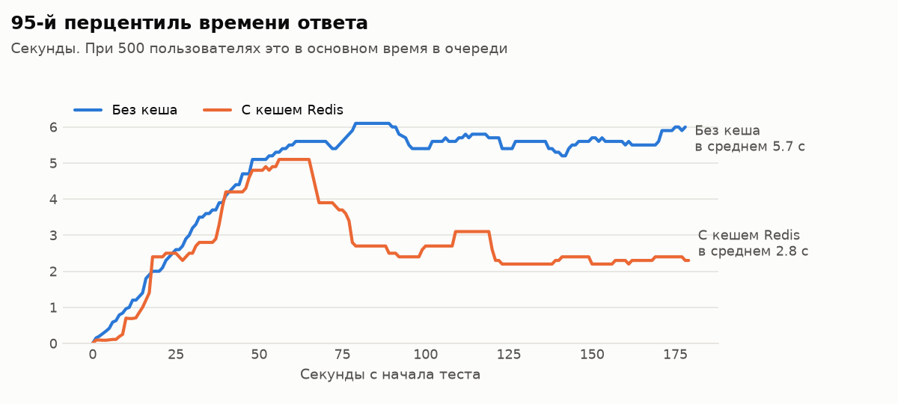
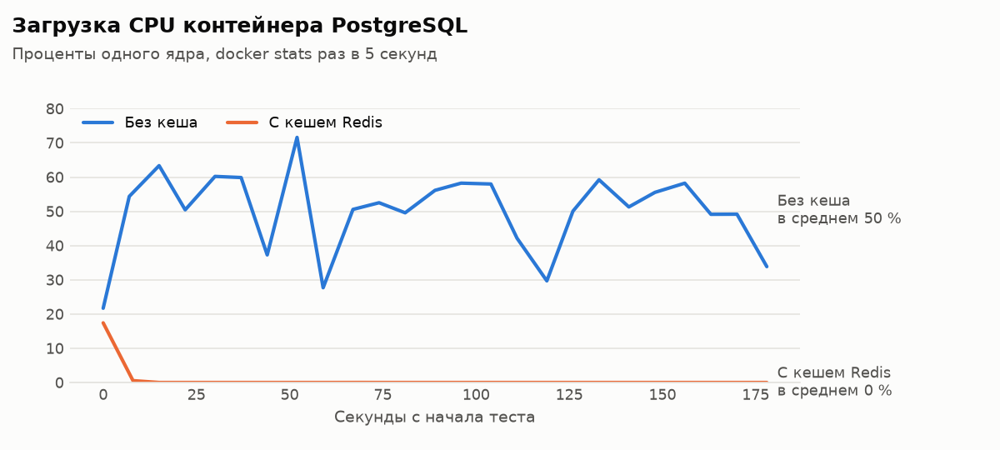

# Итоги замеров: кеш меню на Redis

Лабораторная работа № 4. Сравнение `GET /menu` без кеша и с кешем Cache-Aside.

## Условия

| Параметр | Значение |
|---|---|
| Пользователей | 500, подключаются по 10 в секунду |
| Пауза между запросами | 0,1–0,5 с |
| Длительность | 3 минуты |
| Сценарий | 4 из 5 запросов `GET /menu/items`, 1 из 5 `GET /menu/categories/{id}` |
| Данные | 12 разделов, 300 блюд, ответ `/menu/items` 26 КБ |
| Приложение | один процесс uvicorn |
| Машина | 4 ядра, Locust, PostgreSQL и Redis на ней же |

Оба финальных прогона сделаны на одном коде. Отличается только `MENU_CACHE_ENABLED`.

## Главное

| Метрика | Без кеша | С кешем | Изменение |
|---|---|---|---|
| RPS после разгона | 91 | 188 | ×2,1 |
| Медиана ответа | 5,1 с | 2,2 с | −57% |
| 95-й перцентиль после разгона | 5,7 с | 2,8 с | −51% |
| Транзакций в PostgreSQL | 21 983 | 99 | ÷222 |
| Строк прочитано PostgreSQL | 5,9 млн | 16 тыс. | ÷362 |
| CPU PostgreSQL | 50% ядра | 0% | |
| Попаданий в кеш | | 29 991 | промахов 0 |
| Ошибок | 0 | 0 | |

## Графики







## По эндпоинтам

| Эндпоинт | Запросов без кеша | Запросов с кешем | RPS без кеша | RPS с кешем | Медиана без / с кешем |
|---|---|---|---|---|---|
| `GET /menu/items` | 12 552 | 23 717 | 70,1 | 132,2 | 5,1 / 2,2 с |
| `GET /menu/categories/{id}` | 3 075 | 5 920 | 17,2 | 33,0 | 5,1 / 2,2 с |
| Всего | 15 627 | 29 637 | 87,3 | 165,2 | 5,1 / 2,2 с |

## Один запрос без очереди

500 последовательных запросов, `scripts/latency_probe.py`.

| Эндпоинт | Без кеша, медиана / p95 | С кешем, медиана / p95 |
|---|---|---|
| `GET /menu/items` | 10,8 / 14,5 мс | 4,6 / 6,0 мс |
| `GET /menu/categories/3` | 6,4 / 8,4 мс | 3,0 / 4,1 мс |

Под нагрузкой ответ измеряется секундами из-за очереди. 500 пользователей создают около 1600 запросов в секунду.
Один процесс uvicorn столько не обработает даже с кешем.

## Все прогоны

| Прогон | Что было | RPS | Медиана | Транзакций БД |
|---|---|---|---|---|
| `before` | код после лабораторной № 3 | 72 | 6,4 с | 13 181 |
| `cache_v1` | первый кеш, медленная сериализация | 98 | 4,2 с | 62 |
| `nocache` | финальный код, кеш выключен | 87 | 5,1 с | 21 983 |
| `cache` | финальный код, кеш включён | 165 | 2,2 с | 99 |

После `cache_v1` найдены две проблемы:

1. **Медленная сериализация.** `jsonable_encoder` тратил 6,6 мс из 8 на запрос.
   Исправлено через `response_model`, теперь 0,3 мс.
2. **Взаимоблокировка пула соединений.** Без кеша 13% ответов были 500.
   Сессия держала соединение, пока ответ сериализуется. Исправлено декоратором `short_transactions` в `app/database.py`.

## Вывод

Кеш почти полностью снял нагрузку с PostgreSQL: транзакций в 222 раза меньше, CPU базы упал до нуля.
Пропускная способность выросла вдвое. Дальше упирается в Python: один процесс разбирает запросы и отдаёт JSON.
Следующий шаг для роста RPS: несколько воркеров uvicorn.

## Файлы

Отчёты Locust открываются в браузере:

* [без кеша](results/nocache.html)
* [с кешем](results/cache.html)
* [baseline](results/before.html)
* [первая попытка с кешем](results/cache_v1.html)

| Файл в `results/` | Что внутри |
|---|---|
| `*_stats.csv` | итог по эндпоинтам |
| `*_stats_history.csv` | метрики по секундам, из них графики |
| `*_system.csv` | load average и CPU контейнеров раз в 5 с |
| `*_postgres.txt` | транзакции и строки за прогон |
| `*_redis.txt` | попадания и промахи кеша |
| `latency_probe.txt` | время одного запроса без нагрузки |

## Как повторить

```bash
python -m app.cli seed-menu
MENU_CACHE_ENABLED=false scripts/loadtest.sh nocache
scripts/loadtest.sh cache
python scripts/plot_loadtest.py nocache cache
```
