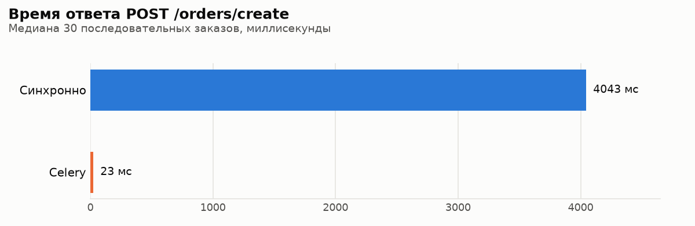
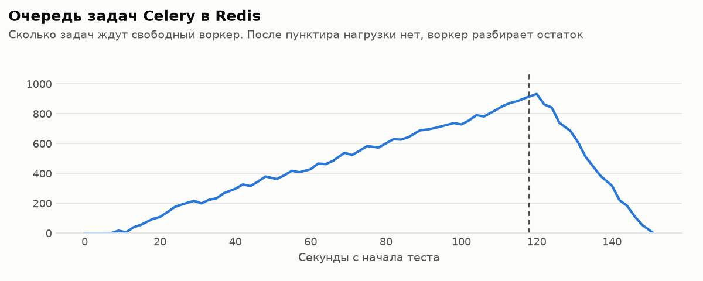

# Защита лабораторной № 5: Celery

Подробности и графики в [README](../../README.md#лабораторная-работа--5-фоновые-задачи-на-celery).

## Что сделано по баллам

| Балл | Требование | Где |
|---|---|---|
| 6–7 | Celery подключён, брокер Redis | `app/core/celery_app.py` |
| 6–7 | PDF, email и SMS в фоне | `app/tasks/orders.py`, заглушки `app/tasks/stubs.py` |
| 6–7 | Задачи вызываются из Service | `OrderService.create_order` → `OrderNotifier` → `CeleryOrderNotifier` |
| 6–7 | `POST /orders/create` отвечает мгновенно | 4043 мс → 23 мс |
| 6–7 | Замеры «до / после» | `docs/lab5/results`, графики `docs/lab5/*.png` |
| 8 | Ретраи 1, 2, 4 с с jitter | `RETRY_POLICY` в `app/tasks/orders.py` |
| 8 | Dead Letter Queue | `OrderTask.on_failure`, `app/tasks/dead_letters.py` |
| 8 | Идемпотентность | `app/tasks/journal.py`, таблица `task_logs` |
| 8 | README с графиками | раздел «Лабораторная работа № 5» |
| 9 | Flower, скриншоты | `docs/lab5/flower_*.png` |
| 10 | Celery Beat | `beat_schedule`, `app/tasks/maintenance.py` |

Сверх методички:
* досылка задач, потерянных при падении брокера;
* сводка заказов `GET /orders/stats`;
* `task_acks_late` на случай падения воркера.

## Главные цифры

| | Синхронно | Celery |
|---|---|---|
| Один заказ, медиана | 4043 мс | 23 мс |
| Под нагрузкой, медиана | 4,1 с | 0,06 с |
| Заказов в секунду | 5,7 | 13,2 |
| Чек дошёл через, медиана | 4,1 с | 16 с |





Последняя строка таблицы честная. Ответ клиенту стал мгновенным, а чек под нагрузкой приходит позже.
Воркер не успевал, и очередь выросла до 933 задач. Лечится числом воркеров, а не кодом API.

## Порядок показа

### 1. Запуск, четыре терминала

```bash
DB_PORT=5433 REDIS_PORT=6380 docker-compose up -d
alembic upgrade head
uvicorn app.main:app
celery -A app.core.celery_app worker --loglevel=info
celery -A app.core.celery_app beat --loglevel=info
celery -A app.core.celery_app flower --address=127.0.0.1 --port=5555
```

Открыть Swagger http://127.0.0.1:8000/docs и Flower http://127.0.0.1:5555.

### 2. Заказ отвечает мгновенно

Войти студентом через Authorize в Swagger. Без пароля можно взять токен из CLI:

```bash
python -m app.cli load-users --count 1
```

```bash
time curl -X POST http://127.0.0.1:8000/orders/create \
  -H "Authorization: Bearer $TOKEN" -H "Content-Type: application/json" \
  -d '{"item_id": 1, "quantity": 1}'
```

Ответ около 20–50 мс. В логе воркера видны три задачи: `generate_order_pdf`, `send_order_email`, `send_order_sms`.
Во Flower на вкладке Tasks они появляются сразу.

### 3. Ретраи и DLQ

Сделать 5 заказов подряд. Почта падает у каждого 5-го заказа, SMS у каждого 3-го не проходит с первой попытки.

В логе воркера:
* `Retry in 1s ... SMS gateway timeout`, затем SMS успешна;
* `Retry in 1s`, `2s`, `4s` для email, затем `failed after 3 retries, moved to DLQ`.

Секунды бывают меньше: это jitter. Во Flower у задачи `Retries 3` и статус `FAILURE`.

```bash
python -m app.cli dlq-list
docker-compose exec redis redis-cli LLEN dlq
docker-compose exec db psql -U sirius -d sirius_food \
  -c "select order_id, kind, status, attempts, error from task_logs order by id desc limit 6"
```

Вернуть задачи после починки провайдера. Воркер перезапустить с `FAKE_EMAIL_FAIL_EVERY=0`, затем:

```bash
python -m app.cli dlq-replay
```

### 4. Идемпотентность

Запустить задачу уже выполненного заказа ещё раз:

```bash
celery -A app.core.celery_app call app.tasks.orders.generate_order_pdf --args='[ORDER_ID]'
```

В логе воркера `already done or in progress, skipped`, задача завершилась за миллисекунды.
PDF второй раз не создан.

### 5. Celery Beat

Через минуту после старта в логе Beat `Sending due task refresh-order-stats`.
Результат видит администратор в `GET /orders/stats` или в базе:

```bash
docker-compose exec db psql -U sirius -d sirius_food -c "select * from order_stats"
```

### 6. Отказ Redis, по желанию

```bash
docker-compose stop redis
# заказ в Swagger: 200 за 0,3 с, в логе uvicorn "broker unavailable"
docker-compose start redis
```

Через 2–3 минуты Beat пишет `Requeued N lost order tasks`, и уведомления уходят.

### 7. Тесты

```bash
pytest tests/test_order_tasks.py -v
```

16 тестов: повторный запуск, ретрай, DLQ, replay, падение воркера, брокера, Beat.

## Вопросы, которые вероятно зададут

**Почему задачи вызываются из сервиса, а не из роутера?**
Чек после заказа это бизнес-правило. Роутер только переводит HTTP. Сервис зовёт абстракцию `OrderNotifier`,
Celery подключается в `app/dependencies.py`. В `service.py` нет импорта celery, это проверяет тест.

**Почему не `.delay()` прямо в сервисе, как в методичке?**
Тогда сервис зависит от брокера: юнит-тесту нужен Redis, замена Celery меняет бизнес-логику.
Через абстракцию правило «после заказа уведомить» осталось в сервисе, а способ выполнения вынесен наружу.

**Что если воркер упадёт посреди задачи?**
`task_acks_late`: задача подтверждается после выполнения. Redis вернёт её через 5 минут.
Журнал разрешит повтор, если запись висит в `started` дольше 2 минут.

**Почему идемпотентность в PostgreSQL, а не флагом в Redis?**
Флаг из методички проверяется и ставится разными командами: два воркера пройдут проверку одновременно.
Здесь занятие записи сделано одним условным `UPDATE` с уникальным ключом. Журнал переживает очистку Redis.

**Почему RPS вырос в 2,3 раза, а не в десятки?**
Locust ждёт ответа и делает паузу 2–4 с. Пользователь синхронно тратит на цикл 7 с, с Celery 3 с.
Время ответа упало в 179 раз, это и есть главный результат.

**Почему воркер на потоках?**
Задачи ждут сеть, а не процессор. 64 потока дешевле 64 процессов.
Для тяжёлых вычислений, например настоящей генерации PDF, нужен prefork по числу ядер.

**Что если упал сам брокер?**
Заказ сохраняется и отвечает 200, ошибка пишется в лог. Beat раз в минуту досылает задачи заказов без записей в журнале.
Полностью проблему решает transactional outbox: событие пишется в БД в одной транзакции с заказом.

**Почему в задачу передаётся только id?**
Аргументы видны во Flower и лежат в Redis. Email и телефон студента там не нужны.
Воркер читает свежие данные из БД в момент выполнения.

**Зачем пересчитывать вчерашний день в статистике?**
Заказ, отменённый после полуночи, меняет вчерашнюю выручку.

**Можно ли запустить два Beat?**
Нельзя: каждая задача выполнится дважды. Beat запускается в одном экземпляре.
