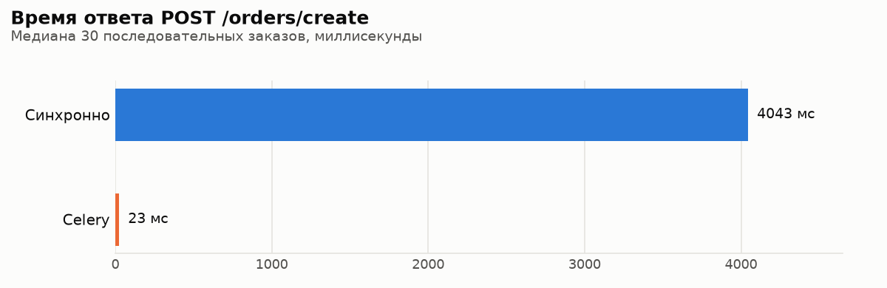
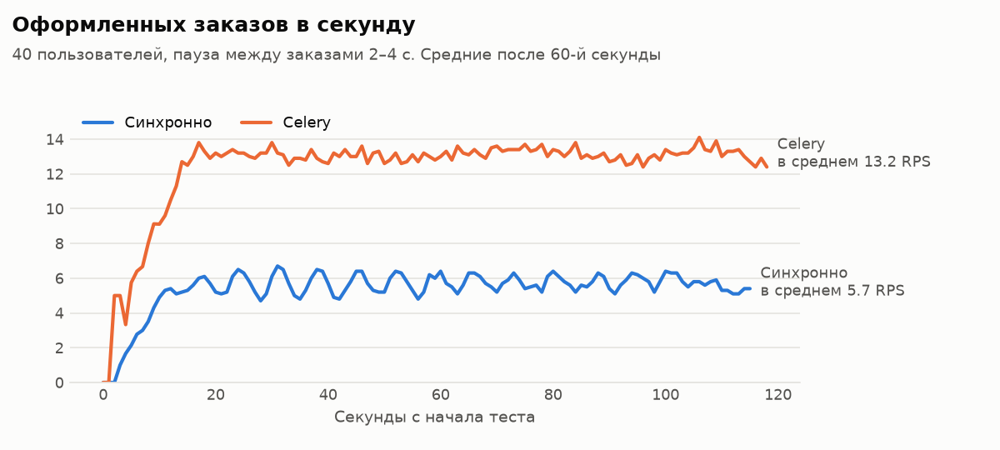
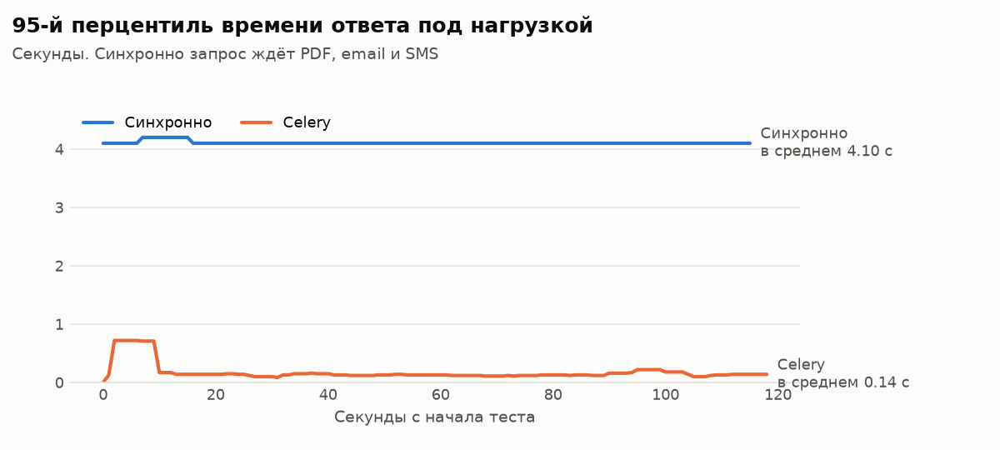
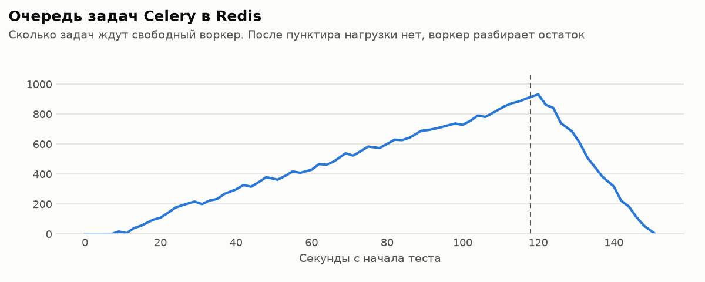
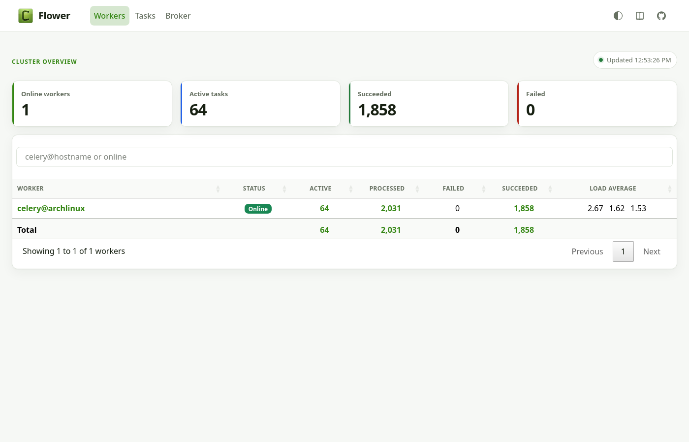
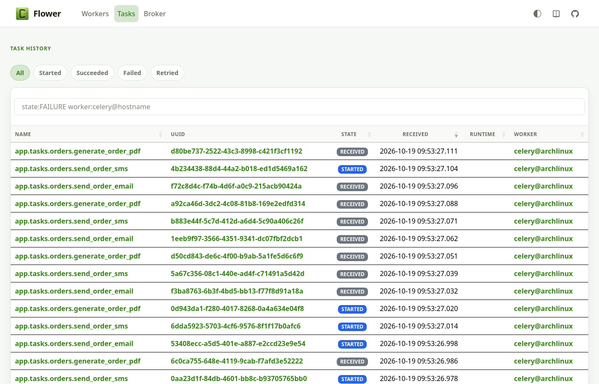
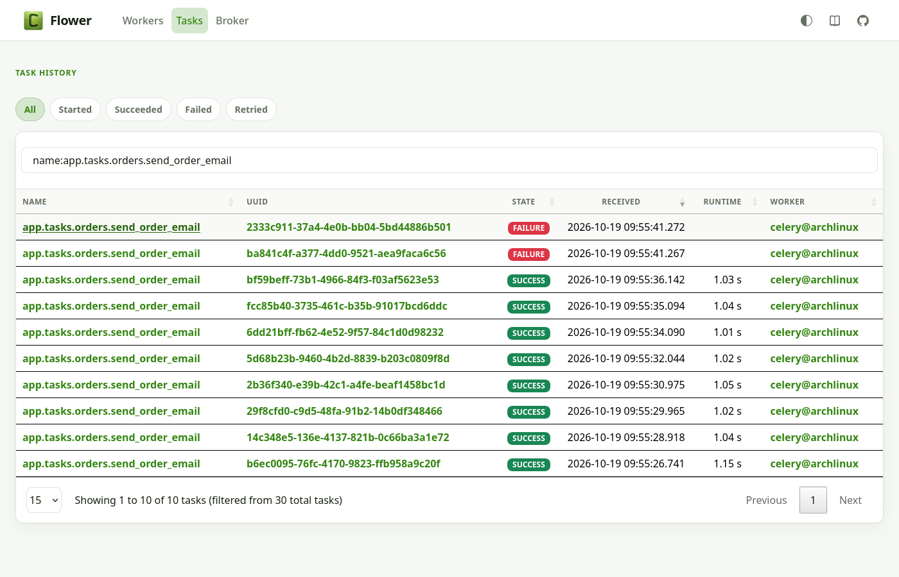
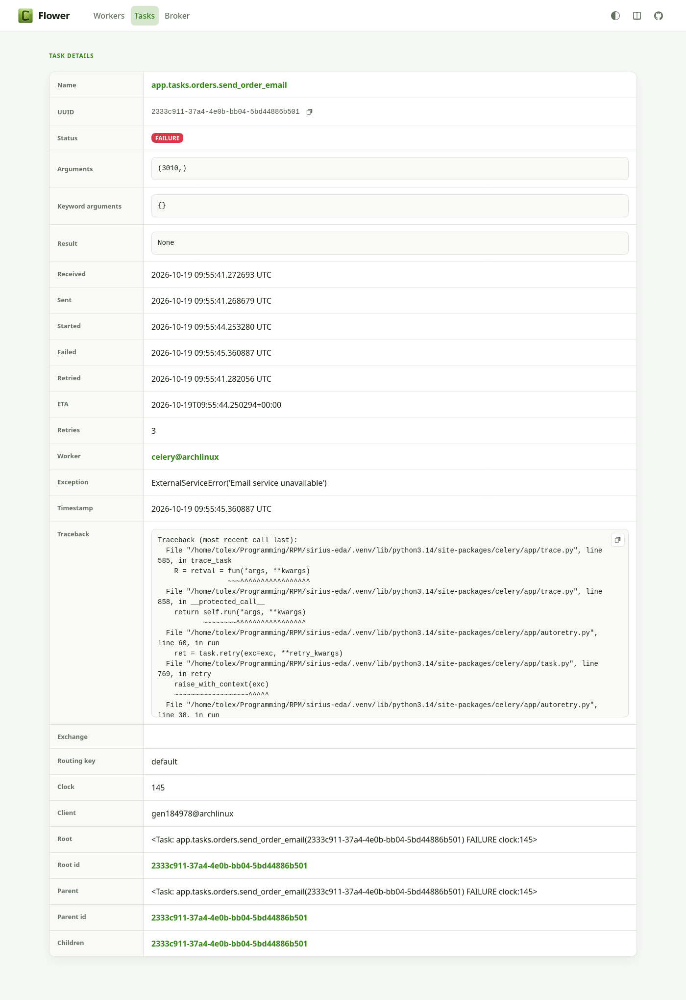
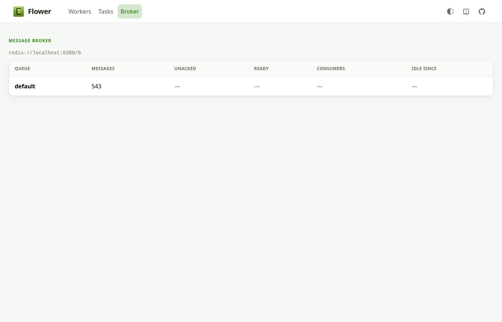

# Итоги лабораторной № 5: фоновые задачи на Celery

Оформление заказа `POST /orders/create`: PDF-чек, email и SMS выполняются в запросе или в Celery.
Выполнено на 10 баллов.

## Что сделано

| Балл | Требование | Где |
|---|---|---|
| 6–7 | Celery подключён, брокер Redis, JSON вместо pickle | `app/core/celery_app.py` |
| 6–7 | PDF, email и SMS вынесены в фон | `app/tasks/orders.py`, заглушки `app/tasks/stubs.py` |
| 6–7 | Задачи вызываются из Service | `OrderService.create_order` → `OrderNotifier` → `CeleryOrderNotifier` |
| 6–7 | `POST /orders/create` отвечает мгновенно | 4043 мс → 23 мс |
| 6–7 | Замеры «до / после» | `scripts/order_probe.py`, `scripts/loadtest_orders.sh` |
| 8 | Ретраи 1, 2, 4 с, jitter, не больше 3 | `RETRY_POLICY` в `app/tasks/orders.py` |
| 8 | Dead Letter Queue | `OrderTask.on_failure`, `app/tasks/dead_letters.py` |
| 8 | Идемпотентность | `app/tasks/journal.py`, таблица `task_logs`, миграция `0006` |
| 8 | README с графиками | раздел «Лабораторная работа № 5» в `README.md` |
| 9 | Flower, скриншоты | ниже |
| 10 | Celery Beat | `app/tasks/maintenance.py`, расписание в `app/core/celery_app.py` |

Сверх методички:
* досылка задач, которые не попали в очередь из-за падения брокера;
* сводка заказов по дням `GET /orders/stats` для администратора;
* `task_acks_late`: задача не теряется, если воркер упал посреди работы;
* в задачу передаётся только id заказа, email и телефон не попадают в Redis и во Flower.

Тесты: 196, из них 16 на фоновые задачи в `tests/test_order_tasks.py`.

## Условия замера

| Параметр | Значение |
|---|---|
| Заглушки | PDF 2 с, email 1 с, SMS 1 с |
| Один запрос | 30 заказов подряд без параллельной нагрузки |
| Нагрузка | 40 студентов, пауза между заказами 2–4 с, 2 минуты |
| Приложение | один процесс uvicorn |
| Воркер | `--pool threads --concurrency 64`: задачи ждут сеть, а не CPU |
| Машина | 4 ядра, PostgreSQL и Redis в Docker на ней же |

Финальные прогоны сделаны на одном коде, отличается только `ORDER_TASKS_MODE=sync|celery`.
Сбои заглушек на время замера выключены, чтобы ретраи не искажали время.

## Главное

| Метрика | Синхронно | Celery | Изменение |
|---|---|---|---|
| Один заказ, медиана | 4043 мс | 23 мс | ÷179 |
| Один заказ, 95-й перцентиль | 4063 мс | 54 мс | ÷75 |
| Под нагрузкой, медиана | 4,1 с | 0,06 с | ÷72 |
| Под нагрузкой, 95-й перцентиль | 4,1 с | 0,14 с | ÷29 |
| Заказов в секунду после разгона | 5,7 | 13,2 | ×2,3 |
| Заказов за 2 минуты | 657 | 1538 | ×2,3 |
| Ошибки | 0 | 0 | |
| Максимум задач в очереди | | 933 | |
| От заказа до последнего уведомления, медиана | 4,1 с | 16,2 с | |
| То же, 95-й перцентиль | 4,1 с | 29,6 с | |

## Графики









## Все прогоны

| Прогон | Что было | Один заказ, медиана | Под нагрузкой, медиана | Заказов в секунду |
|---|---|---|---|---|
| `before` | коммит «Замер baseline», всё в запросе | 4053 мс | 4,1 с | 5,5 |
| `sync` | финальный код, `ORDER_TASKS_MODE=sync` | 4043 мс | 4,1 с | 5,5 |
| `celery` | финальный код, `ORDER_TASKS_MODE=celery` | 23 мс | 0,06 с | 12,9 |

Заказов в секунду здесь за весь прогон, вместе с разгоном. Выше в таблице только после разгона.

## Проверка ретраев, DLQ и идемпотентности

Шесть заказов подряд со включёнными сбоями. Почта падает у каждого 5-го заказа, SMS у каждого 3-го не проходит с первой попытки.
Журнал `task_logs` после выполнения:

| Заказ | PDF | Email | SMS |
|---|---|---|---|
| 715 | done, 1 попытка | **dead, 4 попытки** | done, 1 попытка |
| 716 | done, 1 | done, 1 | done, 1 |
| 717 | done, 1 | done, 1 | **done, 2 попытки** |
| 718 | done, 1 | done, 1 | done, 1 |
| 719 | done, 1 | done, 1 | done, 1 |
| 720 | done, 1 | **dead, 4 попытки** | **done, 2 попытки** |

Лог воркера: задержки ретраев растут, задача уходит в DLQ.

```text
send_order_sms   retry: Retry in 1s: ExternalServiceError('SMS gateway timeout')
send_order_email retry: Retry in 1s: ExternalServiceError('Email service unavailable')
send_order_email retry: Retry in 2s: ExternalServiceError('Email service unavailable')
send_order_email retry: Retry in 4s: ExternalServiceError('Email service unavailable')
Order 720 email failed after 3 retries, moved to DLQ
```

Задержка бывает меньше 1, 2, 4 с: jitter выбирает случайное значение в этих пределах.

| Проверка | Результат |
|---|---|
| `python -m app.cli dlq-list` | 2 задачи с ошибкой и временем, очередь не меняется |
| `dlq-replay` после починки почты | обе задачи выполнены, `done`, 5 попыток, DLQ пуста |
| Повторный запуск PDF для заказа 719 | `already done or in progress, skipped` за 8 мс |
| Redis остановлен, заказ до исправления | 500 через 19 с |
| Redis остановлен, заказ после `task_ignore_result` | 200 за 0,3 с, ошибка в логе |
| Beat через минуту после остановки Redis | `Requeued 6 lost order tasks`, все задачи `done` |

## Flower

Под нагрузкой: 64 задачи выполняются одновременно, 1858 уже выполнено.



Задачи в реальном времени: одни приняты воркером, другие уже выполняются.



Письма каждого 5-го заказа не ушли, остальные выполнены.



Упавшая задача: 3 ретрая, ошибка провайдера, в аргументах только id заказа.



Очередь в Redis во время нагрузки.



## Celery Beat

| Задача | Расписание | Что делает |
|---|---|---|
| `refresh_order_stats` | раз в минуту | число заказов и выручка за сегодня и вчера в таблицу `order_stats` |
| `requeue_lost_order_tasks` | раз в минуту | досылает задачи заказов, которые не попали в очередь |
| `cleanup_task_logs` | в 03:00 UTC | удаляет записи `task_logs` старше 30 дней |

Лог Beat и воркера:

```text
Scheduler: Sending due task refresh-order-stats (app.tasks.maintenance.refresh_order_stats)
Scheduler: Sending due task requeue-lost-order-tasks (app.tasks.maintenance.requeue_lost_order_tasks)
Requeued 6 lost order tasks
Order stats refreshed: 2026-10-18 0 orders, 2026-10-19 719 orders
```

Сводку видит администратор: `GET /orders/stats?days=7`.

## Вывод

Клиент больше не ждёт PDF, email и SMS: ответ стал быстрее в 179 раз.
Пропускная способность выросла в 2,3 раза. В этом сценарии её ограничивает пауза между заказами, а не сервер.

Фоновая работа никуда не делась. 13 заказов в секунду дают 40 задач в секунду, а воркер успевал около 31.
Очередь росла всю нагрузку и рассосалась за 30 секунд после неё. Чек приходил в среднем через 16 секунд.
Очередь сглаживает пик, а скорость обработки задаётся числом воркеров. Следующий шаг: второй воркер или больше потоков.

## Файлы

Отчёты Locust открываются в браузере:

* [синхронно](results/sync.html)
* [Celery](results/celery.html)
* [baseline](results/before.html)

| Файл в `results/` | Что внутри |
|---|---|
| `*_probe.csv` | время каждого из 30 последовательных заказов |
| `*_stats.csv` | итог Locust |
| `*_stats_history.csv` | метрики по секундам, из них графики |
| `*_system.csv` | load average и длина очереди раз в 2 с |
| `celery_receipts.txt` | время от заказа до последнего уведомления |
| `celery_worker.log` | лог воркера во время нагрузки |

## Как повторить

```bash
python -m app.cli seed-menu
ACCESS_TOKEN_TTL_MINUTES=120 python -m app.cli load-users --count 50 > tokens.txt
python scripts/order_probe.py http://127.0.0.1:8000 tokens.txt celery
export FAKE_EMAIL_FAIL_EVERY=0 FAKE_SMS_FLAKY_EVERY=0
ORDER_TASKS_MODE=sync   scripts/loadtest_orders.sh sync tokens.txt
ORDER_TASKS_MODE=celery scripts/loadtest_orders.sh celery tokens.txt
python scripts/plot_orders.py sync celery
```
