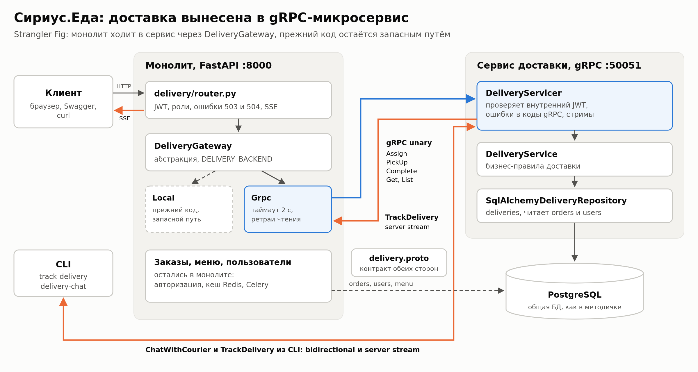

# Защита лабораторной № 6: доставка в gRPC-микросервис

Подробности в [README](../../README.md#лабораторная-работа--6-доставка-в-grpc-микросервис), итоги в [result.md](result.md).

## Что сделано по баллам

| Балл | Требование | Где |
|---|---|---|
| 4–5 | `.proto` создан, код сгенерирован | `proto/delivery.proto`, `delivery_pb2*.py`, `scripts/gen_proto.sh` |
| 6–7 | gRPC-сервер работает | пакет `delivery_service`, `python -m delivery_service` |
| 6–7 | Монолит вызывает сервис | `GrpcDeliveryGateway` в `app/modules/delivery/grpc_client.py` |
| 6–7 | Два процесса работают вместе | лог сервиса и ответы API ниже |
| 8 | `UNAVAILABLE` и таймауты | `to_domain_error`, `call` в `app/modules/delivery/router.py`: 503 и 504 |
| 8 | README с архитектурной схемой | `docs/lab6/architecture.png`, раздел «Лабораторная работа № 6» |
| 9 | Server Streaming `TrackDelivery` | `DeliveryServicer.TrackDelivery`, CLI `track-delivery`, SSE `/delivery/{id}/track` |
| 10 | Bidirectional Streaming, чат | `DeliveryServicer.ChatWithCourier`, CLI `delivery-chat` |

Сверх методички:
* переключатель `DELIVERY_BACKEND=grpc|local`, откат без деплоя;
* сервис сам проверяет пользователя по внутреннему JWT;
* повторы только для чтения, один канал на процесс;
* статус `on_the_way` и эндпоинт `PATCH /delivery/{id}/pickup`;
* 22 теста на настоящем gRPC-сервере, всего 223.



## Главные цифры

| | Медиана | 95-й перцентиль |
|---|---|---|
| Доставка внутри монолита | 9,0 мс | 15,1 мс |
| Монолит через gRPC | 12,8 мс | 23,0 мс |
| gRPC напрямую | 6,8 мс | 9,4 мс |
| Сервис лежит, запись | 503 за 8 мс | |
| Сервис лежит, чтение с повторами | 503 за 0,3 с | |

Сеть стоит около 4 мс на запрос. Отказ сервиса превращается в быстрый 503, а не в зависший запрос.

## Порядок показа

### 1. Запуск, два процесса

```bash
DB_PORT=5433 REDIS_PORT=6380 docker-compose up -d
python -m delivery_service     # терминал 1
uvicorn app.main:app           # терминал 2
```

В терминале 1: `Delivery gRPC server listening on 127.0.0.1:50051`.
Swagger: http://127.0.0.1:8000/docs.

### 2. Жизненный цикл доставки через gRPC

Студентом создать заказ в Swagger `POST /orders/create`. Оплаченного статуса через API нет, ставим вручную:

```bash
docker-compose exec db psql -U sirius -d sirius_food -c "update orders set status='paid' where id=ORDER_ID"
```

Войти курьером через Authorize и вызвать по очереди:

| Запрос | Ответ | Лог сервиса |
|---|---|---|
| `POST /delivery/assign` | `{"status":"success","delivery_id":5}` | `AssignCourier OK 24.2 ms` |
| `PATCH /delivery/5/pickup` | `"status":"on_the_way"` | `PickUpOrder OK 12.3 ms` |
| `PATCH /delivery/5/complete` | `{"status":"success"}` | `CompleteDelivery OK 40.3 ms` |
| `GET /delivery/999` | 404 | `GetDelivery NOT_FOUND` |
| `PATCH /delivery/5/complete` ещё раз | 400 | `CompleteDelivery FAILED_PRECONDITION` |

Главное: каждая строка ответа API рождает строку в логе другого процесса.

### 3. Стрим статусов

До назначения курьера запустить в третьем терминале:

```bash
python -m app.cli track-delivery --delivery-id 5 --user-id 9
```

Пока курьер жмёт pickup и complete, строки появляются сами:

```text
10:51:30  доставка 5: in_progress
10:51:32  доставка 5: on_the_way
10:51:34  доставка 5: completed
```

Тот же стрим через HTTP для браузера:

```bash
curl -N -H "Authorization: Bearer $TOKEN" http://127.0.0.1:8000/delivery/5/track
```

### 4. Чат

Два терминала, заказчик и курьер:

```bash
python -m app.cli delivery-chat --delivery-id 5 --user-id 9
python -m app.cli delivery-chat --delivery-id 5 --user-id 60
```

Сообщение из одного терминала сразу появляется в другом. Повар или другой студент получает
`Ошибка: Нет доступа к чужой доставке`.

### 5. Отказ сервиса

Остановить терминал 1 через Ctrl+C. В Swagger:

* `POST /delivery/assign` → 503 мгновенно, заголовок `retry-after: 5`;
* `GET /delivery/4` → 503 за 0,3 с: чтение повторилось 3 раза;
* меню и заказы работают.

Запустить сервис снова. Тот же `GET` отвечает 200, монолит не перезапускали.

### 6. Откат Strangler Fig

```bash
DELIVERY_BACKEND=local uvicorn app.main:app
```

Доставка работает без сервиса, на прежнем коде внутри монолита.

### 7. Тесты

```bash
pytest tests/test_delivery_grpc.py -v
```

Одни и те же сценарии гоняются через `local` и через настоящий gRPC-сервер и дают одинаковый результат.

## Вопросы, которые вероятно зададут

**Почему роутер не зовёт gRPC-клиент напрямую?**
Роутер зависит от абстракции `DeliveryGateway`. Реализацию выбирает `app/dependencies.py`.
Так работает откат на `local` и тесты без сети, а `grpc` не импортируется во внутренних слоях.

**Где бизнес-логика доставки?**
В `DeliveryService`, как и раньше. Servicer только переводит protobuf в вызовы и ошибки в коды gRPC.
Правила не скопированы, поэтому `local` и `grpc` ведут себя одинаково, это проверяют тесты.

**Почему чтения повторяются, а записи нет?**
Если ответ `AssignCourier` потерялся после записи в БД, повтор назначит курьера второй раз.
Чтение повторять безопасно. Повторы заданы в service config канала: 3 попытки, пауза от 0,1 с, только на `UNAVAILABLE`.

**Зачем таймаут 2 секунды?**
Без него зависший сервис держит поток монолита бесконечно. Пул потоков заканчивается, и падает весь монолит.

**Почему один канал, а не новый на каждый запрос?**
Канал держит соединение HTTP/2 и мультиплексирует вызовы. Новый канал на запрос платит за TCP-рукопожатие.
После падения сервиса канал переподключается сам: 200 через 63 мс без рестарта монолита.

**Как сервис узнаёт пользователя?**
Монолит кладёт в метаданные внутренний JWT на 1 минуту. Сервис проверяет подпись и читает роль и блокировку из БД.
Пользовательский токен не подойдёт: тип другой. Заблокированный пользователь получит отказ и в сервисе.

**Почему общая БД, если это плохо?**
Так в методичке, вынос делается по шагам. Связь честно видна: сервис пишет `orders.status = delivered`.
Следующий шаг: своя база с `deliveries`, данные заказа в запросе, статус заказа меняет монолит по событию.

**Как стрим узнаёт об изменении?**
Изменение в этом же процессе будит стрим сразу через `StatusBoard`. Раз в 2 с стрим перечитывает БД:
так он видит изменения, сделанные мимо сервиса. На `completed` стрим закрывается.

**Как устроен чат?**
Первое сообщение подключает к комнате доставки. Входящие читает отдельный поток, ответы отдаёт поток вызова.
Автора и время ставит сервер. Новый участник получает последние 20 сообщений.

**Что будет при SIGTERM?**
Сервер перестаёт принимать вызовы и даёт текущим 5 секунд на завершение.

**Почему браузеру SSE, а не gRPC?**
Браузер не умеет gRPC без прокси. Монолит читает стрим и отдаёт его как `text/event-stream`.
