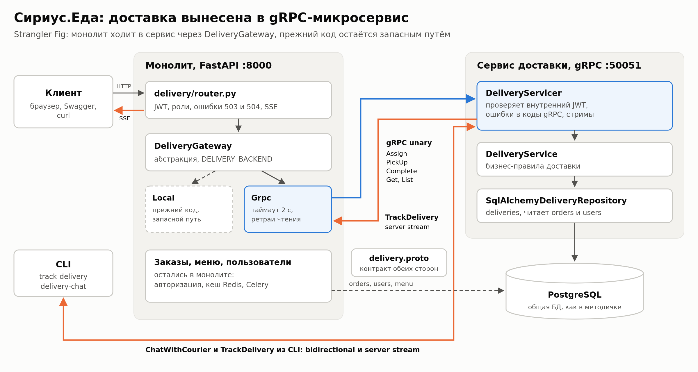
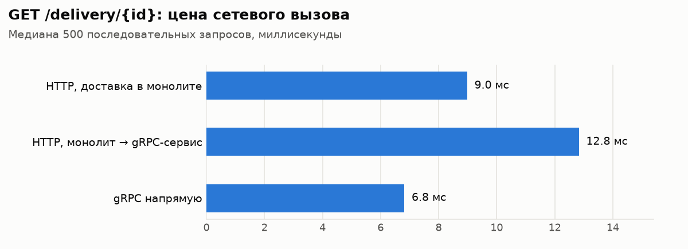

# Итоги лабораторной № 6: доставка в gRPC-микросервис

Модуль `delivery` вынесен в отдельный процесс. Монолит ходит в него по gRPC через `DeliveryGateway`.
Выполнено на 10 баллов.



## Что сделано

| Балл | Требование | Где |
|---|---|---|
| 4–5 | Контракт и сгенерированный код | `proto/delivery.proto`, `delivery_pb2.py`, `delivery_pb2_grpc.py`, `scripts/gen_proto.sh` |
| 6–7 | gRPC-сервер | пакет `delivery_service`: `server.py`, `servicer.py`, `realtime.py` |
| 6–7 | Клиент в монолите | `app/modules/delivery/grpc_client.py` |
| 6–7 | Два процесса взаимодействуют | `uvicorn app.main:app` и `python -m delivery_service` |
| 8 | `UNAVAILABLE`, таймауты | 503 с `Retry-After`, 504, повторы чтения |
| 8 | README с архитектурной схемой | раздел «Лабораторная работа № 6» в `README.md` |
| 9 | Server Streaming `TrackDelivery` | CLI `track-delivery`, SSE `GET /delivery/{id}/track` |
| 10 | Bidirectional Streaming `ChatWithCourier` | CLI `delivery-chat` |

Сверх методички:
* `DELIVERY_BACKEND=grpc|local`: откат на прежний код без деплоя;
* внутренний JWT: сервис сам проверяет пользователя, роль и блокировку;
* статус `on_the_way` и `PATCH /delivery/{id}/pickup`;
* SSE-мост, чтобы стрим статусов видел браузер;
* тест сверяет закоммиченный сгенерированный код с контрактом.

Тесты: 223, из них 22 в `tests/test_delivery_grpc.py` на настоящем gRPC-сервере.

## Контракт

| Метод | Тип | Что делает |
|---|---|---|
| `AssignCourier` | unary | назначить курьера на оплаченный заказ |
| `PickUpOrder` | unary | курьер забрал заказ, `on_the_way` |
| `CompleteDelivery` | unary | доставлено, заказ получает `delivered` |
| `GetDelivery` | unary | доставка по id |
| `ListMyDeliveries` | unary | доставки текущего пользователя |
| `TrackDelivery` | server stream | статус при каждом изменении |
| `ChatWithCourier` | bidirectional stream | чат заказчика и курьера |

## Цена сетевого вызова

`GET /delivery/{id}`, 500 последовательных запросов после 20 прогревочных.

| Путь | Медиана | 95-й перцентиль | 99-й перцентиль |
|---|---|---|---|
| HTTP, доставка внутри монолита | 9,0 мс | 15,1 мс | 21,3 мс |
| HTTP, монолит → gRPC-сервис | 12,8 мс | 23,0 мс | 34,8 мс |
| gRPC напрямую | 6,8 мс | 9,4 мс | 13,6 мс |



Вынос добавил около 4 мс на запрос. Это HTTP/2 до сервиса, выпуск и проверка внутреннего токена
и повторное чтение пользователя из БД в сервисе. Сам сервис отвечает за 5 мс, это видно в его логе.

## Два процесса работают вместе

Ответы API:

```text
POST  /delivery/assign      -> 200 {"status":"success","delivery_id":5}
PATCH /delivery/5/pickup    -> 200 {"id":5,"order_id":5047,"courier_id":60,"status":"on_the_way"}
PATCH /delivery/5/complete  -> 200 {"status":"success"}
```

Лог сервиса в то же время:

```text
delivery_service INFO AssignCourier OK 24.2 ms
delivery_service INFO ListMyDeliveries OK 11.6 ms
delivery_service INFO TrackDelivery OK 5.7 ms
delivery_service INFO PickUpOrder OK 12.3 ms
delivery_service INFO CompleteDelivery OK 40.3 ms
delivery_service INFO ChatWithCourier OK 8.1 ms
delivery_service INFO ChatWithCourier PERMISSION_DENIED 11.9 ms
```

Ошибки проходят через сеть с правильным смыслом:

| Ситуация | Код gRPC | HTTP |
|---|---|---|
| Доставки нет | `NOT_FOUND` | 404 |
| Чужая доставка | `PERMISSION_DENIED` | 403 |
| Доставка уже завершена | `FAILED_PRECONDITION` | 400 |
| Нет внутреннего токена | `UNAUTHENTICATED` | 401 |
| Исключение в сервисе | `INTERNAL`, без деталей | 503 |
| Сервис не запущен | `UNAVAILABLE` | 503 |
| Сервис не ответил за 2 с | `DEADLINE_EXCEEDED` | 504 |

## Отказ сервиса

Сервис остановлен, монолит продолжает работать.

| Запрос | Результат |
|---|---|
| `POST /delivery/assign` | 503 за 8 мс, `Retry-After: 5`, без повторов |
| `GET /delivery/4` | 503 за 0,33 с, 3 попытки |
| `GET /delivery/my` | 503 за 0,29 с, 3 попытки |
| `GET /delivery/4` после запуска сервиса | 200 за 63 мс, затем 11 мс |

Монолит не перезапускали: канал переподключился сам.

## Стрим статусов

CLI, подписка до назначения курьера:

```text
10:51:30  доставка 5: in_progress
10:51:32  доставка 5: on_the_way
10:51:34  доставка 5: completed
```

То же через SSE, `curl -N /delivery/5/track`:

```text
event: status
data: {"delivery_id": 5, "courier_id": 60, "status": "in_progress"}

event: status
data: {"delivery_id": 5, "courier_id": 60, "status": "on_the_way"}

event: status
data: {"delivery_id": 5, "courier_id": 60, "status": "completed"}
```

Стрим закрывается сам на финальном статусе. Чужую доставку отслеживать нельзя: 403.

## Чат

| Заказчик | Курьер |
|---|---|
| `[10:51:43] вы: Где мой заказ?` | `[10:51:43] student 9: Где мой заказ?` |
| `[10:51:45] courier 60: Буду через 5 минут, позвоню в домофон` | `[10:51:45] вы: Буду через 5 минут, позвоню в домофон` |

Повар в той же доставке:

```text
Ошибка: Нет доступа к чужой доставке
```

## Тесты

| Что проверяется | Тестов |
|---|---|
| Полный цикл и доменные ошибки одинаковы в `local` и `grpc`, пустой `courier_id` | 5 |
| Внутренний токен, заблокированный пользователь | 2 |
| Сервис лежит, дедлайн, `INTERNAL` без деталей | 3 |
| `TrackDelivery`: все статусы, внешние изменения, чужая доставка в обоих режимах | 4 |
| Чат: два участника, история, посторонний | 3 |
| API 503, SSE, переиспользование канала, код совпадает с контрактом, повторы | 5 |

## Вывод

Доставка работает в отдельном процессе, монолит про её устройство знает только контракт.
Плата за это: 4 мс на запрос и новый вид отказа, сервис может не ответить.
Отказ обработан: монолит отвечает 503 за миллисекунды, остальное работает, после подъёма сервиса всё восстанавливается само.

Стримы дают то, чего нет в REST без надстроек: статус приходит в момент изменения, чат идёт по одному соединению.

Слабое место осталось из методички: общая БД. Сервис пишет `orders.status`, то есть чужие данные.
Следующий шаг: своя база доставки и событие «доставлено», по которому статус заказа меняет монолит.

## Файлы

| Файл в `results/` | Что внутри |
|---|---|
| `local_http.csv`, `grpc_http.csv`, `grpc_direct.csv` | время каждого из 500 запросов |
| `demo_http.txt` | цикл доставки через API |
| `demo_service_log.txt` | лог сервиса во время показа |
| `demo_track.txt`, `demo_sse.txt` | стрим статусов в CLI и SSE |
| `demo_chat_*.txt` | чат заказчика, курьера и постороннего |
| `demo_outage.txt` | ответы при остановленном сервисе |

## Как повторить

```bash
python -m delivery_service
uvicorn app.main:app
PYTHONPATH=. python scripts/delivery_probe.py http http://127.0.0.1:8000 5 9 grpc_http
PYTHONPATH=. python scripts/delivery_probe.py grpc localhost:50051       5 9 grpc_direct
# перезапустить монолит с DELIVERY_BACKEND=local, затем probe http с меткой local_http
python scripts/plot_delivery.py
```
