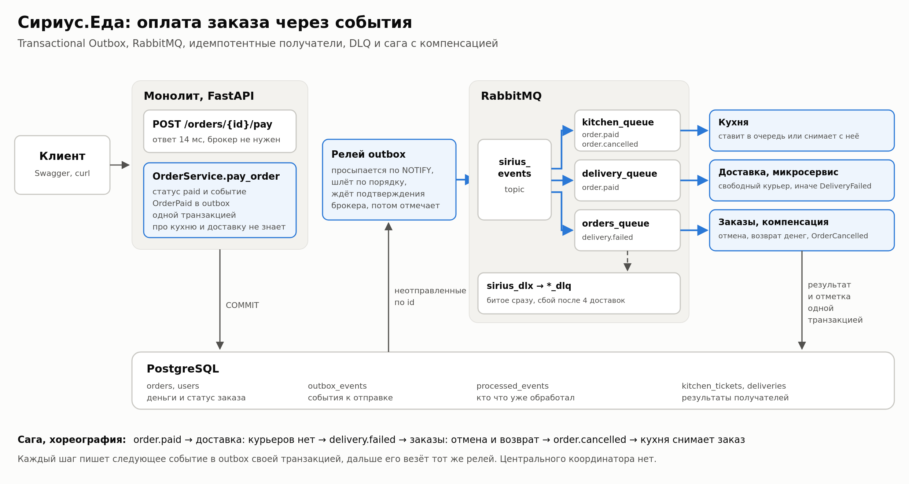

# Защита лабораторной № 7: event-driven архитектура

Подробности в [README](../../README.md#лабораторная-работа--7-event-driven-архитектура), итоги в [result.md](result.md).

## Что сделано по баллам

| Балл | Требование | Где |
|---|---|---|
| 4–5 | RabbitMQ поднят, событие публикуется | `docker-compose.yml`, `app/core/rabbitmq.py`, `app/workers/outbox_relay.py` |
| 6–7 | `OrderPaid` при оплате | `POST /orders/{id}/pay`, `OrderService.pay_order` |
| 6–7 | Кухня и доставка получают независимо | `app/workers/kitchen_consumer.py`, `delivery_service/worker.py`, свои очереди |
| 6–7 | Работает end-to-end | заказ 5049: билет кухни и курьер через 0,2 с после оплаты |
| 8 | Идемпотентность | `processed_events`, ключ `(consumer, event_id)`, `app/outbox.py` |
| 8 | DLQ | `sirius_dlx`, `kitchen_dlq`, `delivery_dlq`, `orders_dlq` |
| 8 | README со схемой | `docs/lab7/architecture.png`, раздел «Лабораторная работа № 7» |
| 9 | Сага с компенсацией | `DeliveryFailed` → `app/workers/orders_consumer.py`: отмена, возврат, `OrderCancelled` |
| 10 | Transactional Outbox | таблица `outbox_events`, релей с `LISTEN/NOTIFY` |
| 10 | Интеграционные тесты consumer'ов | `tests/test_events_rabbitmq.py`, 6 тестов на настоящем RabbitMQ |

Сверх методички:
- ретраи с паузой 1, 2, 4 с и лимит доставок в quorum-очереди;
- разбор DLQ и replay командами CLI;
- модуль кухни с очередью `GET /kitchen/tickets`;
- автоназначение курьера с `FOR UPDATE SKIP LOCKED`.

Тесты: 274, из них 44 в `tests/test_events.py` и 6 интеграционных.



## Главные цифры

| | Значение |
|---|---|
| Ответ `POST /orders/{id}/pay` | 18 мс |
| Событие в RabbitMQ | 19 мс |
| Кухня получила заказ | 30 мс |
| Сага целиком, с возвратом денег | 100 мс |
| То же с опросом outbox раз в секунду | 3,9 с |
| RabbitMQ лежал 15 с, оплат | 50, все ответили 200 |
| Потеряно событий | 0 |

## Порядок показа

### 1. Запуск, шесть терминалов

```bash
DB_PORT=5433 REDIS_PORT=6380 docker-compose up -d
alembic upgrade head
uvicorn app.main:app
python -m app.workers.outbox_relay
python -m app.workers.kitchen_consumer
python -m delivery_service.worker
python -m app.workers.orders_consumer
python -m delivery_service
```

Каждая команда в своём терминале. Открыть RabbitMQ http://localhost:15672, логин `sirius`, пароль `sirius`.
На вкладке Exchanges `sirius_events` показать привязки, на вкладке Queues шесть очередей.

### 2. Оплата: кухня и доставка независимо

Токены без входа, как в прошлых работах:

```bash
S=$(python -c "from app.core.jwt import create_access_token; print(create_access_token(9))")
ORDER=$(curl -s -X POST http://127.0.0.1:8000/orders/create -H "Authorization: Bearer $S" \
  -H "Content-Type: application/json" -d '{"item_id": 1, "quantity": 1}' | jq -r .order_id)
curl -s -X POST http://127.0.0.1:8000/orders/$ORDER/pay -H "Authorization: Bearer $S"
```

В логах:
- релей: `published 1 events, oldest waited 65 ms`;
- кухня: `order.paid ... queued as ticket 1`;
- доставка: `order.paid ... delivery 7, courier 60`.

Кухня и доставка не знают друг о друге, `OrderService` не знает ни о ком.

### 3. Сага

Повторить оплату второго заказа, пока единственный курьер занят. В логах по порядку:
1. Кухня: `queued`.
2. Доставка: `Нет свободного курьера, DeliveryFailed published`.
3. Заказы: `cancelled, refunded 100.00 to user 9`.
4. Кухня: `removed from queue`.

```bash
docker-compose exec db psql -U sirius -d sirius_food -c "select id, status from orders order by id desc limit 2"
docker-compose exec db psql -U sirius -d sirius_food -c "select balance from users where id = 9"
```

### 4. Идемпотентность

В RabbitMQ: Exchanges → `sirius_events` → Publish message. Routing key `order.paid`,
в Payload вставить событие из outbox, тот же `event_id`:

```bash
docker-compose exec db psql -U sirius -d sirius_food -tA \
  -c "select payload from outbox_events where routing_key = 'order.paid' order by id desc limit 1"
```

Опубликовать три раза. Кухня и доставка пишут `duplicate, skipped`, билетов и доставок не прибавилось.

### 5. DLQ

Опубликовать в `sirius_events` с ключом `order.paid` строку `not-json`. Кухня и доставка: `rejected ... to DLQ`.

```bash
python -m app.cli events-dlq
```

Временный сбой. Остановить кухню, оплатить заказ, остановить БД, запустить кухню:

```bash
docker-compose stop db
python -m app.workers.kitchen_consumer   # attempt 1, 2, 3, 4 failed, moved to DLQ
docker-compose start db
python -m app.cli events-dlq             # reason delivery_limit
python -m app.cli events-dlq-replay --queue kitchen
```

После replay заказ встаёт в очередь кухни, битые сообщения остаются в DLQ.

### 6. Outbox: RabbitMQ недоступен

```bash
docker-compose stop rabbitmq
# оплатить заказ: 200 за 14 мс
python -m app.cli outbox-status      # Неотправленных событий: 1
docker-compose start rabbitmq
```

Через 10 секунд релей пишет `connected`, событие уходит, кухня и доставка его обрабатывают.

### 7. Тесты

```bash
pytest tests/test_events.py tests/test_events_rabbitmq.py -v
```

Интеграционные тесты поднимают свои очереди с уникальным префиксом и удаляют их: рабочие очереди не трогаются.

## Вопросы, которые вероятно зададут

**Почему не публиковать прямо из `pay_order`, как в методичке?**
Брокер лежит: либо 500 после оплаты, либо оплаченный заказ без события. Публикация до COMMIT ещё хуже:
событие об оплате, которая откатилась. Outbox пишет событие в той же транзакции, что и статус.

**Что если релей упадёт после публикации, но до отметки `published_at`?**
Событие уйдёт второй раз. Получатели отсеют его по `processed_events`. Потери нет, дубль безопасен.

**Почему ключ идемпотентности `(consumer, event_id)`, а не `event_id`?**
БД общая. С одним `event_id` кухня записала бы отметку, и доставка пропустила бы то же событие.

**Почему отметка в той же транзакции, что и результат?**
Иначе падение между ними даёт либо дубль, либо потерю. Отметка и билет кухни коммитятся вместе или не коммитятся вовсе.

**Почему quorum-очереди?**
Они сами считают доставки, `x-delivery-limit: 3`, и после четвёртой неудачной отдают сообщение в DLX.
Классическая очередь крутила бы падающее сообщение вечно.

**Почему битое сообщение не ретраится?**
Повтор не исправит JSON. Оно сразу уходит в DLQ, очередь не блокируется.

**Как два заказа не получат одного курьера?**
`SELECT ... FOR UPDATE SKIP LOCKED`: второй consumer пропускает заблокированного курьера и берёт следующего.
Плюс частичный уникальный индекс: одна живая доставка на заказ.

**Почему хореография, а не оркестрация?**
Шагов три, координатор добавил бы сервис и точку отказа. Минус: процесс виден только по событиям.
При пяти и больше шагах уже нужен оркестратор с явным состоянием саги.

**Зачем `LISTEN/NOTIFY`?**
Без него релей опрашивает таблицу раз в секунду. Сага проходит через outbox три раза: 3,9 с против 100 мс.

**Порядок событий гарантирован?**
Релей отправляет по `id` и на ошибке останавливается. Но получатель с ретраями может обработать события в другом порядке.
Кухня это учитывает: отмена раньше оплаты не даст поставить заказ в очередь.

**Что найдено при проверке?**
- Replay из DLQ крутил битые сообщения по кругу.
- После рестарта PostgreSQL первый запрос падал с 500: в пуле оставались разорванные соединения, включён `pool_pre_ping`.
- После рестарта RabbitMQ consumer'ы ждали 5 секунд, поставлено 2.
