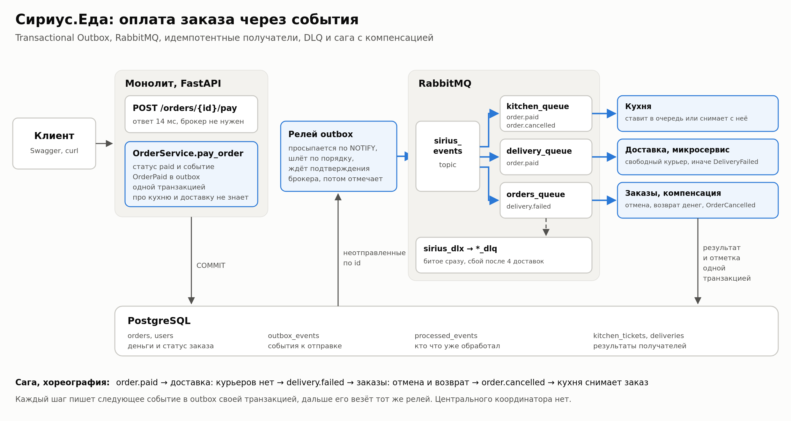
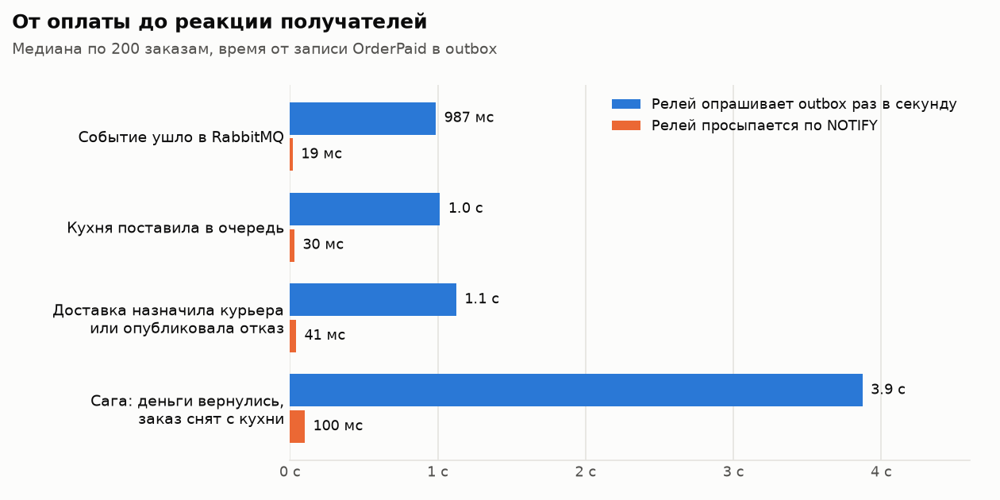
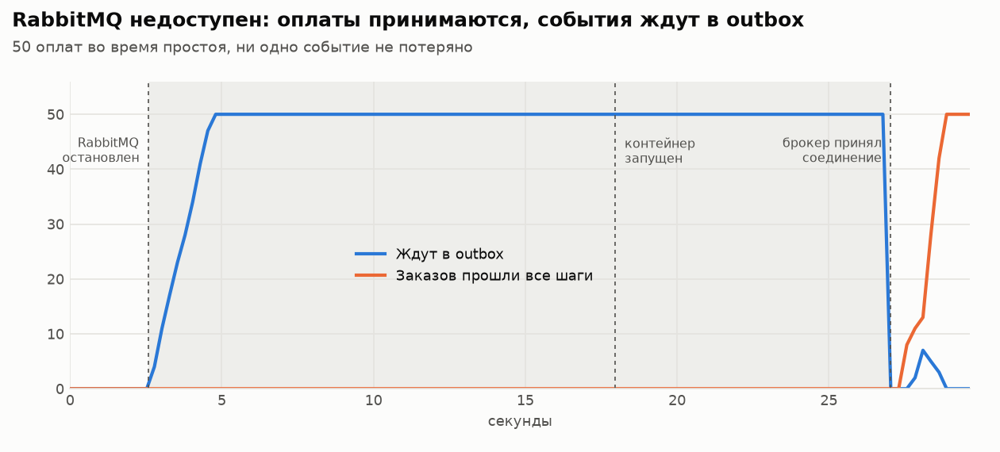
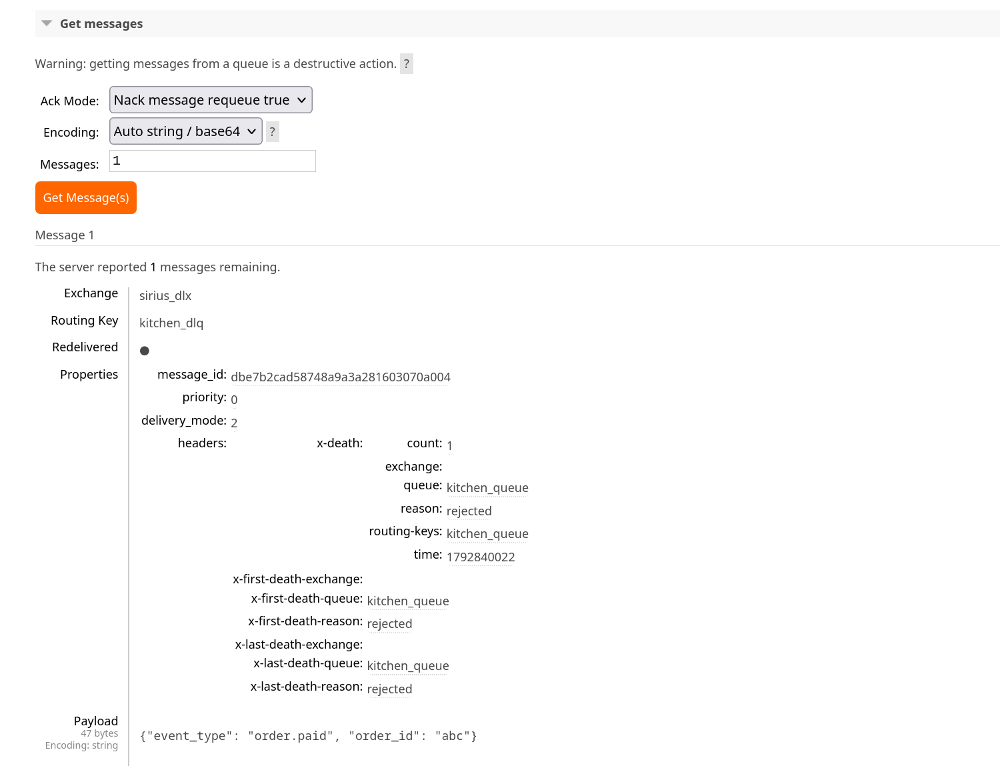
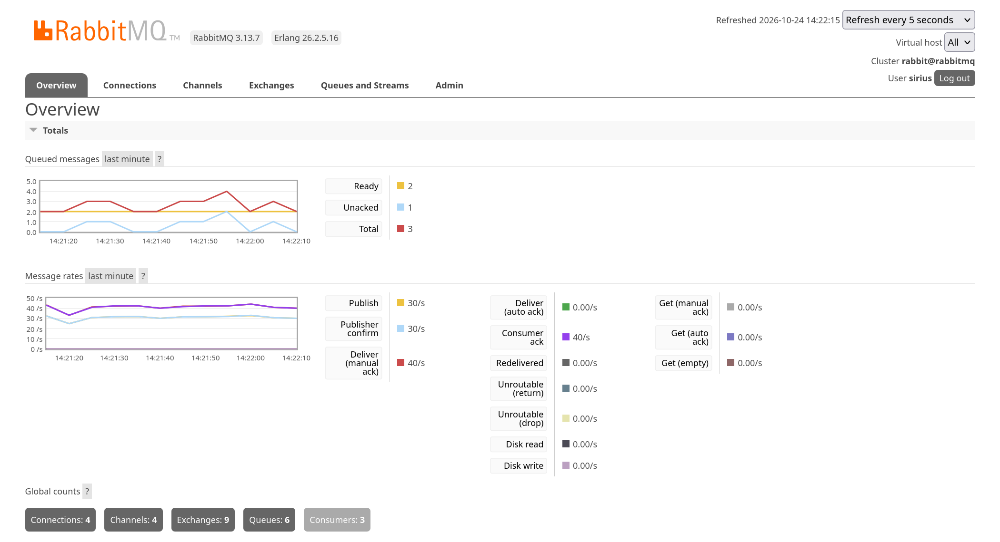
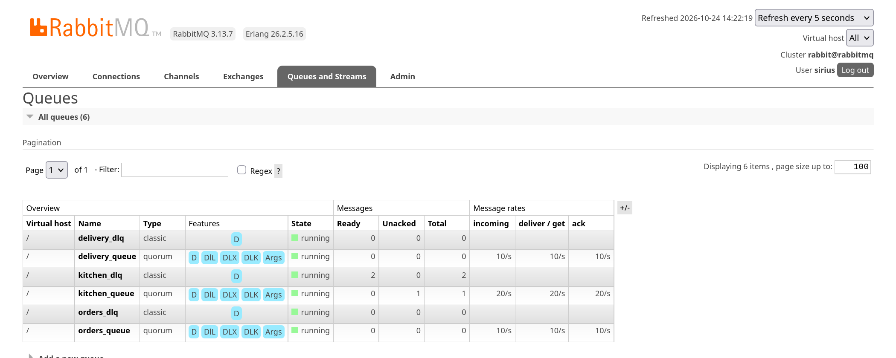
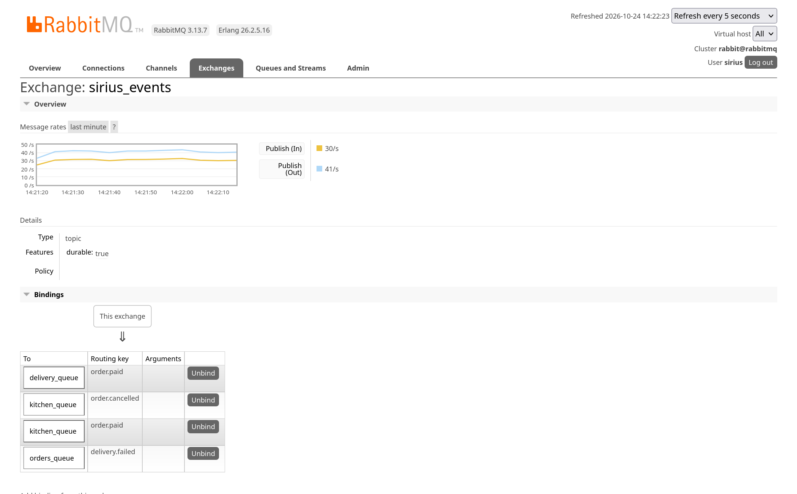

# Итоги лабораторной № 7: event-driven архитектура

Оплата заказа публикует событие `OrderPaid`. Кухня и доставка реагируют на него независимо, сага возвращает деньги,
если курьера нет. Выполнено на 10 баллов: Transactional Outbox и интеграционные тесты consumer'ов на настоящем RabbitMQ.



## Что сделано

| Балл | Требование | Где |
|---|---|---|
| 4–5 | RabbitMQ, публикация события | `docker-compose.yml`, `app/core/rabbitmq.py`, `app/workers/outbox_relay.py` |
| 6–7 | `OrderPaid` при оплате | `POST /orders/{id}/pay`, `OrderService.pay_order` |
| 6–7 | Кухня и доставка независимо | `app/workers/kitchen_consumer.py`, `delivery_service/worker.py` |
| 8 | Идемпотентность | `processed_events`, `app/outbox.py` |
| 8 | DLQ | `sirius_dlx` и три `*_dlq`, `python -m app.cli events-dlq` |
| 8 | README со схемой | раздел «Лабораторная работа № 7» в `README.md` |
| 9 | Сага с компенсацией | `DeliveryFailed`, `app/workers/orders_consumer.py`, `OrderCancelled` |
| 10 | Transactional Outbox | `outbox_events`, релей с `LISTEN/NOTIFY` |
| 10 | Интеграционные тесты consumer'ов | `tests/test_events_rabbitmq.py` |

Тесты: 274. Из них 44 в `tests/test_events.py` без брокера, репозитории в памяти и на SQLite,
и 6 в `tests/test_events_rabbitmq.py` на настоящем RabbitMQ.

## События

| Событие | Кто публикует | Кто получает | Что делает получатель |
|---|---|---|---|
| `order.paid` | заказы, при оплате | кухня | ставит заказ в очередь |
| `order.paid` | заказы, при оплате | доставка | назначает свободного курьера или публикует `delivery.failed` |
| `delivery.failed` | доставка | заказы | отменяет заказ, возвращает деньги, публикует `order.cancelled` |
| `order.cancelled` | заказы | кухня | снимает заказ с очереди |

Каждое событие несёт `event_id`, `occurred_at`, `event_type` и данные заказа. В свойствах сообщения `message_id = event_id`,
сообщения persistent.

## Условия замера

| Параметр | Значение |
|---|---|
| Заказы | 200 подряд, оформление и оплата через HTTP |
| Курьеры | 10 свободных, остальные заказы проходят сагу |
| Процессы | uvicorn, релей, три consumer'а, по одному экземпляру |
| Время шагов | из БД: `outbox_events.created_at`, `published_at`, `processed_events.processed_at` |
| Машина | 4 ядра, PostgreSQL и RabbitMQ 3.13.7 в Docker на ней же |

## Задержка событий

| Шаг от записи в outbox | Релей по NOTIFY, медиана | p95 | Опрос раз в секунду, медиана | p95 |
|---|---|---|---|---|
| Ответ `POST /orders/{id}/pay` | 18 мс | 31 мс | 15 мс | 53 мс |
| Событие ушло в RabbitMQ | 19 мс | 31 мс | 987 мс | 1939 мс |
| Кухня поставила в очередь | 30 мс | 51 мс | 1015 мс | 1506 мс |
| Доставка назначила курьера или отказала | 41 мс | 66 мс | 1125 мс | 1533 мс |
| Сага: возврат и снятие с кухни | 100 мс | 170 мс | 3873 мс | 4628 мс |



Из 200 заказов курьер назначен на 10, остальные 190 сага отменила с возвратом денег.

Ответ на оплату не зависит от брокера: запрос пишет две строки в одной транзакции.
Без `NOTIFY` каждый переход через outbox ждёт опроса до секунды, а у саги таких переходов три.
С опросом релей ещё и копит пачки по 70 событий. Каждое публикуется с подтверждением брокера около 7 мс, пачка уходит полсекунды.

## Отказ RabbitMQ

Брокер остановлен на 15 секунд, за это время оплачено 50 заказов.

| Метрика | Значение |
|---|---|
| Ответ на оплату, медиана | 14 мс, все 200 |
| Событий копилось в outbox | 50 |
| RabbitMQ загружался после старта контейнера | около 9 с |
| Релей отправил 50 событий после подключения | за 0,23 с |
| Все 50 заказов прошли все шаги после подключения | за 2 с |
| Потеряно | 0 |



Лог релея:

```text
14:19:18 relay paused (ChannelInvalidStateError: ... closed), 1 events wait in outbox, retry in 2 s
14:19:20 relay paused (AMQPConnectionError: Connect call failed ... 5672)
...
14:19:40 relay paused (AMQPConnectionError: Server connection reset ...), 50 events wait in outbox
14:19:42 connected to RabbitMQ, relaying outbox
14:19:43 published 50 events, oldest waited 24358 ms
```

Синий всплеск после подключения: компенсации саги для 39 заказов без курьера тоже идут через outbox.

## Сага

Курьер 60 свободен для первого заказа и занят для второго. Баланс студента до второго заказа 9989360.

```text
14:02:20,032 outbox   published 1 events, oldest waited 65 ms
14:02:20,141 kitchen  order.paid fea13809 order 5049 queued as ticket 1
14:02:20,158 delivery order.paid fea13809 order 5049: delivery 7, courier 60
14:02:21,927 outbox   published 1 events, oldest waited 49 ms
14:02:21,937 kitchen  order.paid 17f88349 order 5050 queued as ticket 2
14:02:21,944 delivery order.paid 17f88349 order 5050: Нет свободного курьера, DeliveryFailed published
14:02:21,959 outbox   published 1 events, oldest waited 24 ms
14:02:22,051 orders   delivery.failed cf5d280b order 5050 cancelled, refunded 100.00 to user 9
14:02:22,073 outbox   published 1 events, oldest waited 48 ms
14:02:22,084 kitchen  order.cancelled c30b7a59 order 5050 removed from queue
```

| | Заказ 5049 | Заказ 5050 |
|---|---|---|
| Статус заказа | paid | cancelled |
| Доставка | 7, курьер 60 | нет |
| Кухня | queued | cancelled |
| Баланс студента после | | 9989460, возврат 100 |

От записи оплаты заказа 5050 до снятия с кухни около 200 мс: три перехода через outbox и брокер.

## Идемпотентность

Событие `OrderPaid` заказа 5049 с тем же `event_id` опубликовано ещё три раза через веб-интерфейс RabbitMQ.

```text
14:02:40,508 kitchen  order.paid fea13809 duplicate, skipped
14:02:40,626 kitchen  order.paid fea13809 duplicate, skipped
14:02:40,686 kitchen  order.paid fea13809 duplicate, skipped
14:02:40,504 delivery order.paid fea13809 duplicate, skipped
14:02:40,624 delivery order.paid fea13809 duplicate, skipped
14:02:40,681 delivery order.paid fea13809 duplicate, skipped
```

Билетов кухни по заказу: 1. Доставок: 1.

## DLQ

| Сообщение | Что случилось | Причина в `x-death` |
|---|---|---|
| `not-json` | отклонено кухней и доставкой сразу | `rejected` |
| `{"event_type": "order.paid", "order_id": "abc"}` | «Нет поля event_id», отклонено сразу | `rejected` |
| `OrderPaid` заказа 5052, PostgreSQL остановлен | 4 доставки с паузой 1, 2, 4 с | `delivery_limit` |

```text
14:08:09,851 kitchen order.paid 0d152311 attempt 1 failed
14:08:10,906 kitchen order.paid 0d152311 attempt 2 failed
14:08:12,962 kitchen order.paid 0d152311 attempt 3 failed
14:08:17,025 kitchen order.paid 0d152311 attempt 4 failed, moved to DLQ
```

После запуска PostgreSQL:

```text
$ python -m app.cli events-dlq-replay --queue kitchen
Возвращено в kitchen_queue: 1, битых оставлено в DLQ: 2
14:10:58,157 kitchen order.paid 0d152311 order 5052 queued as ticket 4
```

Битое сообщение в DLQ, веб-интерфейс RabbitMQ:



## RabbitMQ под нагрузкой

30 событий в секунду на входе exchange, 40 на выходе: `order.paid` уходит и кухне, и доставке.



Шесть очередей: три рабочих quorum и три DLQ.



Привязки exchange `sirius_events`:



## Найдено при проверке

| Проблема | Как проявилась | Исправление |
|---|---|---|
| Replay из DLQ крутил битые сообщения | вернул 8 сообщений вместо 3 | берёт только то, что было в DLQ на старте, битые оставляет |
| Разорванные соединения в пуле после рестарта PostgreSQL | первый запрос 500, consumer доставки потратил попытку | `pool_pre_ping=True` |
| Переподключение к RabbitMQ раз в 5 с | после рестарта брокера очередь стояла лишние секунды | 2 с |

## Вывод

Заказы больше не знают ни о кухне, ни о доставке. Оплата отвечает за 18 мс и не зависит от брокера.
Событие доходит до получателей за 30–40 мс, сага с возвратом денег проходит за 100 мс.

RabbitMQ можно остановить: оплаты продолжаются, события ждут в outbox и уходят, как только брокер поднимется.
Повторная доставка ничего не дублирует, битое сообщение не блокирует очередь, временный сбой переживает три повтора.

Цена: результат появляется не сразу, а состояние согласуется через события. Процессов стало на четыре больше.
БД по-прежнему общая, поэтому `processed_events` и `outbox_events` одни на всех. Следующий шаг: своя БД доставки со своим outbox.

## Файлы

| Файл в `results/` | Что внутри |
|---|---|
| `notify.csv`, `poll.csv` | время каждого шага для 200 заказов |
| `outage.csv`, `outage_timeline.csv`, `outage_marks.csv` | отказ RabbitMQ: шаги, отсчёты раз в 0,25 с, отметки времени |
| `demo_saga.txt` | оплата с курьером и сага, состояние БД и логи |
| `demo_idempotency.txt` | три повтора одного события |
| `demo_dlq.txt` | битые сообщения |
| `demo_retry_dlq.txt` | ретраи при остановленной БД и replay |
| `demo_outage_relay.txt` | лог релея во время отказа брокера |

## Как повторить

```bash
PYTHONPATH=. python scripts/event_probe.py latency http://127.0.0.1:8000 notify
python -m app.workers.outbox_relay --poll-only   # вместо обычного релея
PYTHONPATH=. python scripts/event_probe.py latency http://127.0.0.1:8000 poll
PYTHONPATH=. python scripts/event_probe.py outage  http://127.0.0.1:8000 outage
python scripts/plot_events.py
```
