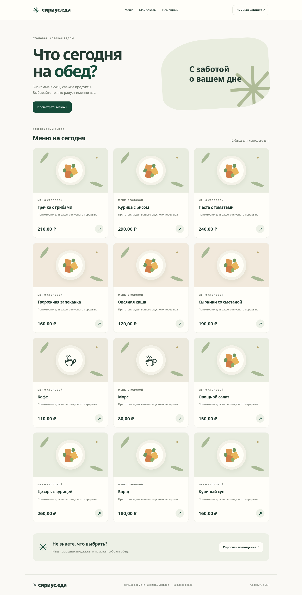
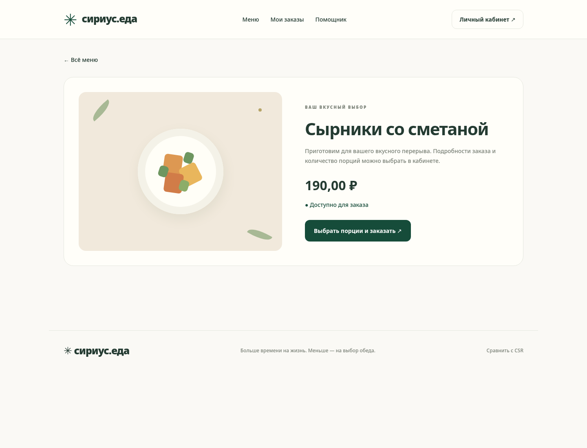
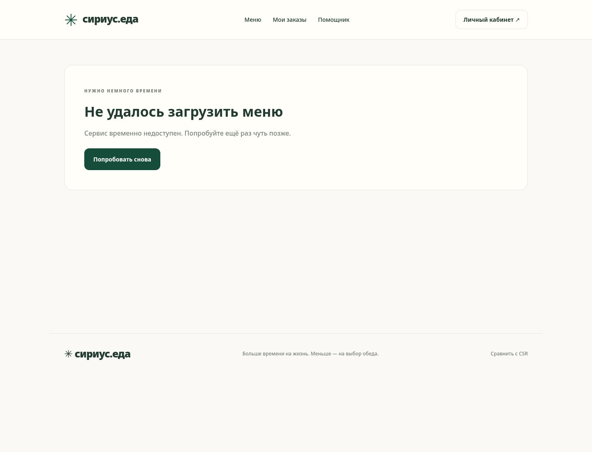

# ЛР №8: результат реализации

Реализован вариант с нуля, бонус SEO + ISR, дополнительно CSR и сравнительные замеры.
Публичная витрина — Next.js 16.4.6, React 19.3.1, TypeScript, Tailwind CSS 4.
Существующий SPA и его пользовательские сценарии сохранены.

## Проверки

- `storefront: npm run build` — успешно, включая проверку TypeScript.
- `frontend: npm run build` — успешно, текущий SPA собирается с переходом из карточки блюда.
- `pytest tests/test_menu_service.py tests/test_menu_cache.py tests/test_menu_detail.py tests/test_architecture.py`:
  **33 passed**. Чтение отдельного блюда публично, неизвестный id даёт 404,
  нечисловой параметр — 422. Недоступное для заказа блюдо остаётся читаемым.
- `docker compose --profile monitoring config --quiet` — конфигурация корректна.
- `nginx -t` внутри контейнера с сетью none — новая конфигурация общего ingress корректна.
- Production Next.js: `/menu` и `/menu/1` содержат HTML-карточки, названия и цены.
- Метаданные блюда title/description/Open Graph находятся в head документа.
- Неизвестное блюдо в витрине возвращает HTTP 404 и понятную страницу.
- CSR-HTML не содержит блюд; данные приходят отдельным браузерным запросом.
- API действительно остановлен во время проверки: показан error.tsx; после перезапуска
  и нажатия повтора страница успешно загружает блюдо.
- При отдельном запуске медленного API проверен loading во время клиентского перехода.
- Desktop и mobile 390 px: карточки отображаются, переполнения по горизонтали нет.
- ISR проверен отдельным production-запуском: PATCH меняет тестовую цену 190 → 197,
  немедленный ответ сохраняет 190, после 65 секунд и фоновой регенерации показывает 197.
- Для SSR из браузера нет запросов меню, для CSR зафиксирован один запрос на прогон.

## Условия и границы проверки

Docker на текущем хосте не смог создать veth-сетевой интерфейс (`operation not supported`).
Поэтому полный Compose со связанными сервисами на этом запуске не проверен.
Для функциональных браузерных проверок использован настоящий FastAPI с штатными
in-memory репозиториями и 12 блюдами из seed. Это не мок HTTP-ответов в браузере.
Рабочие PostgreSQL-данные, заказы и платежи не изменялись.

Новая связь с существующим кабинетом проверена браузером в настоящем Vite SPA:
`/?item=1` открывает форму «Ваш вкусный выбор» с выбранным блюдом и удаляет параметр
после открытия. Новых операций с ЮKassa не выполнялось. Полный платёжный E2E на PostgreSQL в рамках
этой лабораторной повторно не запускался.

## Замеры

Три SSR и три CSR-прогона выполнены в Chromium на production-сборке Next.js,
с выключенным браузерным кешем и одинаковым CDP-ограничением сети: задержка 80 мс,
download 200000 B/s, upload 100000 B/s. FastAPI с 12 блюдами работал на loopback,
серверный ISR-кеш был прогрет. Это локальный эксперимент, а не production SLA.

| Вариант | Прогон | Первое блюдо в DOM, мс | TTFB, мс | FCP, мс | Запросы меню из браузера |
| --- | ---: | ---: | ---: | ---: | ---: |
| SSR `/menu` | 1 | 364.1 | 6.3 | 464 | 0 |
| SSR `/menu` | 2 | 318.5 | 7.9 | 384 | 0 |
| SSR `/menu` | 3 | 300.1 | 10.5 | 348 | 0 |
| **SSR среднее** | — | **327.6** | **8.2** | **398.7** | **0** |
| CSR `/menu-csr` | 1 | 1269.9 | 6.7 | 336 | 1 |
| CSR `/menu-csr` | 2 | 1310.8 | 9.4 | 348 | 1 |
| CSR `/menu-csr` | 3 | 1264.6 | 9.3 | 320 | 1 |
| **CSR среднее** | — | **1281.8** | **8.4** | **334.7** | **1** |

`Первое блюдо в DOM` — момент появления первого видимого блока блюда в DOM, не точное
время его отрисовки на экране. `FCP` учитывает первую отрисовку любого содержимого,
например шапки, поэтому в CSR FCP наступил раньше, чем загрузились блюда. В этом
эксперименте SSR показал блюда в среднем примерно на 954 мс раньше; браузер отдельно
запрашивал меню только при CSR. Исходные значения и условия сохранены в
[`verification.json`](results/verification.json).
Автоматизация: `storefront/scripts/verify.mjs`; отдельно `--isr-only` проверяет TTL.

## Артефакты

### SSR-меню на компьютере

### Страница отдельного блюда

### Меню на мобильном экране

### Ошибка при недоступном API

Сценарий показа и ответы для защиты вынесены в [отдельную памятку](DEFENSE.md).

## Карта реализации

- `app/modules/menu/service.py`, `router.py`: чтение блюда через существующий репозиторий.
- `storefront/src/app/menu/[[...listing]]/page.tsx`: `/menu` с генерацией по первому запросу.
- `storefront/src/app/menu/[id]/page.tsx`: динамическая карточка, SEO, ISR.
- `storefront/src/lib/api.ts`: серверный fetch, кеш 60 секунд, таймаут, обработка 404.
- `storefront/src/app/menu/{loading,error,not-found}.tsx`: состояния страницы.
- `storefront/src/app/menu-csr/`: клиентская загрузка для сравнения.
- `storefront/src/app/api/menu/items/route.ts`: same-origin прокси для отдельного CSR-запуска.
- `frontend/nginx.conf`, `docker-compose.yml`: общий origin для витрины и SPA.
- `frontend/src/app/App.tsx`: выбор блюда из query при возврате в оформление;
  `components/layout/Header.tsx`: переход к витрине.
- [Структура компонентов SPA](../../frontend/README.md): страницы, формы, карточки, хуки и HTTP-клиент.
