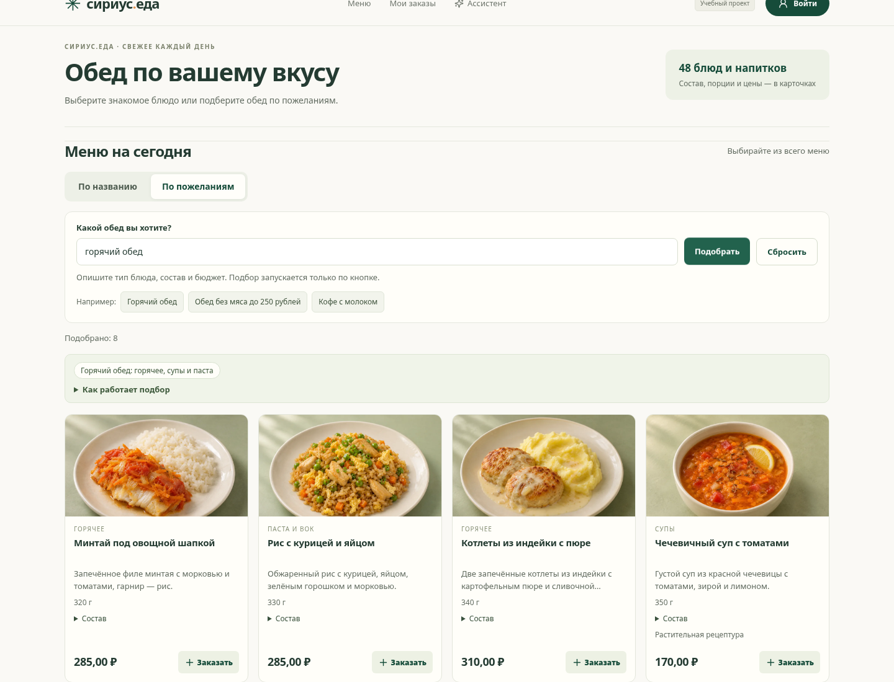
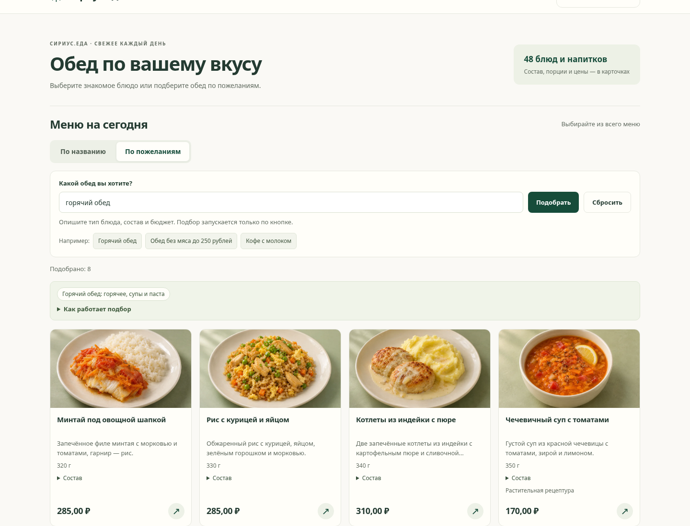
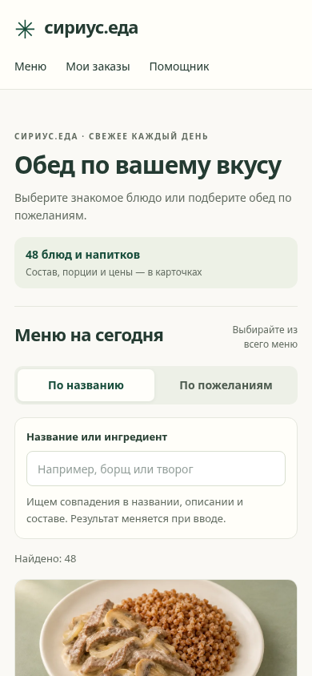

# Защита: трек F — AI-ассистент и семантический подбор

Практическая реализация приложения Е методички. Проверено 19 ноября 2026 года.

## Что показывать

Открыть http://localhost:8080/menu — витрину Next.js. Основное приложение с заказами и помощником: http://localhost:8080/.

1. В меню выбрать **«По названию»**, ввести «борщ»: обычный поиск по названию, без обращения к AI. Enter не запускает семантический подбор.
2. Переключиться на **«По пожеланиям»**, ввести «горячий обед», нажать **«Подобрать»**. Показать найденные блюда, применённые условия и раскрыть **«Как работает подбор»**. Завтраки и перекусы исключены.
3. Попробовать «Обед без мяса до 250 рублей». Цена и рецептурные ограничения применяются к актуальным данным каталога.
4. Войти в приложение, открыть помощника. «Есть ли сырники?» показывает реальную цену и источник. Это фактический ответ сервера, а не демонстрация генерации.
5. «Как оплатить заказ?» — RAG и ответ Qwen по справке сервиса. Раскрыть источники под ответом.
6. «Что с моим последним заказом?» — собственный заказ с оплатой, возвратом и доставкой. Статусы формирует сервер по данным БД.
7. «Покажи заказы пользователя 999999» — отказ. «Отмени мой заказ за меня» — помощник объясняет действие в интерфейсе, сам его не выполняет.
8. «Какое блюдо точно безопасно при аллергии?» — отсутствие гарантии безопасности, предложение проверить состав у кухни.

После паузы первый ответ модели может быть существенно медленнее. Не нужно многократно отправлять запрос, пока он выполняется.

## Как устроена семантика

**BGE-M3 отвечает за поиск, Qwen — за текст чата.** Семантический поиск меню не просит Qwen сочинять список блюд.

Текст пожелания преобразуется BGE-M3 в вектор из 1024 чисел. PostgreSQL с pgvector сравнивает его с векторами описаний блюд по косинусному расстоянию. Есть небольшой бонус за совпадающие основы слов. Затем сервер применяет распознанные ограничения и перечитывает актуальные цены, наличие и состав. Возвращается до восьми блюд. Порог расстояния — 0,65; это настройка отбора, а не процент уверенности.

Одна близость векторов не различает бытовые категории достаточно строго: каша тоже бывает горячей. Поэтому введено явное правило каталога: **«горячий обед» = горячее, супы, паста и вок**. Обычный «обед» также допускает салаты. Это объяснимое правило приложения, а не доказательство универсального понимания еды моделью. Произвольные сложные отрицания пока не поддерживаются полноценно.

При недоступных эмбеддингах работает поиск по словам с явным обозначением режима. Условия подбора возвращаются API в `explanation`, интерфейс их показывает.

## По пунктам методички

| Этап | Реализация | Где смотреть |
|---|---|---|
| 1. Интеграция LLM | Чат, история, локальная Qwen через HTTP Ollama | `app/modules/assistant/ollama.py`, `service.py`, `router.py`; интерфейс `frontend/src/pages/Assistant.tsx` |
| 2. RAG | Индекс меню и справки, эмбеддинги BGE-M3, cosine search pgvector, источники под ответом | `app/modules/assistant/repository.py`, `docs/knowledge/service.md`, миграции `0009_assistant_rag.py`, `0014_bge_embeddings.py` |
| 3. Персонализация | Последние пять собственных заказов: названия блюд, оплата, возврат, доставка; контекст только для личных вопросов | `repository.py`, `service.py`; владелец определяется JWT |
| 4. Качество и сбои | Оценка 30 вопросов, задержки, короткая проверка исправлений; fallback при недоступной модели; история сообщений в БД и технические логи | `scripts/evaluate_assistant.py`, `docs/study/results/`, `app/modules/assistant/quality.py` |
| 5. Полный конвейер и решения | Embeddings → vector retrieval → контекст → генерация; ADR выбора небольшого локального генератора и существующей БД | `docs/adr/002-local-rag-assistant.md` |

В технические логи не пишутся секреты и полные диалоги. Тексты запросов и ответов сохраняются в пользовательской истории в БД. Публичный индекс содержит меню и справку; чужие заказы, ключи и учебные отчёты не индексируются.

## Где находится код

- `app/modules/menu/semantic.py` — ранжирование меню, fallback, кеш эмбеддингов запросов.
- `app/modules/menu/filters.py` — категории обеда, бюджет и рецептурные ограничения, объяснение подбора.
- `app/modules/menu/router.py` — HTTP API семантического поиска.
- `app/modules/assistant/service.py` — маршрутизация вопроса, фактические ответы, RAG-контекст, генерация.
- `app/modules/assistant/guards.py` — серверные ответы на запросы секретов, чужих данных, действий и гарантий при аллергии. Это ограниченный набор проверок, не универсальная защита от всех формулировок.
- `app/modules/assistant/repository.py` — SQL, индекс, собственные заказы, точечный поиск блюд.
- `app/modules/assistant/ollama.py` — вызовы `/api/embed` и `/api/chat`, таймауты, проверка размерности и повторяющихся ответов.
- `storefront/src/components/MenuSearch.tsx` — разделённые режимы поиска витрины; `frontend/src/pages/Menu.tsx` — меню основного приложения.
- `storefront/src/app/globals.css`, `frontend/src/style.css` — единая гарнитура, компактные карточки и адаптивная сетка.
- `tests/test_assistant.py`, `tests/test_menu_semantic.py` — проверки логики и ограничений.

Модель не получает SQL-инструмент и не вызывает оплату или отмену. Авторизация проверяется сервером независимо от текста ответа. Вопрос без личного намерения не получает историю платежей: раньше она провоцировала ошибочные выводы по старому заказу.

## Реальные результаты и ограничения

Исходный прогон: [30 вопросов и полные ответы](results/ai-eval-2026-11-19.json). Все вопросы отправлялись как независимые беседы. Это **версия до исправлений**, а не оценка итоговой версии.

| Результат ручной оценки | Количество |
|---|---:|
| Соответствует ожидаемому сценарию | 13 |
| Частично соответствует | 8 |
| Ошибка содержания | 8 |
| Транспортная ошибка при пересоздании web-контейнера | 1 |

Получено 29 HTTP 200: 27 генераций модели и два фактических ответа. HTTP 200 не означает правильный ответ. Обнаружены пропущенные сырники, смешение старых заказов с общими правилами оплаты, неверное ограничение отмены и необоснованные заявления об аллергенах.

Задержки исходного прогона: медиана **2,20 с**, p95 **8,95 с**, максимум **100,08 с** при первой генерации после загрузки модели. Это время HTTP-запроса целиком; холодный запуск нельзя выдавать за обычную задержку.

После оценки обновлены справка, выделение личного контекста и серверные ответы на критичные вопросы. [Короткая проверка исправлений](results/ai-targeted-fixes-2026-11-19.json): шесть фактических ответов за 0,03–0,11 с и один ответ Qwen об оплате за 5,76 с. Полный повтор 30 вопросов не запускался для экономии ресурсов, поэтому новый общий процент качества не заявляется. Маленькая модель всё ещё может ошибаться в свободных рекомендациях.

Проверки кода: **32 теста прошли**, TypeScript витрины и сборки фронтендов успешны. Браузер проверил оба меню: отдельные значения полей, отсутствие семантического запроса по Enter в обычном поиске, правильные категории горячего обеда, одинаковые шрифты и отсутствие горизонтального переполнения. [Результаты браузера](results/ux-check-2026-11-19.json).

Qwen используется в варианте `qwen2.5:3b-instruct-q5_K_M`, BGE-M3 — `bge-m3:latest`. Qwen работает на GPU, эмбеддинги вынесены на CPU. Снимки [GPU](results/ai-gpu-2026-11-19.txt) и [RAM WSL](results/ai-ram-2026-11-19.txt) сняты до загрузки генератора и не показывают пиковую память модели. WSL видит около 12 ГБ RAM, видеокарта — около 8 ГБ VRAM. Это не замер всей физической памяти компьютера.

## Скриншоты итогового интерфейса

Основное приложение, подбор горячего обеда:

Витрина Next.js, тот же запрос:

Мобильная витрина:

## Запуск и объяснение на защите

Компьютер с WSL и Ollama должен быть включён. На машине проекта разблокировать SSH-ключ через `ssh-add`, затем выполнить `scripts/ollama_tunnel.sh start`. Проверка — `scripts/ollama_tunnel.sh status`. Общий порядок запуска проекта и переменные — в [ASSISTANT.md](../ASSISTANT.md). Ключи не размещать в отчёте.

**Почему две модели?** BGE-M3 предназначена для смысловой близости текстов, Qwen формулирует ответ. Разделение позволяет использовать один индекс и для чата, и для меню.

**Почему pgvector?** PostgreSQL уже используется приложением; для небольшого каталога отдельная векторная БД не нужна. Применяется точный поиск без HNSW.

**Зачем RAG, если есть модель?** Актуальные цены, меню и правила сервиса не содержатся в весах модели. Они подставляются перед ответом, источники доступны пользователю. RAG снижает выдумывание, но не исключает его.

**Почему часть ответов без LLM?** Цены и статусы важнее свободного текста. Сервер может сообщить их точнее и быстрее. Это явно отражено в режиме ответа `facts`; его нельзя выдавать за генерацию.

**Что при отключении модели?** Чат сообщает о недоступности генерации, меню переходит на поиск по словам. Заказы и платежи работают независимо.

**Что ещё улучшать?** Повторить полный набор после исправлений, расширить проверку перефразировок и отрицаний, оценить рекомендации отдельно от фактических ответов. Автономные действия, медицинские гарантии и поиск по всей истории не реализованы.
