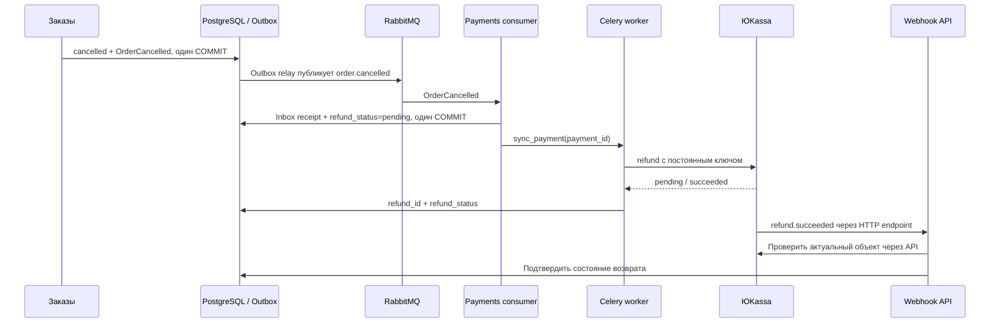

# Соответствие треку D: платёжная интеграция

Источник: «Программа учебной практики», Приложение Г.

| Этап методички | Реализация | Подтверждение |
|---|---|---|
| 1. Тестовый шлюз, POST /payments, order_id, amount, Idempotency-Key, запись БД | ЮKassa test mode; amount обязателен и сверяется с зафиксированной суммой заказа; намерение сохраняется до сетевого вызова | Настоящий тестовый платёж №106; HTTP-тесты обязательности amount и конфликта суммы |
| 2. Вебхуки успешной/неуспешной оплаты и возврата, проверка подлинности | POST /payments/webhook; payment.succeeded, payment.canceled, refund.succeeded; перечитывание объекта через авторизованный API ЮKassa | Повторы webhook, поддельный статус, insufficient_funds, проверка возврата; доступный публичный HTTPS ingress |
| 3. Retry 1/2/4/8 с + jitter, тот же ключ, DLQ | Celery sync_payment; постоянные ключи платежа/возврата; 5xx, timeout и 429 повторяются; остальные 4xx сразу направляются на разбор | Тест потерянного ответа после принятия запроса, проверки классификации HTTP, 5 попыток и DLQ, одна попытка при окончательной ошибке |
| 4. Идемпотентность API и уведомлений | Ограничения БД, блокировка заказа, неизменяемый ключ провайдера, атомарный OrderPaid в outbox | Два HTTP POST → один платёж; повторные webhook → один OrderPaid; 100 конкурентных повторов → один платёж |
| 5. Saga: OrderCancelled → refund | payments_queue и payments_consumer; Inbox + намерение возврата в одной транзакции; затем Celery обращается к шлюзу | Настоящий RabbitMQ доставляет три копии события → один запуск возврата; потеря Redis после commit не теряет компенсацию; поздняя оплата отменённого заказа |
| 5. Нагрузка: 100 платежей | 100 независимых параллельных POST и отдельный прогон 100 одинаковых запросов | payment_probe_methodic.json: 100/100 успешных в каждом сценарии, 100 и 1 разных платежей соответственно; demo-адаптер |
| 5. ADR | docs/adr/001-external-payments.md | Обоснование шлюза, outbox, состояний, ограничений и протокола проверки webhook |

## Соответствие названий протоколу ЮKassa

В методичке используются обобщённые имена событий. Их реальные эквиваленты в выбранном шлюзе:

- `payment_succeeded` → `payment.succeeded`;
- `payment_failed` → `payment.canceled`, причина хранится в `cancellation_reason`, например `insufficient_funds`;
- `refund_succeeded` → `refund.succeeded`;
- `gateway_payment_id` методички → `payments.gateway_id` в нашей модели;
- наш HTTP `Idempotency-Key` → `Idempotence-Key` API ЮKassa.

ЮKassa не передаёт общую HMAC-подпись из учебного примера. Подлинность и актуальность проверяются
по объекту, полученному через авторизованный API, с сопоставлением суммы, валюты и заказа.
Поддельный статус из тела уведомления не может подтвердить оплату или возврат.
Источник: https://yookassa.ru/developers/using-api/webhooks

## Цепочка Saga

На последнем HTTP-шаге уведомление принимает роутер payments, а не AMQP consumer.
Beat страхует потерю постановки задачи после фиксации намерения в БД.
Если отмена пришла раньше подтверждения оплаты, первое событие фиксируется без возврата.
Поздняя успешная оплата отменённого заказа атомарно публикует новый OrderCancelled;
его обработчик инициирует единственную компенсацию.

## Как показать преподавателю

1. Вход студентом → заказ → страница тестового шлюза → успешная оплата.
2. Повторный POST /payments с тем же order_id, amount и ключом возвращает тот же id.
   Изменение amount или ключа того же заказа возвращает 409; отсутствующая amount — 422.
3. Воспроизвести уведомление об оплате несколько раз: платёж и OrderPaid остаются единственными.
   Проверка на настоящей ЮKassa записана в `results/yookassa_duplicate_webhook.json`.
4. Отменить оплаченный заказ до передачи курьером в путь. В логах: orders → outbox → payments consumer → Celery refund.
5. Повторить OrderCancelled: повторный возврат не создаётся; проверить один refund_id.
6. Показать сценарии таймаута, 5xx, DLQ и поддельного webhook из тестов.
7. Показать отчёт нагрузки и оговорить, что шлюз в этом прогоне — управляемый demo.

## Подтверждено с настоящим тестовым магазином

- Заказ №106 оплачен через ЮKassa. Ручное воспроизведение HTTPS уведомлений с проверкой API сохранило единственный OrderPaid.
- Заказ №108: доставка отказала → OrderCancelled → payments consumer → refund. GET API ЮKassa подтвердил возврат 290 ₽ и совпадение сохранённого refund_id: `results/yookassa_saga_refund.json`.
- Пользователь включил три уведомления в кабинете. Временный адрес туннеля может меняться при переподключении — его требуется обновлять.

Остаётся отдельно зафиксировать доставку уведомления непосредственно от провайдера после настройки актуального URL и настоящий отказ тестовой карты. Ручные повторы уведомлений и HTTP-тесты не выдаются за эти действия.
